# スライド表現カタログ

正本は`catalog.json`。このファイルは`scripts/build_catalog.py`で生成する。

48基本型 + 11追加変化形 + 2共通原則 = 61見本。名称は画像のラベルを保存し、配置は視覚読取、用途・記号・注意点は再利用のための解釈を含む。見本の微小な本文や架空数値を実データとして転用しない。

見本画像は名称ラベルごと保存している。詳細が読み切れないときは元の2400×3000画像と切り出し位置で確認する。

| ID | 型 | 区分 | 方法名称 | 用途グループ |
| --- | --- | --- | --- | --- |
| [type-01-1](#type-01-1) | 01 | 基本型 | 目次 | 決めさせる |
| [type-01-2](#type-01-2) | 01 | 追加変化形 | 目次（中扉） | 決めさせる |
| [type-02-1](#type-02-1) | 02 | 基本型 | エグゼクティブサマリ | 決めさせる |
| [type-02-2](#type-02-2) | 02 | 追加変化形 | エグゼクティブサマリ（問い立て型） | 決めさせる |
| [type-03-1](#type-03-1) | 03 | 基本型 | クロージング決定 | 決めさせる |
| [type-04-1](#type-04-1) | 04 | 基本型 | 個票カタログ | 決めさせる |
| [type-05-1](#type-05-1) | 05 | 基本型 | KPIレーン付き時系列 | 決めさせる |
| [type-06-1](#type-06-1) | 06 | 基本型 | バブル優先度マップ | 決めさせる |
| [type-07-1](#type-07-1) | 07 | 基本型 | 滝分解 | 分解する |
| [type-07-2](#type-07-2) | 07 | 追加変化形 | 滝分解（上下並列） | 分解する |
| [type-08-1](#type-08-1) | 08 | 基本型 | ファネル | 分解する |
| [type-09-1](#type-09-1) | 09 | 基本型 | バリューチェーン収益図 | 分解する |
| [type-09-2](#type-09-2) | 09 | 追加変化形 | バリューチェーン収益図（三層版） | 分解する |
| [type-10-1](#type-10-1) | 10 | 基本型 | 分配カスケード | 分解する |
| [type-11-1](#type-11-1) | 11 | 基本型 | ロジックツリー | 分解する |
| [type-12-1](#type-12-1) | 12 | 基本型 | 数式分解 | 分解する |
| [type-13-1](#type-13-1) | 13 | 基本型 | 同単位の滞留分解 | 分解する |
| [type-46-1](#type-46-1) | 46 | 基本型 | 縦型イシューツリー | 分解する |
| [type-14-1](#type-14-1) | 14 | 基本型 | 軸統一並列 | 比べる |
| [type-15-1](#type-15-1) | 15 | 基本型 | 共通軸プロセス並列 | 比べる |
| [type-16-1](#type-16-1) | 16 | 基本型 | 共通目盛の構造比較 | 比べる |
| [type-17-1](#type-17-1) | 17 | 基本型 | 同型フロー対比 | 比べる |
| [type-18-1](#type-18-1) | 18 | 基本型 | 同型組織対比 | 比べる |
| [type-19-1](#type-19-1) | 19 | 基本型 | フォルム対比 | 比べる |
| [type-19-2](#type-19-2) | 19 | 追加変化形 | フォルム対比（リスク評価マップ） | 比べる |
| [type-45-1](#type-45-1) | 45 | 基本型 | 論証テーブル | 比べる |
| [type-45-2](#type-45-2) | 45 | 追加変化形 | 論証テーブル（時間展開形） | 比べる |
| [type-45-3](#type-45-3) | 45 | 追加変化形 | 論証テーブル（横並び形） | 比べる |
| [type-45-4](#type-45-4) | 45 | 追加変化形 | 論証テーブル（仮説検証形） | 比べる |
| [type-20-1](#type-20-1) | 20 | 基本型 | 同位置Before/After | 変化を見せる |
| [type-21-1](#type-21-1) | 21 | 基本型 | 面積の組み替え | 変化を見せる |
| [type-21-2](#type-21-2) | 21 | 追加変化形 | 面積の組み替え（残像版） | 変化を見せる |
| [type-22-1](#type-22-1) | 22 | 基本型 | 前提の書き換え表 | 変化を見せる |
| [type-23-1](#type-23-1) | 23 | 基本型 | 面積図・構成比×効率 | 関係と位置で見せる |
| [type-24-1](#type-24-1) | 24 | 基本型 | 実数面積図 | 関係と位置で見せる |
| [type-24-2](#type-24-2) | 24 | 追加変化形 | 実数面積図（2枚並置） | 関係と位置で見せる |
| [type-25-1](#type-25-1) | 25 | 基本型 | 軌跡散布 | 関係と位置で見せる |
| [type-25-2](#type-25-2) | 25 | 追加変化形 | 軌跡散布（頭打ち） | 関係と位置で見せる |
| [type-26-1](#type-26-1) | 26 | 基本型 | 循環散布 | 関係と位置で見せる |
| [type-27-1](#type-27-1) | 27 | 基本型 | 基準線で意味づける散布 | 関係と位置で見せる |
| [type-28-1](#type-28-1) | 28 | 基本型 | 小マルチプル散布＋表 | 関係と位置で見せる |
| [type-29-1](#type-29-1) | 29 | 基本型 | 期間線分散布 | 関係と位置で見せる |
| [type-30-1](#type-30-1) | 30 | 基本型 | 重なりのベン図 | 関係と位置で見せる |
| [type-31-1](#type-31-1) | 31 | 基本型 | 積み上げエリア | 関係と位置で見せる |
| [type-32-1](#type-32-1) | 32 | 基本型 | 2×2と判断ロジック | 関係と位置で見せる |
| [type-33-1](#type-33-1) | 33 | 基本型 | ライフサイクル対応 | 関係と位置で見せる |
| [type-34-1](#type-34-1) | 34 | 基本型 | 襷がけ補完 | 関係と位置で見せる |
| [type-35-1](#type-35-1) | 35 | 基本型 | 期別スイムレーン | 時間と工程で見せる |
| [type-36-1](#type-36-1) | 36 | 基本型 | モジュール工程 | 時間と工程で見せる |
| [type-37-1](#type-37-1) | 37 | 基本型 | フェーズガント | 時間と工程で見せる |
| [type-38-1](#type-38-1) | 38 | 基本型 | 二段工程 | 時間と工程で見せる |
| [type-39-1](#type-39-1) | 39 | 基本型 | 会議体連携 | 時間と工程で見せる |
| [type-40-1](#type-40-1) | 40 | 基本型 | 金モノ交差 | 時間と工程で見せる |
| [type-47-1](#type-47-1) | 47 | 基本型 | 業務フロー図 | 時間と工程で見せる |
| [type-41-1](#type-41-1) | 41 | 基本型 | レイヤーマップ | 構造を地図化する |
| [type-42-1](#type-42-1) | 42 | 基本型 | バリューチェーン地図 | 構造を地図化する |
| [type-43-1](#type-43-1) | 43 | 基本型 | 組織マッピング | 構造を地図化する |
| [type-44-1](#type-44-1) | 44 | 基本型 | 全体と拡大 | 構造を地図化する |
| [type-48-1](#type-48-1) | 48 | 基本型 | 関係者相関マップ | 構造を地図化する |
| [principle-1](#principle-1) | 原則 | 共通原則 | 共通項のくくり出し | 全型に効く原則 |
| [principle-2](#principle-2) | 原則 | 共通原則 | 重なりの作法 | 全型に効く原則 |

## 決めさせる

### type-01-1: 目次

- 区分: 基本型
- 使いどころ: 資料の入口と全体テーマを示す
- 配置・スライド表現: 青い全面背景に左寄せの大きな題名、短い補足、下部に発行情報
- 記号・データとの対応: 白文字と主役色の地で情報の階層を作る
- 再利用時の注意: 見本名は目次だが画像は表紙様式。目次項目が必要なら追加する
- 元見本: [front 行1・列1、切出し座標[108, 431, 533, 719]](../assets/source/catalog-front.webp)

### type-01-2: 目次（中扉）

- 区分: 追加変化形
- 使いどころ: 章の切り替えと章内の問いを示す
- 配置・スライド表現: 青地に章番号と章タイトル、下部に白い論点パネルを並べる
- 記号・データとの対応: 大きく淡い章番号、論点の番号を対応させる
- 再利用時の注意: 中扉と本編の論点番号を一致させる
- 元見本: [front 行1・列2、切出し座標[548, 431, 973, 719]](../assets/source/catalog-front.webp)

### type-02-1: エグゼクティブサマリ

- 区分: 基本型
- 使いどころ: 全体の結論と承認論点を一覧にする
- 配置・スライド表現: 番号付き論点を縦の行、判断・根拠・参照先を横の列に置く
- 記号・データとの対応: 主役色の番号、細い横罫、短い文章
- 再利用時の注意: 末尾の決定ページと論点を同じ番号で対応させる
- 元見本: [front 行1・列3、切出し座標[986, 431, 1411, 719]](../assets/source/catalog-front.webp)

### type-02-2: エグゼクティブサマリ（問い立て型）

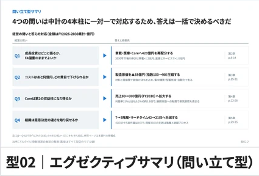

- 区分: 追加変化形
- 使いどころ: 判断する問いと答えを対で示す
- 配置・スライド表現: 左のQ番号と問いから小矢印を介し右の答えへ、複数行で反復する
- 記号・データとの対応: 淡色の問い領域、青いQと矢印
- 再利用時の注意: 問いと答えを一対一にし、同じ切り口に揃える
- 元見本: [front 行1・列4、切出し座標[1425, 431, 1850, 719]](../assets/source/catalog-front.webp)

### type-03-1: クロージング決定

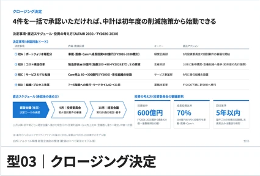

- 区分: 基本型
- 使いどころ: 承認事項と実行条件を確定する
- 配置・スライド表現: 上段に決定事項の表、下段左に直近日程、右に判断指標のパネル
- 記号・データとの対応: 番号付き決定行、工程矢印、大きな判断数値
- 再利用時の注意: 担当・期限・基準が未知ならxxと明示し、決定を捏造しない
- 元見本: [front 行1・列5、切出し座標[1865, 431, 2290, 719]](../assets/source/catalog-front.webp)

### type-04-1: 個票カタログ

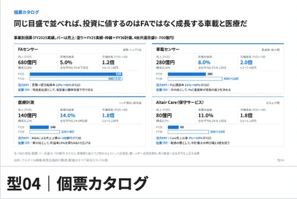

- 区分: 基本型
- 使いどころ: 同種対象の違いを同じ観点で比較する
- 配置・スライド表現: 同一寸法の個票を2×2に置き、指標・小グラフ・注記を同位置に配置
- 記号・データとの対応: 同じスケールの棒、同じ順序の数値
- 再利用時の注意: 対象ごとに項目や尺度を変えない
- 元見本: [front 行2・列1、切出し座標[108, 736, 533, 1021]](../assets/source/catalog-front.webp)

### type-05-1: KPIレーン付き時系列

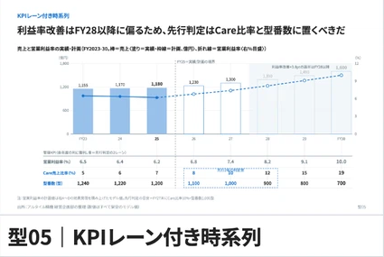

- 区分: 基本型
- 使いどころ: 主要推移と管理指標を同時に読む
- 配置・スライド表現: 上に棒と折れ線の時系列、下に同じ年列でKPI表を置く
- 記号・データとの対応: 実績の塗りと予測の線種、縦に通る年列
- 再利用時の注意: 上下の時間軸を合わせ、異なる単位を明示する
- 元見本: [front 行2・列2、切出し座標[548, 736, 973, 1021]](../assets/source/catalog-front.webp)

### type-06-1: バブル優先度マップ

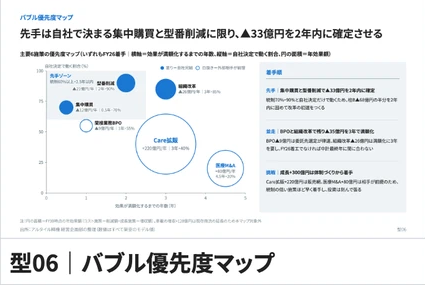

- 区分: 基本型
- 使いどころ: 効果・所要時間・実行可能性から優先施策を選ぶ
- 配置・スライド表現: 左にバブル散布、右に番号対応の施策解説パネル
- 記号・データとの対応: 横は効果実現までの時間、縦は自社で進める割合、面積は効果、塗りと白抜きで外部前提を区別
- 再利用時の注意: 面積と値を比例させ、外部前提を自社で確定できる値に見せない
- 元見本: [front 行2・列3、切出し座標[986, 736, 1411, 1021]](../assets/source/catalog-front.webp)

## 分解する

### type-07-1: 滝分解

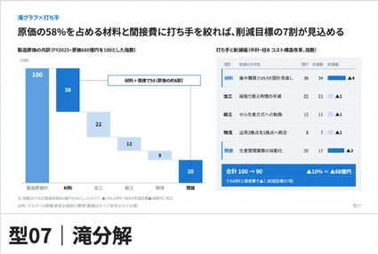

- 区分: 基本型
- 使いどころ: 合計の増減を要因に分ける
- 配置・スライド表現: 左に起点から終点までの階段状の棒、右に要因と打ち手の表
- 記号・データとの対応: 合計は濃色、要因は階調、受け渡しは補助線
- 再利用時の注意: 起終点の合計と寄与を照合する
- 元見本: [front 行3・列1、切出し座標[108, 1115, 533, 1401]](../assets/source/catalog-front.webp)

### type-07-2: 滝分解（上下並列）

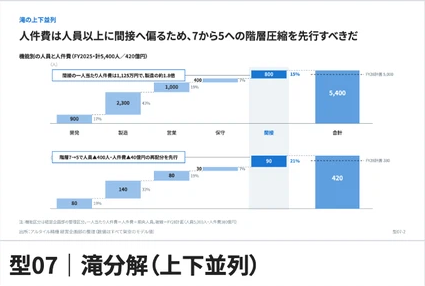

- 区分: 追加変化形
- 使いどころ: 二つの増減構造を同じ形式で対比する
- 配置・スライド表現: 滝図を上下に置き、要因列の位置を合わせる
- 記号・データとの対応: 同じ色の役割と要因順序、各図に合計ラベル
- 再利用時の注意: 異なる総額を比較する場合は尺度差を明示する
- 元見本: [front 行3・列2、切出し座標[548, 1115, 973, 1401]](../assets/source/catalog-front.webp)

### type-08-1: ファネル

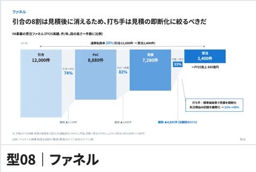

- 区分: 基本型
- 使いどころ: 工程ごとの歩留まりと最大離脱を示す
- 配置・スライド表現: 工程を左から右へ並べ、段の大きさを件数に対応させ、離脱地点に注記を引く
- 記号・データとの対応: 段の件数と段間の歩留まり、細くなる連結
- 再利用時の注意: 本見本は横型。面積を任意にして減少率を誇張しない
- 元見本: [front 行3・列3、切出し座標[986, 1115, 1411, 1401]](../assets/source/catalog-front.webp)

### type-09-1: バリューチェーン収益図

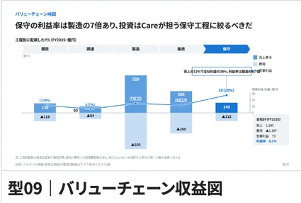

- 区分: 基本型
- 使いどころ: 工程別の売上・費用・利益の偏りを示す
- 配置・スライド表現: 上に工程矢羽根、下に同じ工程位置の収益図を並べる
- 記号・データとの対応: 基準線の上下に正負の量、主役工程を青で強調
- 再利用時の注意: 工程と数値の横位置を対応させ、単位を揃える
- 元見本: [front 行3・列4、切出し座標[1425, 1115, 1850, 1401]](../assets/source/catalog-front.webp)

### type-09-2: バリューチェーン収益図（三層版）

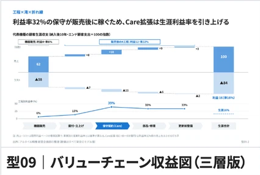

- 区分: 追加変化形
- 使いどころ: 工程と金額と効率を一度に対応させる
- 配置・スライド表現: 上段に工程、中央に増減・金額図、下段に利益率などの折れ線
- 記号・データとの対応: 三段を同じ工程列で貫通させる
- 再利用時の注意: 率と金額の軸を分け、三層を独立した図として説明する
- 元見本: [front 行3・列5、切出し座標[1865, 1115, 2290, 1401]](../assets/source/catalog-front.webp)

### type-10-1: 分配カスケード

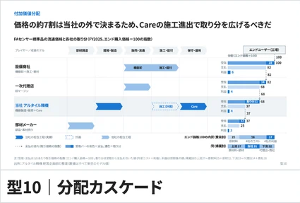

- 区分: 基本型
- 使いどころ: 取引段階の取り分と自社余地を示す
- 配置・スライド表現: 左に関係者・段階の行、中央に段階間の分配形、右に共通スケールの収支棒
- 記号・データとの対応: 自社の取り分は濃色、他者は淡色
- 再利用時の注意: 受取・支払・利益の定義を揃え、二重計上を避ける
- 元見本: [front 行4・列1、切出し座標[108, 1418, 533, 1705]](../assets/source/catalog-front.webp)

### type-11-1: ロジックツリー

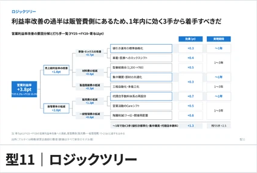

- 区分: 基本型
- 使いどころ: 成果を計算可能な要因と施策へ分ける
- 配置・スライド表現: 左の総指標から右へ枝分かれし、末端の施策の右に効果と期間の列
- 記号・データとの対応: 枝の四則演算、枠、同じ行の評価欄
- 再利用時の注意: 加算・乗算の関係を明示し、末端の重複を確認する
- 元見本: [front 行4・列2、切出し座標[548, 1418, 973, 1705]](../assets/source/catalog-front.webp)

### type-12-1: 数式分解

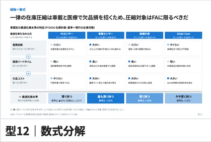

- 区分: 基本型
- 使いどころ: 同じ指標に効く数式要素を対象別に比較する
- 配置・スライド表現: 対象を列、式の要素を行に置き、下段に全体の評価をまとめる
- 記号・データとの対応: 演算記号、要素ごとの状態と含意、主役列の強調
- 再利用時の注意: 定性的な影響を未根拠の定量値に置き換えない
- 元見本: [front 行4・列3、切出し座標[986, 1418, 1411, 1705]](../assets/source/catalog-front.webp)

### type-13-1: 同単位の滞留分解

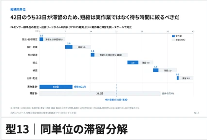

- 区分: 基本型
- 使いどころ: 総時間を実働と待ちに分ける
- 配置・スライド表現: 共通時間軸に工程別の帯を階段状に置き、下部に実働と待ちの合計帯
- 記号・データとの対応: 実働は青、待ちは淡色、全て同じ時間単位
- 再利用時の注意: 経過時間と工数を混ぜず、並行工程の重複を考慮する
- 元見本: [front 行4・列4、切出し座標[1425, 1418, 1850, 1705]](../assets/source/catalog-front.webp)

### type-46-1: 縦型イシューツリー

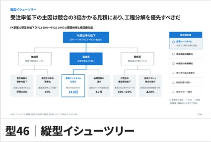

- 区分: 基本型
- 使いどころ: 問いから原因・仮説を下へ分解する
- 配置・スライド表現: 頂点の問いから下向きに分岐し、右側に検証の観点を置く
- 記号・データとの対応: 重要経路を濃色や太線、葉に具体的な要因
- 再利用時の注意: 問いと原因を同じ階層で混在させず、重要経路の理由を示す
- 元見本: [front 行4・列5、切出し座標[1865, 1418, 2290, 1705]](../assets/source/catalog-front.webp)

## 比べる

### type-14-1: 軸統一並列

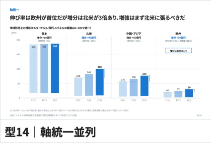

- 区分: 基本型
- 使いどころ: 対象間の水準と推移を公平に比較する
- 配置・スライド表現: 同じ軸を持つ小さな棒グラフを横並びに置く
- 記号・データとの対応: 軸の最小・最大・目盛を共通化、同じ年を同じ階調
- 再利用時の注意: 対象ごとに自動スケールを変えない
- 元見本: [front 行5・列1、切出し座標[108, 1799, 533, 2086]](../assets/source/catalog-front.webp)

### type-15-1: 共通軸プロセス並列

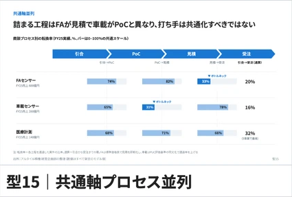

- 区分: 基本型
- 使いどころ: 複数対象の同工程の差を見る
- 配置・スライド表現: 上に共通工程を一度だけ置き、対象を行にし工程列ごとに指標を配置
- 記号・データとの対応: 共通矢羽根と対応する横棒・数値
- 再利用時の注意: 工程順と指標の分母を揃える
- 元見本: [front 行5・列2、切出し座標[548, 1799, 973, 2086]](../assets/source/catalog-front.webp)

### type-16-1: 共通目盛の構造比較

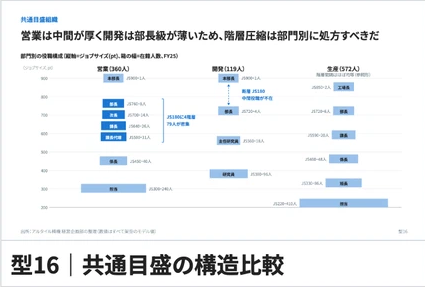

- 区分: 基本型
- 使いどころ: 等級や報酬の階層を比較する
- 配置・スライド表現: 対象を横に並べ、共通の縦目盛上に階層の箱を配置
- 記号・データとの対応: 箱の高さと位置で水準、色で注目範囲
- 再利用時の注意: 箱の位置が実数目盛か序列かを明示する
- 元見本: [front 行5・列3、切出し座標[986, 1799, 1411, 2086]](../assets/source/catalog-front.webp)

### type-17-1: 同型フロー対比

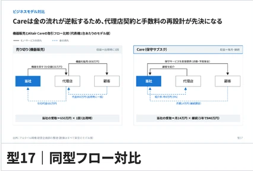

- 区分: 基本型
- 使いどころ: 二つの事業・制度の流れを比較する
- 配置・スライド表現: 左右に同型の関係者箱と流れ、下に対応する評価帯
- 記号・データとの対応: モノは実線、金は破線、対応する箱は同位置
- 再利用時の注意: 左右で流れの定義と向きを揃える
- 元見本: [front 行5・列4、切出し座標[1425, 1799, 1850, 2086]](../assets/source/catalog-front.webp)

### type-18-1: 同型組織対比

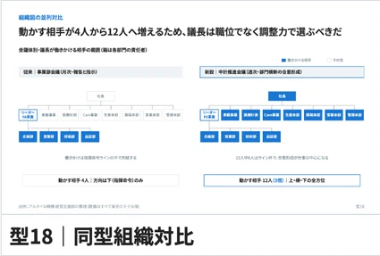

- 区分: 基本型
- 使いどころ: 組織の規模と働きかけ範囲を比較する
- 配置・スライド表現: 左右に組織ツリーを置き、関与範囲を同じ役割位置で強調する
- 記号・データとの対応: 青の組織箱、淡い文脈箱、下に人数の要約
- 再利用時の注意: 人数と箱の個数が異なる場合は明示する
- 元見本: [front 行5・列5、切出し座標[1865, 1799, 2290, 2086]](../assets/source/catalog-front.webp)

### type-19-1: フォルム対比

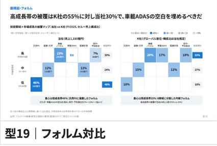

- 区分: 基本型
- 使いどころ: 二者の被覆や構成の形を比較する
- 配置・スライド表現: 左右に共通カテゴリの格子を置き、セルの構成比を塗り分ける
- 記号・データとの対応: 同じ分類軸、濃淡、セル内の割合
- 再利用時の注意: カテゴリと分母を揃え、図の形と量の関係を明示する
- 元見本: [front 行6・列1、切出し座標[108, 2105, 533, 2391]](../assets/source/catalog-front.webp)

### type-19-2: フォルム対比（リスク評価マップ）

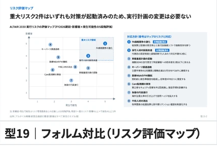

- 区分: 追加変化形
- 使いどころ: リスク分布と対応方針を対応させる
- 配置・スライド表現: 左に影響度×発生可能性のマップ、右に番号対応の方針リスト
- 記号・データとの対応: 番号バッジ、ゾーン境界、強調した重点リスク
- 再利用時の注意: 評価尺度と順位の根拠を示し、確率を推測で補わない
- 元見本: [front 行6・列2、切出し座標[548, 2105, 973, 2391]](../assets/source/catalog-front.webp)

### type-45-1: 論証テーブル

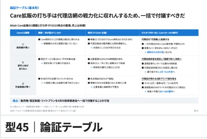

- 区分: 基本型
- 使いどころ: 対象別の事実から含意を導く
- 配置・スライド表現: 対象を列、論点を行に置き、セルに事実と含意を記す
- 記号・データとの対応: 事実を■、含意・打ち手を矢印で区別する
- 再利用時の注意: 意見を事実扱いせず、主張と証拠を対応させる
- 元見本: [front 行6・列3、切出し座標[986, 2105, 1411, 2391]](../assets/source/catalog-front.webp)

### type-45-2: 論証テーブル（時間展開形）

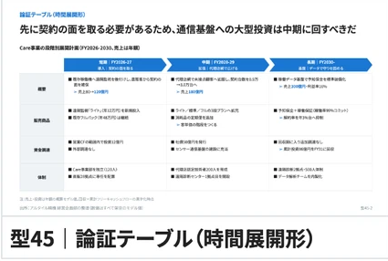

- 区分: 追加変化形
- 使いどころ: 時期別の施策と根拠を示す
- 配置・スライド表現: 時間を列、論点や領域を行に置く表
- 記号・データとの対応: 列上のフェーズ矢羽根、各セルの事実と含意
- 再利用時の注意: 時期境界と依存関係を明示する
- 元見本: [front 行6・列4、切出し座標[1425, 2105, 1850, 2391]](../assets/source/catalog-front.webp)

### type-45-3: 論証テーブル（横並び形）

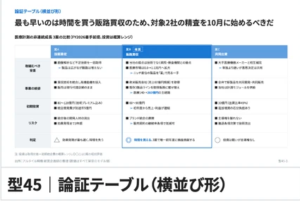

- 区分: 追加変化形
- 使いどころ: 選択肢を共通論点で比較する
- 配置・スライド表現: 選択肢を列、判断観点を行にし、推奨列を枠で囲む
- 記号・データとの対応: 共通のセル構造、主役列の青い枠
- 再利用時の注意: 推奨に不利な根拠も同じ基準で載せる
- 元見本: [front 行6・列5、切出し座標[1865, 2105, 2290, 2391]](../assets/source/catalog-front.webp)

### type-45-4: 論証テーブル（仮説検証形）

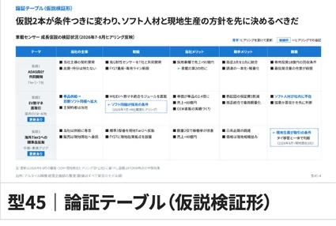

- 区分: 追加変化形
- 使いどころ: 仮説が条件によって変わる様子を示す
- 配置・スライド表現: テーマ、現在の主張、根拠、成立・反証条件、示唆を列で対応させる
- 記号・データとの対応: 検証結果や変わる結論を青で強調する
- 再利用時の注意: 右列の意味は再利用用の解釈。見本の微小な全セル文言の逐語転記ではない
- 元見本: [front 行7・列1、切出し座標[108, 2413, 533, 2699]](../assets/source/catalog-front.webp)

## 変化を見せる

### type-20-1: 同位置Before/After

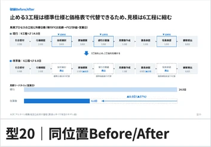

- 区分: 基本型
- 使いどころ: 変更後に消える工程と残る工程を示す
- 配置・スライド表現: 変更前後の同じ工程列を上下に置き、下部に総時間の比較帯
- 記号・データとの対応: 削除箇所を同位置に残して破線、短縮分を棒で示す
- 再利用時の注意: 削除後に箱を詰めて対応関係を崩さない
- 元見本: [back 行1・列1、切出し座標[108, 431, 461, 677]](../assets/source/catalog-back.webp)

### type-21-1: 面積の組み替え

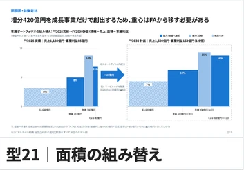

- 区分: 基本型
- 使いどころ: 全体の規模と構成の転換を示す
- 配置・スライド表現: 左右に同じ基準の面積図を置き、中央に変換矢印を置く
- 記号・データとの対応: 幅と高さで二量、その積で総量、同じ対象は同じ色
- 再利用時の注意: 前後で縮尺を変えず、面積と実数の関係を明示する
- 元見本: [back 行1・列2、切出し座標[475, 431, 828, 677]](../assets/source/catalog-back.webp)

### type-21-2: 面積の組み替え（残像版）

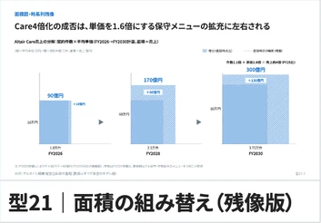

- 区分: 追加変化形
- 使いどころ: 段階的な拡大と前時点との差を示す
- 配置・スライド表現: 三時点の面積図を横並びに置き、直前時点の輪郭を重ねる
- 記号・データとの対応: 点線の残像、時点間の矢印、増分注記
- 再利用時の注意: 輪郭の比較は同じ尺度・基準位置で行う
- 元見本: [back 行1・列3、切出し座標[841, 431, 1194, 677]](../assets/source/catalog-back.webp)

### type-22-1: 前提の書き換え表

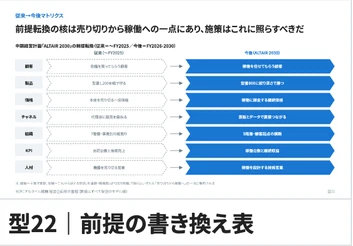

- 区分: 基本型
- 使いどころ: 従来の考え方から新方針への転換を示す
- 配置・スライド表現: 観点を行にし、左の従来と右の今後を矢印で結ぶ
- 記号・データとの対応: 従来は淡色・破線、今後は主役色・実線
- 再利用時の注意: 同じ観点の言葉を対にし、実績と方針を区別する
- 元見本: [back 行1・列4、切出し座標[1208, 431, 1561, 677]](../assets/source/catalog-back.webp)

## 関係と位置で見せる

### type-23-1: 面積図・構成比×効率

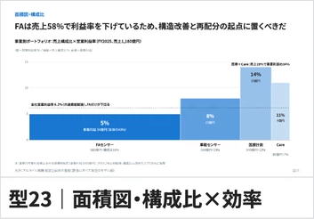

- 区分: 基本型
- 使いどころ: 規模と効率から重点領域を選ぶ
- 配置・スライド表現: 対象ごとに幅と高さの異なる矩形を共通基準線から並べる
- 記号・データとの対応: 幅は構成比、高さは効率、面積は成果、全体平均の水平線
- 再利用時の注意: 幅の和と構成比の分母を確認する
- 元見本: [back 行2・列1、切出し座標[108, 771, 461, 1017]](../assets/source/catalog-back.webp)

### type-24-1: 実数面積図

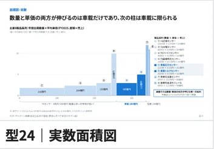

- 区分: 基本型
- 使いどころ: 多くの対象の量と質を一度に比較する
- 配置・スライド表現: 共通底辺に幅・高さの異なる矩形を並べ、右に対象の説明を置く
- 記号・データとの対応: 両軸は実数、矩形の面積は積の値
- 再利用時の注意: 幅だけで順位を読ませず、軸と単位を明示する
- 元見本: [back 行2・列2、切出し座標[475, 771, 828, 1017]](../assets/source/catalog-back.webp)

### type-24-2: 実数面積図（2枚並置）

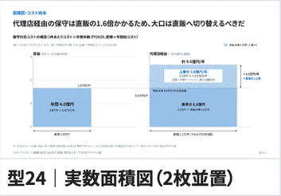

- 区分: 追加変化形
- 使いどころ: 二対象の量と質の違いを比較する
- 配置・スライド表現: 左右に実数面積図を置き、差が出る幅と高さを補助線で示す
- 記号・データとの対応: 二図の共通尺度、差分寸法と数値
- 再利用時の注意: 独立に正規化して面積差を失わない
- 元見本: [back 行2・列3、切出し座標[841, 771, 1194, 1017]](../assets/source/catalog-back.webp)

### type-25-1: 軌跡散布

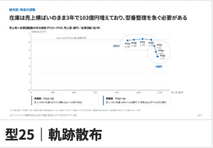

- 区分: 基本型
- 使いどころ: 二指標の時系列変化を追う
- 配置・スライド表現: 散布図の年次点を順に結び、局面の近くに注記を置く
- 記号・データとの対応: 年ラベル、軌跡線、局面の囲み
- 再利用時の注意: 点の順序を明示し、軌跡を因果の証明と扱わない
- 元見本: [back 行2・列4、切出し座標[1208, 771, 1561, 1017]](../assets/source/catalog-back.webp)

### type-25-2: 軌跡散布（頭打ち）

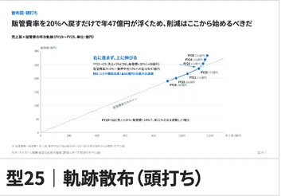

- 区分: 追加変化形
- 使いどころ: 投資などの増加に対する成果の鈍化を示す
- 配置・スライド表現: 年次点の軌跡に初期の基準傾向を補助線で重ねる
- 記号・データとの対応: 後期の軌跡と基準線の乖離、局面への注記
- 再利用時の注意: 外挿線の式・対象期間と推定前提を示す
- 元見本: [back 行2・列5、切出し座標[1575, 771, 1928, 1017]](../assets/source/catalog-back.webp)

### type-26-1: 循環散布

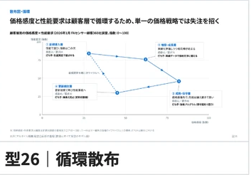

- 区分: 基本型
- 使いどころ: 順に関連する複数状態の循環を示す
- 配置・スライド表現: 散布上の状態点を閉じた経路で結び、点の近くに説明を置く
- 記号・データとの対応: 矢印の方向、始点と状態名
- 再利用時の注意: 循環の順序に根拠がある場合に使い、単なる相関と混同しない
- 元見本: [back 行2・列6、切出し座標[1942, 771, 2295, 1017]](../assets/source/catalog-back.webp)

### type-27-1: 基準線で意味づける散布

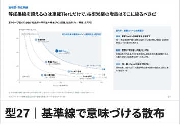

- 区分: 基本型
- 使いどころ: 同じ成果の境界に対して対象を評価する
- 配置・スライド表現: 左に散布と等成果の曲線、右に重点施策の解説
- 記号・データとの対応: 基準曲線と重点点の主役色、直接ラベル
- 再利用時の注意: 曲線は指標の数式から計算する
- 元見本: [back 行3・列1、切出し座標[108, 1034, 461, 1279]](../assets/source/catalog-back.webp)

### type-28-1: 小マルチプル散布＋表

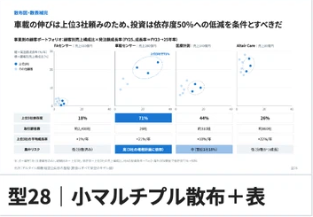

- 区分: 基本型
- 使いどころ: 分布の形と数値を対象別に比較する
- 配置・スライド表現: 上に共通軸の小散布を並べ、下に同じ列で数値表を置く
- 記号・データとの対応: 散布の軸統一、列位置の一致、重点列の強調
- 再利用時の注意: 小図ごとの目盛差で形を変えない
- 元見本: [back 行3・列2、切出し座標[475, 1034, 828, 1279]](../assets/source/catalog-back.webp)

### type-29-1: 期間線分散布

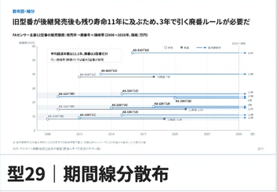

- 区分: 基本型
- 使いどころ: 開始・終了と継続期間を対象別に示す
- 配置・スライド表現: 横に共通時系列、縦に対象を置き、期間を水平線分で示す
- 記号・データとの対応: 開始と終了のマーク、現在線、継続の線の延長
- 再利用時の注意: 本見本は期間を示す線分。現在線と予定終了を区別する
- 元見本: [back 行3・列3、切出し座標[841, 1034, 1194, 1279]](../assets/source/catalog-back.webp)

### type-30-1: 重なりのベン図

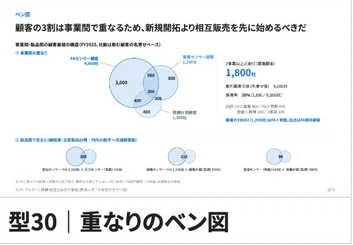

- 区分: 基本型
- 使いどころ: 集合の重複と統合機会を示す
- 配置・スライド表現: 中央に重なる円と人数、右にキーナンバー、下に補足小図
- 記号・データとの対応: 交差部の数、中心の集約値、淡色の円
- 再利用時の注意: 面積が近似なら明示し、集合の合計を二重計上しない
- 元見本: [back 行3・列4、切出し座標[1208, 1034, 1561, 1279]](../assets/source/catalog-back.webp)

### type-31-1: 積み上げエリア

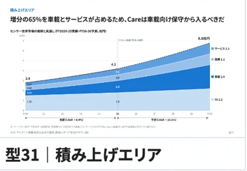

- 区分: 基本型
- 使いどころ: 総量と内訳の時間変化を示す
- 配置・スライド表現: 時系列に沿って系列を積み上げ、右端に系列名を直接書く
- 記号・データとの対応: 階調の層、実績と予測の境界、合計ラベル
- 再利用時の注意: 系列順を固定し、下層の変化で上層が誤読されないようにする
- 元見本: [back 行3・列5、切出し座標[1575, 1034, 1928, 1279]](../assets/source/catalog-back.webp)

### type-32-1: 2×2と判断ロジック

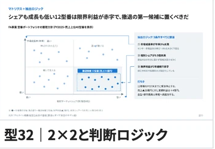

- 区分: 基本型
- 使いどころ: 二軸で対象を分け対応方針を説明する
- 配置・スライド表現: 左に2×2の散布マトリクス、右に方針の説明を置く
- 記号・データとの対応: 重点象限の枠、象限から方針への対応線
- 再利用時の注意: 判断に効く軸を選び、閾値の根拠を示す
- 元見本: [back 行3・列6、切出し座標[1942, 1034, 2295, 1279]](../assets/source/catalog-back.webp)

### type-33-1: ライフサイクル対応

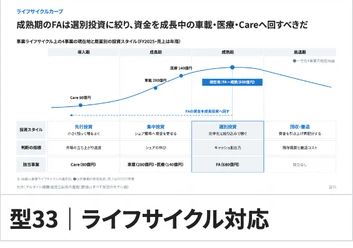

- 区分: 基本型
- 使いどころ: 成熟度に応じて施策を切り替える
- 配置・スライド表現: 上に段階カーブ、下に同じ段階列で方針表を置く
- 記号・データとの対応: 現在地の垂線、主役段階の強調
- 再利用時の注意: 概念曲線を実測値と扱わず、段階判定の根拠を示す
- 元見本: [back 行4・列1、切出し座標[108, 1298, 461, 1546]](../assets/source/catalog-back.webp)

### type-34-1: 襷がけ補完

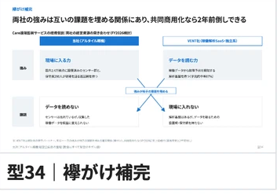

- 区分: 基本型
- 使いどころ: 二者の強みで相手の課題を補う
- 配置・スライド表現: 二者を列、強みと課題を行にする2×2を置く
- 記号・データとの対応: 対角に結ぶ交差矢印、中央に補完の効果
- 再利用時の注意: 一方向の依存と相互補完を区別する
- 元見本: [back 行4・列2、切出し座標[475, 1298, 828, 1546]](../assets/source/catalog-back.webp)

## 時間と工程で見せる

### type-35-1: 期別スイムレーン

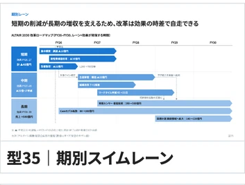

- 区分: 基本型
- 使いどころ: 効果の出る時期ごとに施策を並べる
- 配置・スライド表現: 短期・中期・長期を縦レーン、横を共通時間軸にする
- 記号・データとの対応: 期間バー、レーン見出しの効果合計、現在線
- 再利用時の注意: 期間の重なりと依存を示し、単純に効果を重複加算しない
- 元見本: [back 行5・列1、切出し座標[108, 1629, 461, 1896]](../assets/source/catalog-back.webp)

### type-36-1: モジュール工程

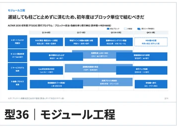

- 区分: 基本型
- 使いどころ: 担当・効果を持つ実行ブロックを配置する
- 配置・スライド表現: 領域別レーンと時間軸の上に連結するモジュールを置く
- 記号・データとの対応: ブロック内の担当・効果、期間に比例する横幅
- 再利用時の注意: ブロックの隙間を任意にして日程を誤読させない
- 元見本: [back 行5・列2、切出し座標[475, 1629, 828, 1896]](../assets/source/catalog-back.webp)

### type-37-1: フェーズガント

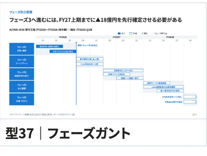

- 区分: 基本型
- 使いどころ: 段階的な実行と依存関係を示す
- 配置・スライド表現: フェーズを行、時間を列にし、工程を階段状に配置する
- 記号・データとの対応: 完了は塗り、計画は枠、現在線と依存線
- 再利用時の注意: 時制と担当の色の意味を混在させない
- 元見本: [back 行5・列3、切出し座標[841, 1629, 1194, 1896]](../assets/source/catalog-back.webp)

### type-38-1: 二段工程

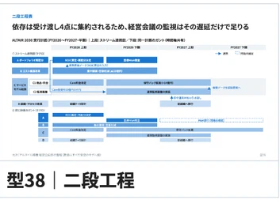

- 区分: 基本型
- 使いどころ: 連携構造と詳細日程を同時に読む
- 配置・スライド表現: 上段にストリーム連携、下段に対応するガントを置く
- 記号・データとの対応: 上下の共通時間軸、工程名の対応、接続線
- 再利用時の注意: 上段と下段の期間が矛盾しないようにする
- 元見本: [back 行5・列4、切出し座標[1208, 1629, 1561, 1896]](../assets/source/catalog-back.webp)

### type-39-1: 会議体連携

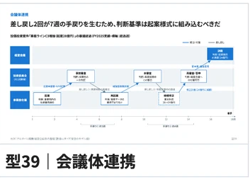

- 区分: 基本型
- 使いどころ: 審議・承認の受け渡しと手戻りを示す
- 配置・スライド表現: 会議体を縦レーン、審議段階を横にし、会議箱を接続する
- 記号・データとの対応: 矢印に渡す文書、戻りの線と所要週数
- 再利用時の注意: 会議の開催頻度と日程上の依存を確認する
- 元見本: [back 行5・列5、切出し座標[1575, 1629, 1928, 1896]](../assets/source/catalog-back.webp)

### type-40-1: 金モノ交差

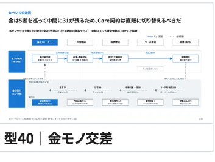

- 区分: 基本型
- 使いどころ: 取引の物流と資金のタイミングを示す
- 配置・スライド表現: 上にモノの流れ、下に金額・支払条件を同じ工程列で置く
- 記号・データとの対応: モノの実線、金の破線、取引金額と支払サイト
- 再利用時の注意: モノの移動と所有権・支払時点を区別する
- 元見本: [back 行5・列6、切出し座標[1942, 1629, 2295, 1896]](../assets/source/catalog-back.webp)

### type-47-1: 業務フロー図

- 区分: 基本型
- 使いどころ: 役割別の処理・判断・例外を可視化する
- 配置・スライド表現: 役割レーン内に処理箱、ひし形、ループを配置する
- 記号・データとの対応: 通常フローと例外の点線、発生率と追加日数
- 再利用時の注意: 分岐条件と戻り先を明示し、未知の率を補わない
- 元見本: [back 行6・列1、切出し座標[108, 1895, 461, 2161]](../assets/source/catalog-back.webp)

## 構造を地図化する

### type-41-1: レイヤーマップ

- 区分: 基本型
- 使いどころ: 層と系列の被覆と空白を見る
- 配置・スライド表現: 縦に層、横に系列の格子を作り、プレイヤーの箱を配置する
- 記号・データとの対応: 自社の被覆を濃色、範囲をブラケットや集約帯
- 再利用時の注意: 層ごとに異なる分類軸を混ぜない
- 元見本: [back 行7・列1、切出し座標[108, 2232, 461, 2498]](../assets/source/catalog-back.webp)

### type-42-1: バリューチェーン地図

- 区分: 基本型
- 使いどころ: 工程に対する成功要因と担当の被覆を示す
- 配置・スライド表現: 上に工程、中に成功要因、下にプレイヤーの範囲帯を置く
- 記号・データとの対応: 同じ工程列、被覆帯、空白領域
- 再利用時の注意: 空白が不足を意味するか対象外かを確認する
- 元見本: [back 行7・列2、切出し座標[475, 2232, 828, 2498]](../assets/source/catalog-back.webp)

### type-43-1: 組織マッピング

- 区分: 基本型
- 使いどころ: 組織を類型に対応させて選択を考える
- 配置・スライド表現: 上に組織ツリーと番号、右に類型凡例、下に比較表を置く
- 記号・データとの対応: 番号バッジと類型、表の対応列
- 再利用時の注意: 組織の上下関係と類型の関係を区別する
- 元見本: [back 行7・列3、切出し座標[841, 2232, 1194, 2498]](../assets/source/catalog-back.webp)

### type-44-1: 全体と拡大

- 区分: 基本型
- 使いどころ: 全体に対する重点部分の内訳を示す
- 配置・スライド表現: 左に全体の内訳、右に選んだ部分の拡大図を置く
- 記号・データとの対応: 選択領域の強調、拡大先への引き出し、別スケール
- 再利用時の注意: 右の拡大尺度を明示し、同尺度に見せない
- 元見本: [back 行7・列4、切出し座標[1208, 2232, 1561, 2498]](../assets/source/catalog-back.webp)

### type-48-1: 関係者相関マップ

- 区分: 基本型
- 使いどころ: 主役と関係者の交換関係を俯瞰する
- 配置・スライド表現: 中央に主役、周囲に関係者を置き、関係を放射状に接続する
- 記号・データとの対応: モノは実線、金は破線、データは点線、矢印に内容
- 再利用時の注意: 線の交差を整理し、矢印の方向と関係の意味を確認する
- 元見本: [back 行7・列5、切出し座標[1575, 2232, 1928, 2498]](../assets/source/catalog-back.webp)

## 全型に効く原則

### principle-1: 共通項のくくり出し

- 区分: 共通原則
- 使いどころ: 共通条件をまとめ選択肢の差を見せる
- 配置・スライド表現: 選択肢を列、評価観点を行にし、共通する行を横断セルにまとめる
- 記号・データとの対応: 差分だけを各列に残し、共通事項を一度だけ書く
- 再利用時の注意: 共通化しても例外や条件差を失わない
- 元見本: [back 行8・列1、切出し座標[108, 2571, 461, 2838]](../assets/source/catalog-back.webp)

### principle-2: 重なりの作法

- 区分: 共通原則
- 使いどころ: 期間ブロックの重なりを読みやすくする
- 配置・スライド表現: レーン内の重なったブロックを同じ方向と角度でずらす
- 記号・データとの対応: 統一したずらし、接続と箱の前後関係
- 再利用時の注意: 位置を崩す場合も時間軸と対応は保ち、恣意的な角度を混ぜない
- 元見本: [back 行8・列2、切出し座標[475, 2571, 828, 2838]](../assets/source/catalog-back.webp)

