# 表現構造カタログ

正本はcatalog.json。build_catalog.pyで生成する。48基本構造・11変化形・2共通原則のIDを維持している。

構成図は汎用の領域・役割・関係を示す模式図で、実データの量や出力デザインを規定しない。用途と軸が入力に適合する場合に配置の参考とする。整理方法の選択肢はこの61構造に限定せず、framework.mdとselection-rules.mdから一覧外・複合表現も検討する。

| ID | 方法名称 | 区分 | 用途 |
| --- | --- | --- | --- |
| [type-01-1](#type-01-1) | 全体テーマ・目次 | 基本構造 | 要点・全体像を示す |
| [type-01-2](#type-01-2) | 章の導入 | 変化形 | 要点・全体像を示す |
| [type-02-1](#type-02-1) | 要点サマリ | 基本構造 | 要点・全体像を示す |
| [type-02-2](#type-02-2) | 問いと答えのサマリ | 変化形 | 要点・全体像を示す |
| [type-03-1](#type-03-1) | まとめ・次の行動 | 基本構造 | 要点・全体像を示す |
| [type-04-1](#type-04-1) | 個票カタログ | 基本構造 | 要点・全体像を示す |
| [type-05-1](#type-05-1) | KPIレーン付き時系列 | 基本構造 | 要点・全体像を示す |
| [type-06-1](#type-06-1) | バブル比較マップ | 基本構造 | 要点・全体像を示す |
| [type-07-1](#type-07-1) | 滝分解 | 基本構造 | 分解する |
| [type-07-2](#type-07-2) | 滝分解（上下並列） | 変化形 | 分解する |
| [type-08-1](#type-08-1) | ファネル | 基本構造 | 分解する |
| [type-09-1](#type-09-1) | バリューチェーン収益図 | 基本構造 | 分解する |
| [type-09-2](#type-09-2) | バリューチェーン収益図（三層版） | 変化形 | 分解する |
| [type-10-1](#type-10-1) | 分配カスケード | 基本構造 | 分解する |
| [type-11-1](#type-11-1) | ロジックツリー | 基本構造 | 分解する |
| [type-12-1](#type-12-1) | 数式分解 | 基本構造 | 分解する |
| [type-13-1](#type-13-1) | 同単位の滞留分解 | 基本構造 | 分解する |
| [type-46-1](#type-46-1) | 縦型イシューツリー | 基本構造 | 分解する |
| [type-14-1](#type-14-1) | 軸統一並列 | 基本構造 | 比べる |
| [type-15-1](#type-15-1) | 共通軸プロセス並列 | 基本構造 | 比べる |
| [type-16-1](#type-16-1) | 共通目盛の構造比較 | 基本構造 | 比べる |
| [type-17-1](#type-17-1) | 同型フロー対比 | 基本構造 | 比べる |
| [type-18-1](#type-18-1) | 同型組織対比 | 基本構造 | 比べる |
| [type-19-1](#type-19-1) | フォルム対比 | 基本構造 | 比べる |
| [type-19-2](#type-19-2) | フォルム対比（リスク評価マップ） | 変化形 | 比べる |
| [type-45-1](#type-45-1) | 論証テーブル | 基本構造 | 比べる |
| [type-45-2](#type-45-2) | 論証テーブル（時間展開形） | 変化形 | 比べる |
| [type-45-3](#type-45-3) | 論証テーブル（横並び形） | 変化形 | 比べる |
| [type-45-4](#type-45-4) | 論証テーブル（仮説検証形） | 変化形 | 比べる |
| [type-20-1](#type-20-1) | 同位置Before/After | 基本構造 | 変化を見せる |
| [type-21-1](#type-21-1) | 面積の組み替え | 基本構造 | 変化を見せる |
| [type-21-2](#type-21-2) | 面積の組み替え（残像版） | 変化形 | 変化を見せる |
| [type-22-1](#type-22-1) | 前提の書き換え表 | 基本構造 | 変化を見せる |
| [type-23-1](#type-23-1) | 面積図・構成比×効率 | 基本構造 | 関係と位置で見せる |
| [type-24-1](#type-24-1) | 実数面積図 | 基本構造 | 関係と位置で見せる |
| [type-24-2](#type-24-2) | 実数面積図（2枚並置） | 変化形 | 関係と位置で見せる |
| [type-25-1](#type-25-1) | 軌跡散布 | 基本構造 | 関係と位置で見せる |
| [type-25-2](#type-25-2) | 軌跡散布（頭打ち） | 変化形 | 関係と位置で見せる |
| [type-26-1](#type-26-1) | 循環散布 | 基本構造 | 関係と位置で見せる |
| [type-27-1](#type-27-1) | 基準線で意味づける散布 | 基本構造 | 関係と位置で見せる |
| [type-28-1](#type-28-1) | 小マルチプル散布＋表 | 基本構造 | 関係と位置で見せる |
| [type-29-1](#type-29-1) | 期間線分散布 | 基本構造 | 関係と位置で見せる |
| [type-30-1](#type-30-1) | 重なりのベン図 | 基本構造 | 関係と位置で見せる |
| [type-31-1](#type-31-1) | 積み上げエリア | 基本構造 | 関係と位置で見せる |
| [type-32-1](#type-32-1) | 2×2と判断ロジック | 基本構造 | 関係と位置で見せる |
| [type-33-1](#type-33-1) | ライフサイクル対応 | 基本構造 | 関係と位置で見せる |
| [type-34-1](#type-34-1) | 襷がけ補完 | 基本構造 | 関係と位置で見せる |
| [type-35-1](#type-35-1) | 期別スイムレーン | 基本構造 | 時間と工程で見せる |
| [type-36-1](#type-36-1) | モジュール工程 | 基本構造 | 時間と工程で見せる |
| [type-37-1](#type-37-1) | フェーズガント | 基本構造 | 時間と工程で見せる |
| [type-38-1](#type-38-1) | 二段工程 | 基本構造 | 時間と工程で見せる |
| [type-39-1](#type-39-1) | 会議体連携 | 基本構造 | 時間と工程で見せる |
| [type-40-1](#type-40-1) | 金モノ交差 | 基本構造 | 時間と工程で見せる |
| [type-47-1](#type-47-1) | 業務フロー図 | 基本構造 | 時間と工程で見せる |
| [type-41-1](#type-41-1) | レイヤーマップ | 基本構造 | 構造を地図化する |
| [type-42-1](#type-42-1) | バリューチェーン地図 | 基本構造 | 構造を地図化する |
| [type-43-1](#type-43-1) | 組織マッピング | 基本構造 | 構造を地図化する |
| [type-44-1](#type-44-1) | 全体と拡大 | 基本構造 | 構造を地図化する |
| [type-48-1](#type-48-1) | 関係者相関マップ | 基本構造 | 構造を地図化する |
| [principle-1](#principle-1) | 共通項のくくり出し | 共通原則 | 全型に効く原則 |
| [principle-2](#principle-2) | 重なりの作法 | 共通原則 | 全型に効く原則 |

## 要点・全体像を示す

### type-01-1: 全体テーマ・目次

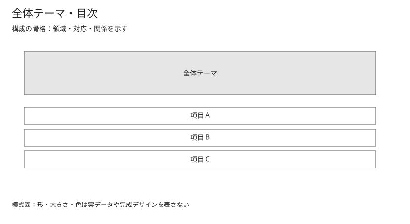

- 使いどころ: 資料の入口と全体テーマを示す
- 整理軸: 横＝章・項目、縦＝情報の階層。論理上の整理軸。全てを数量軸として描くものではない。
- 配置: 全体テーマまたは章題を上位に置き、下に項目・問い・要点をまとめる
- 記号・情報の対応: 文字と背景の区別で全体テーマと補足の階層を示す
- 必要な情報: 章・項目、情報の階層、元情報との対応
- 注意: 全体テーマの提示か項目一覧かを目的に合わせて選ぶ

### type-01-2: 章の導入

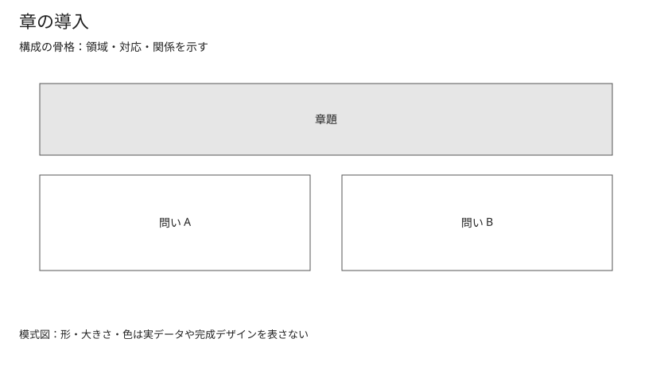

- 使いどころ: 章の切り替えと章内の問いを示す
- 整理軸: 横＝章・項目、縦＝情報の階層。論理上の整理軸。全てを数量軸として描くものではない。
- 配置: 全体テーマまたは章題を上位に置き、下に項目・問い・要点をまとめる
- 記号・情報の対応: 章の位置と章内の問いを対応させる
- 必要な情報: 章・項目、情報の階層、元情報との対応
- 注意: 章の導入と本編の内容を対応させる

### type-02-1: 要点サマリ

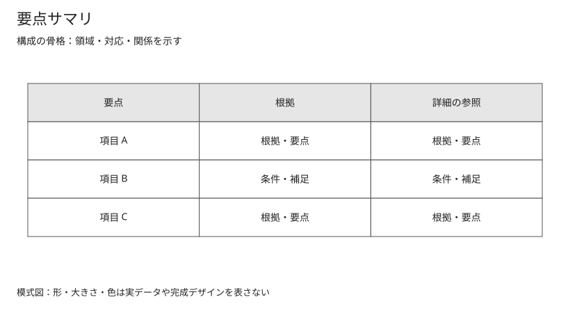

- 使いどころ: 全体の要点・問い・根拠を一覧にする
- 整理軸: 横＝要点と補足、縦＝論点・問い。論理上の整理軸。全てを数量軸として描くものではない。
- 配置: 要点や問いを行、根拠・補足・詳細の参照を列に置く
- 記号・情報の対応: 要点と根拠を行ごとに対応させ、参照先を示す
- 必要な情報: 要点と補足、論点・問い、元情報との対応
- 注意: 要点の根拠と詳細ページを対応させ、問いへの回答が未確定なら明記する

### type-02-2: 問いと答えのサマリ

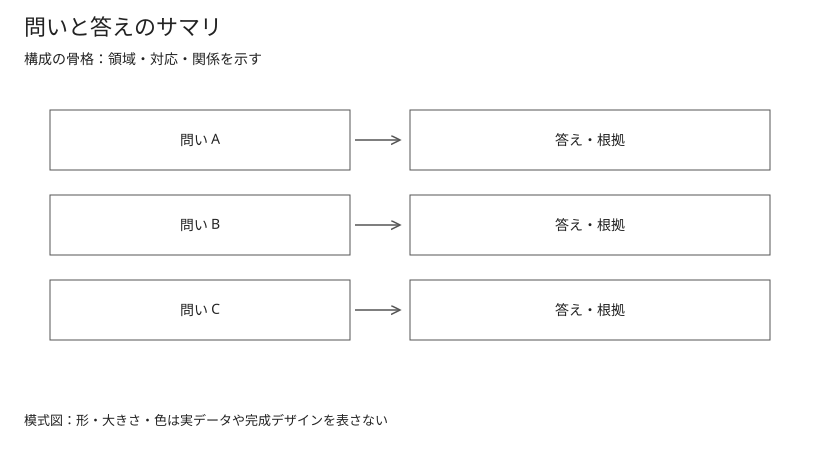

- 使いどころ: 全体の要点・問い・根拠を一覧にする
- 整理軸: 横＝要点と補足、縦＝論点・問い。論理上の整理軸。全てを数量軸として描くものではない。
- 配置: 左のQ番号と問いから小矢印を介し右の答えへ、複数行で反復する
- 記号・情報の対応: 淡色の問い領域、強調したQと矢印
- 必要な情報: 要点と補足、論点・問い、元情報との対応
- 注意: 要点の根拠と詳細ページを対応させ、問いへの回答が未確定なら明記する

### type-03-1: まとめ・次の行動

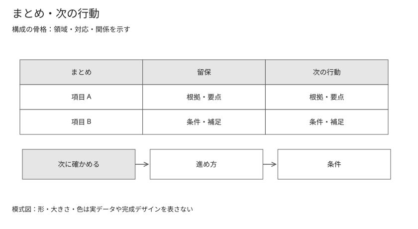

- 使いどころ: 資料の要点と次に扱う事項をまとめる
- 整理軸: 横＝まとめと次の行動、縦＝項目。論理上の整理軸。全てを数量軸として描くものではない。
- 配置: 上段に要点の表、下段に次の行動や追加で確かめる条件を置く
- 記号・情報の対応: 要点と次の行動を対応させ、必要なら時期や判断条件を示す
- 必要な情報: まとめと次の行動、項目、元情報との対応
- 注意: 未確定の行動・担当・時期は要確認とし、判断を求めない資料では次に確かめることを示す

### type-04-1: 個票カタログ

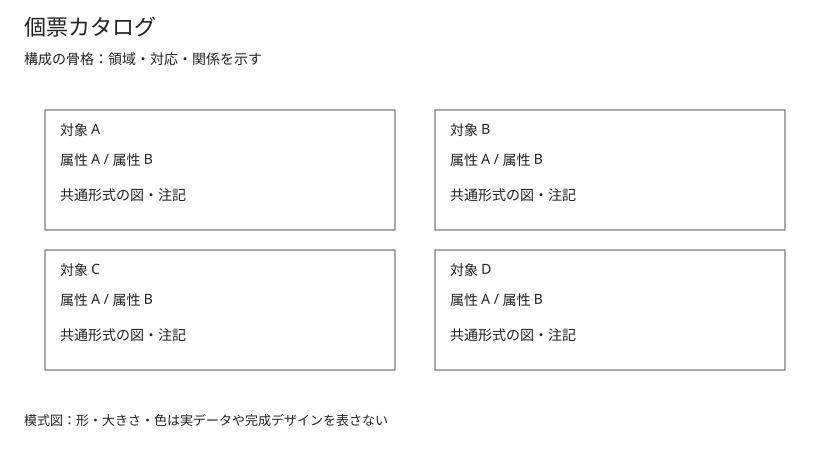

- 使いどころ: 同種対象の違いを同じ観点で比較する
- 整理軸: 横＝共通属性、縦＝対象。論理上の整理軸。全てを数量軸として描くものではない。
- 配置: 同一寸法の個票を2×2に置き、指標・小グラフ・注記を同位置に配置
- 記号・情報の対応: 同じスケールの棒、同じ順序の数値
- 必要な情報: 共通属性、対象、元情報との対応
- 注意: 対象ごとに項目や尺度を変えない

### type-05-1: KPIレーン付き時系列

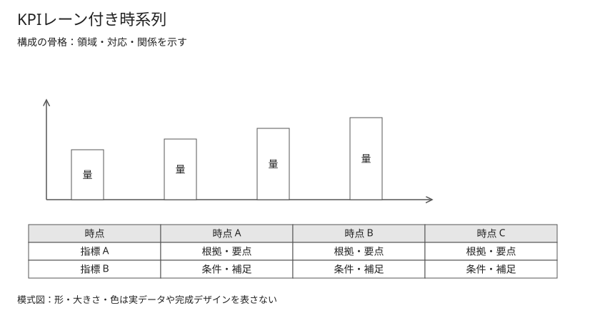

- 使いどころ: 主要推移と管理指標を同時に読む
- 整理軸: 横＝時間、縦＝主要指標と補助指標。論理上の整理軸。全てを数量軸として描くものではない。
- 配置: 上に棒と折れ線の時系列、下に同じ年列でKPI表を置く
- 記号・情報の対応: 実績の塗りと予測の線種、縦に通る年列
- 必要な情報: 時間、主要指標と補助指標、元情報との対応
- 注意: 上下の時間軸を合わせ、異なる単位を明示する

### type-06-1: バブル比較マップ

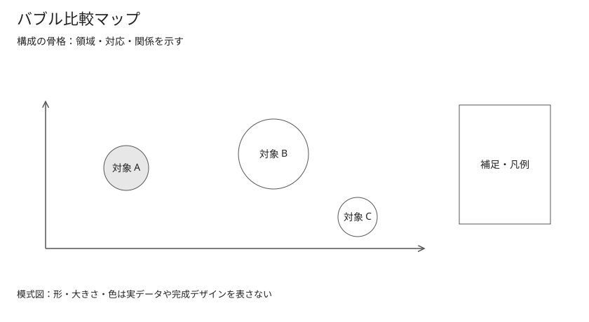

- 使いどころ: 二つの比較軸と規模から対象の特徴を把握する
- 整理軸: 横＝比較軸A、縦＝比較軸B。論理上の整理軸。全てを数量軸として描くものではない。
- 配置: 左にバブル散布、右に番号対応の施策解説パネル
- 記号・情報の対応: 横と縦は入力から選ぶ比較軸、円面積は量。塗り分けはカテゴリや状態
- 必要な情報: 比較軸A、比較軸B、元情報との対応
- 注意: 軸や円面積の意味を入力から定める。数量がない場合は分類図を選ぶ

## 分解する

### type-07-1: 滝分解

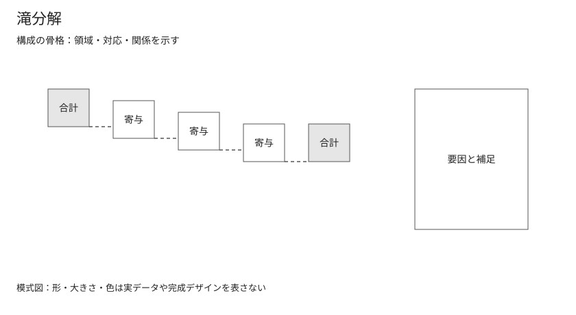

- 使いどころ: 合計の増減を要因に分ける
- 整理軸: 横＝寄与要因、縦＝同単位の量。論理上の整理軸。全てを数量軸として描くものではない。
- 配置: 左に起点から終点までの階段状の棒、右に要因と打ち手の表
- 記号・情報の対応: 合計は濃色、要因は階調、受け渡しは補助線
- 必要な情報: 寄与要因、同単位の量、元情報との対応
- 注意: 起終点の合計と寄与を照合する

### type-07-2: 滝分解（上下並列）

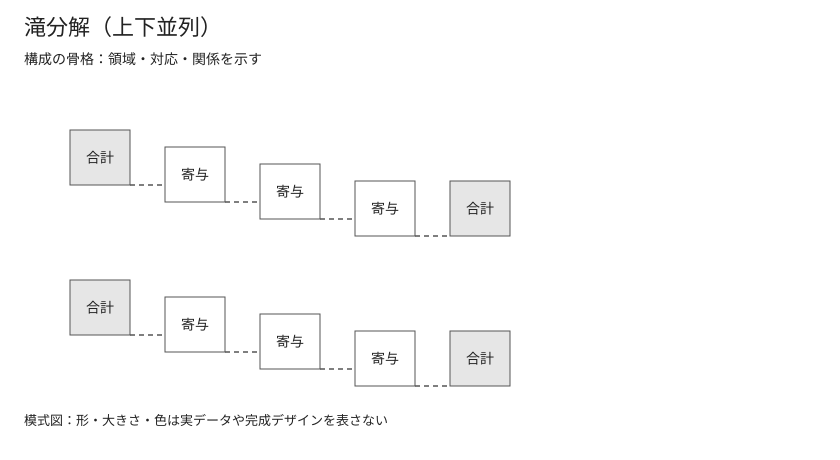

- 使いどころ: 二つの増減構造を同じ形式で対比する
- 整理軸: 横＝寄与要因、縦＝同単位の量。論理上の整理軸。全てを数量軸として描くものではない。
- 配置: 滝図を上下に置き、要因列の位置を合わせる
- 記号・情報の対応: 同じ色の役割と要因順序、各図に合計ラベル
- 必要な情報: 寄与要因、同単位の量、元情報との対応
- 注意: 異なる総額を比較する場合は尺度差を明示する

### type-08-1: ファネル

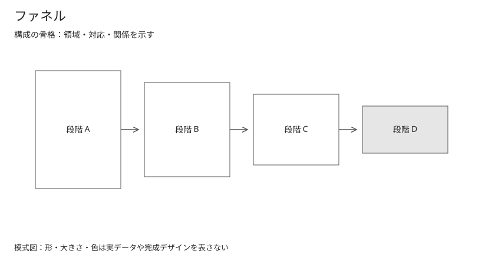

- 使いどころ: 工程ごとの歩留まりと最大離脱を示す
- 整理軸: 横＝段階、縦＝件数・量。論理上の整理軸。全てを数量軸として描くものではない。
- 配置: 工程を左から右へ並べ、段の大きさを件数に対応させ、離脱地点に注記を引く
- 記号・情報の対応: 段の件数と段間の歩留まり、細くなる連結
- 必要な情報: 段階、件数・量、元情報との対応
- 注意: この構造は横型。面積を任意にして減少率を誇張しない

### type-09-1: バリューチェーン収益図

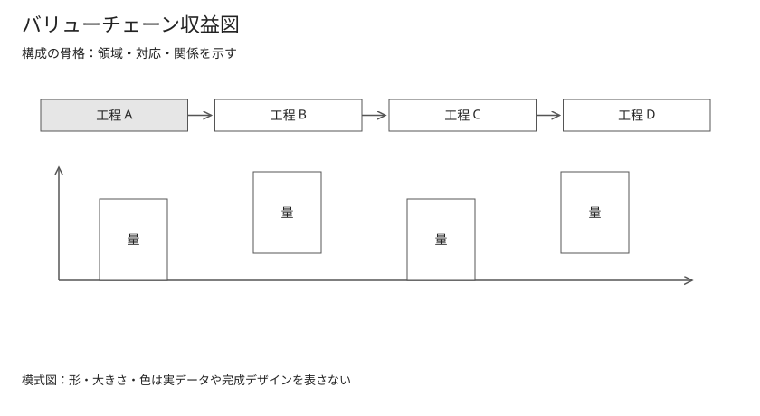

- 使いどころ: 工程別の売上・費用・利益の偏りを示す
- 整理軸: 横＝工程、縦＝量と効率。論理上の整理軸。全てを数量軸として描くものではない。
- 配置: 上に工程矢羽根、下に同じ工程位置の収益図を並べる
- 記号・情報の対応: 基準線の上下に正負の量、主役工程を強調で強調
- 必要な情報: 工程、量と効率、元情報との対応
- 注意: 工程と数値の横位置を対応させ、単位を揃える

### type-09-2: バリューチェーン収益図（三層版）

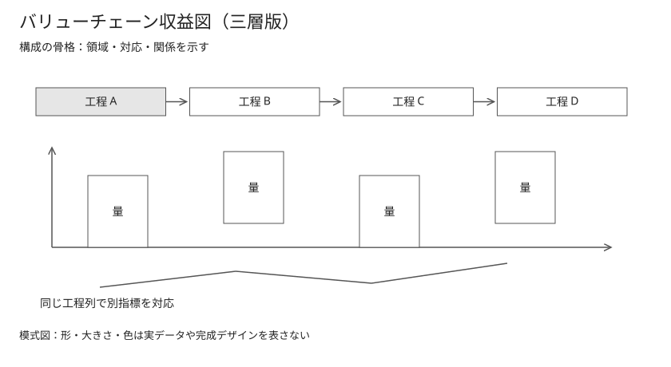

- 使いどころ: 工程と金額と効率を一度に対応させる
- 整理軸: 横＝工程、縦＝量と効率。論理上の整理軸。全てを数量軸として描くものではない。
- 配置: 上段に工程、中央に増減・金額図、下段に利益率などの折れ線
- 記号・情報の対応: 三段を同じ工程列で貫通させる
- 必要な情報: 工程、量と効率、元情報との対応
- 注意: 率と金額の軸を分け、三層を独立した図として説明する

### type-10-1: 分配カスケード

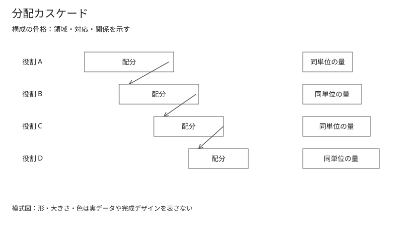

- 使いどころ: 取引段階の取り分と中心対象余地を示す
- 整理軸: 横＝取引・流れ、縦＝関係者。論理上の整理軸。全てを数量軸として描くものではない。
- 配置: 左に関係者・段階の行、中央に段階間の分配形、右に共通スケールの収支棒
- 記号・情報の対応: 中心対象の取り分は濃色、他者は淡色
- 必要な情報: 取引・流れ、関係者、元情報との対応
- 注意: 受取・支払・利益の定義を揃え、二重計上を避ける

### type-11-1: ロジックツリー

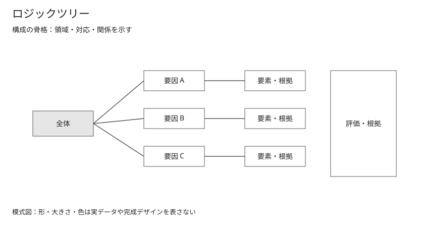

- 使いどころ: 成果を計算可能な要因と施策へ分ける
- 整理軸: 横＝要因の分解、縦＝計算上の階層。論理上の整理軸。全てを数量軸として描くものではない。
- 配置: 左の総指標から右へ枝分かれし、末端の施策の右に効果と期間の列
- 記号・情報の対応: 枝の四則演算、枠、同じ行の評価欄
- 必要な情報: 要因の分解、計算上の階層、元情報との対応
- 注意: 加算・乗算の関係を明示し、末端の重複を確認する

### type-12-1: 数式分解

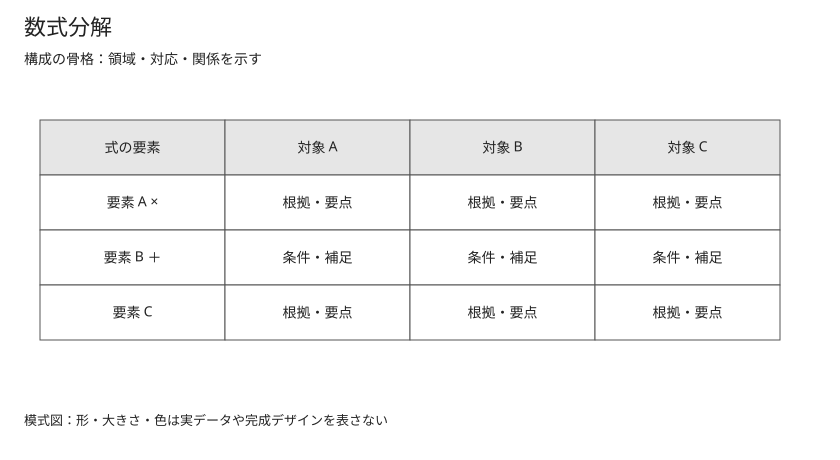

- 使いどころ: 同じ指標に効く数式要素を対象別に比較する
- 整理軸: 横＝対象、縦＝式の要素。論理上の整理軸。全てを数量軸として描くものではない。
- 配置: 対象を列、式の要素を行に置き、下段に全体の評価をまとめる
- 記号・情報の対応: 演算記号、要素ごとの状態と含意、主役列の強調
- 必要な情報: 対象、式の要素、元情報との対応
- 注意: 定性的な影響を未根拠の定量値に置き換えない

### type-13-1: 同単位の滞留分解

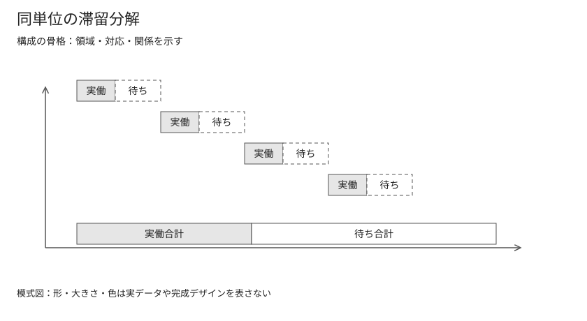

- 使いどころ: 総時間を実働と待ちに分ける
- 整理軸: 横＝経過時間、縦＝工程・状態。論理上の整理軸。全てを数量軸として描くものではない。
- 配置: 共通時間軸に工程別の帯を階段状に置き、下部に実働と待ちの合計帯
- 記号・情報の対応: 実働と待ちを異なる記号で区別、全て同じ時間単位
- 必要な情報: 経過時間、工程・状態、元情報との対応
- 注意: 経過時間と工数を混ぜず、並行工程の重複を考慮する

### type-46-1: 縦型イシューツリー

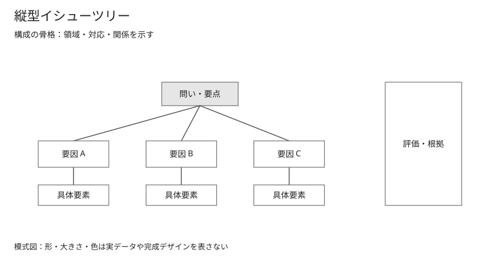

- 使いどころ: 問いから原因・仮説を下へ分解する
- 整理軸: 横＝問いの分解、縦＝階層。論理上の整理軸。全てを数量軸として描くものではない。
- 配置: 頂点の問いから下向きに分岐し、右側に検証の観点を置く
- 記号・情報の対応: 注目する経路を強調し、葉に具体的な要因を置く
- 必要な情報: 問いの分解、階層、元情報との対応
- 注意: 問いと原因を同じ階層で混在させず、重要経路の理由を示す

## 比べる

### type-14-1: 軸統一並列

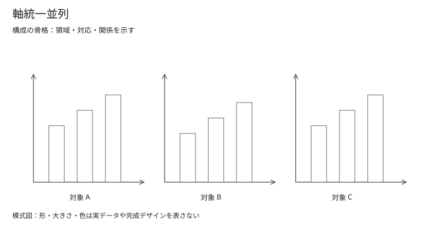

- 使いどころ: 対象間の水準と推移を公平に比較する
- 整理軸: 横＝対象と時点、縦＝共通指標。論理上の整理軸。全てを数量軸として描くものではない。
- 配置: 同じ軸を持つ小さな棒グラフを横並びに置く
- 記号・情報の対応: 軸の最小・最大・目盛を共通化、同じ年を同じ階調
- 必要な情報: 対象と時点、共通指標、元情報との対応
- 注意: 対象ごとに自動スケールを変えない

### type-15-1: 共通軸プロセス並列

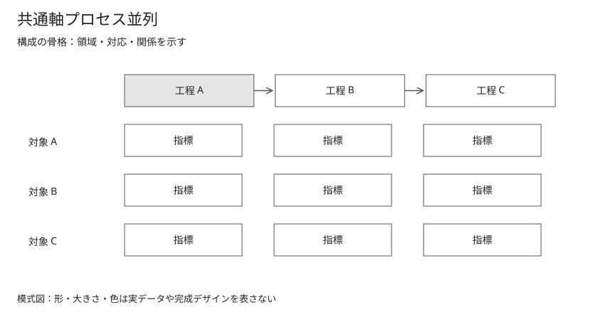

- 使いどころ: 複数対象の同工程の差を見る
- 整理軸: 横＝共通工程、縦＝対象。論理上の整理軸。全てを数量軸として描くものではない。
- 配置: 上に共通工程を一度だけ置き、対象を行にし工程列ごとに指標を配置
- 記号・情報の対応: 共通矢羽根と対応する横棒・数値
- 必要な情報: 共通工程、対象、元情報との対応
- 注意: 工程順と指標の分母を揃える

### type-16-1: 共通目盛の構造比較

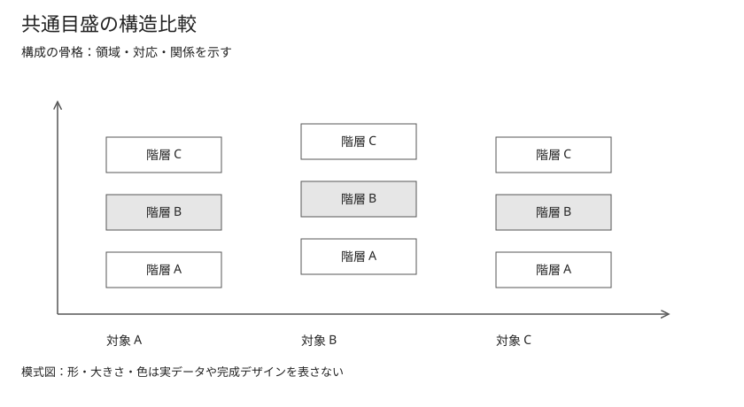

- 使いどころ: 等級や報酬の階層を比較する
- 整理軸: 横＝対象、縦＝共通の水準。論理上の整理軸。全てを数量軸として描くものではない。
- 配置: 対象を横に並べ、共通の縦目盛上に階層の箱を配置
- 記号・情報の対応: 箱の高さと位置で水準、色で注目範囲
- 必要な情報: 対象、共通の水準、元情報との対応
- 注意: 箱の位置が実数目盛か序列かを明示する

### type-17-1: 同型フロー対比

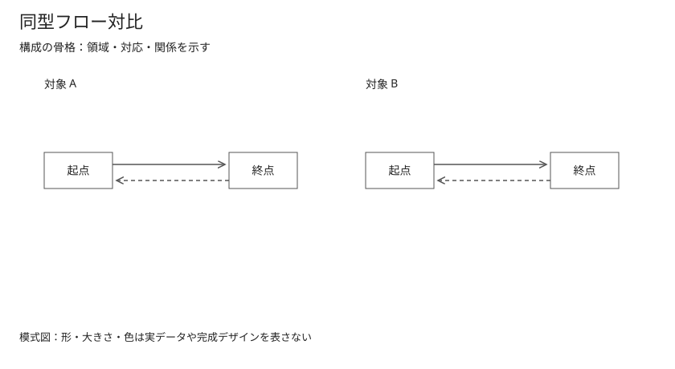

- 使いどころ: 二つの事業・制度の流れを比較する
- 整理軸: 横＝比較対象、縦＝対応する流れ。論理上の整理軸。全てを数量軸として描くものではない。
- 配置: 左右に同型の関係者箱と流れ、下に対応する評価帯
- 記号・情報の対応: モノは実線、金は破線、対応する箱は同位置
- 必要な情報: 比較対象、対応する流れ、元情報との対応
- 注意: 左右で流れの定義と向きを揃える

### type-18-1: 同型組織対比

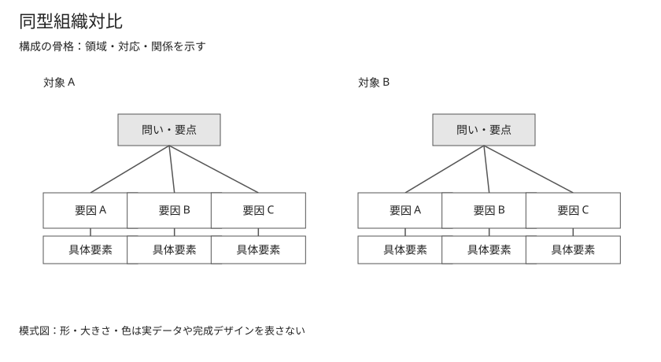

- 使いどころ: 組織の規模と働きかけ範囲を比較する
- 整理軸: 横＝比較対象、縦＝組織・役割の階層。論理上の整理軸。全てを数量軸として描くものではない。
- 配置: 左右に組織ツリーを置き、関与範囲を同じ役割位置で強調する
- 記号・情報の対応: 注目する組織箱と文脈の箱を区別、下に人数の要約
- 必要な情報: 比較対象、組織・役割の階層、元情報との対応
- 注意: 人数と箱の個数が異なる場合は明示する

### type-19-1: フォルム対比

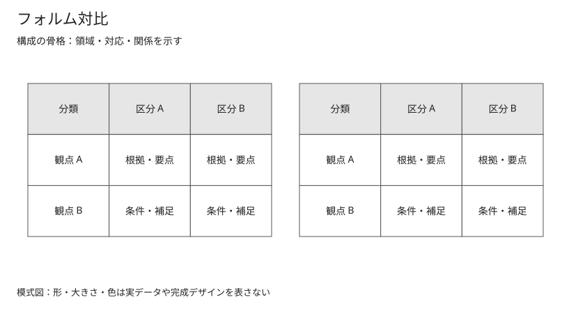

- 使いどころ: 二者の被覆や構成の形を比較する
- 整理軸: 横＝共通分類軸A、縦＝共通分類軸B。論理上の整理軸。全てを数量軸として描くものではない。
- 配置: 左右に共通カテゴリの格子を置き、セルの構成比を塗り分ける
- 記号・情報の対応: 同じ分類軸、濃淡、セル内の割合
- 必要な情報: 共通分類軸A、共通分類軸B、元情報との対応
- 注意: カテゴリと分母を揃え、図の形と量の関係を明示する

### type-19-2: フォルム対比（リスク評価マップ）

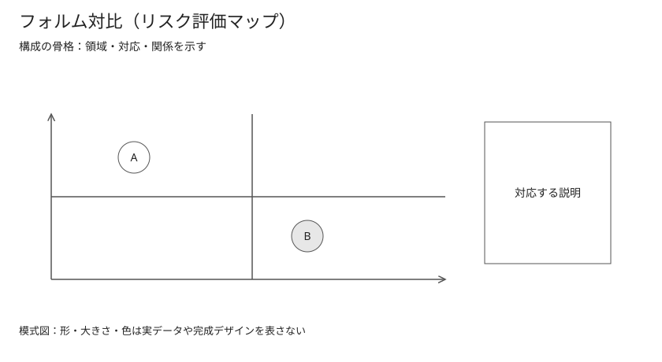

- 使いどころ: リスク分布と対応方針を対応させる
- 整理軸: 横＝共通分類軸A、縦＝共通分類軸B。論理上の整理軸。全てを数量軸として描くものではない。
- 配置: 左に影響度×発生可能性のマップ、右に番号対応の方針リスト
- 記号・情報の対応: カテゴリの印、区分境界、注目する対象の強調
- 必要な情報: 共通分類軸A、共通分類軸B、元情報との対応
- 注意: 評価尺度と順位の根拠を示し、確率を推測で補わない

### type-45-1: 論証テーブル

- 使いどころ: 対象別の事実から含意を導く
- 整理軸: 横＝対象・時期・条件、縦＝論点と根拠。論理上の整理軸。全てを数量軸として描くものではない。
- 配置: 対象を列、論点を行に置き、セルに事実と含意を記す
- 記号・情報の対応: 事実を■、含意・打ち手を矢印で区別する
- 必要な情報: 対象・時期・条件、論点と根拠、元情報との対応
- 注意: 意見を事実扱いせず、主張と証拠を対応させる

### type-45-2: 論証テーブル（時間展開形）

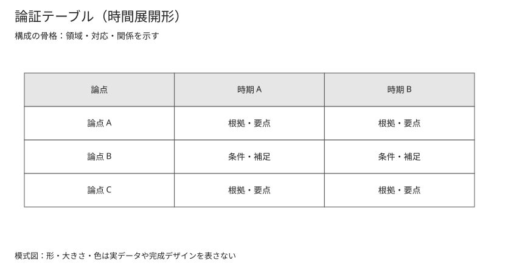

- 使いどころ: 時期別の施策と根拠を示す
- 整理軸: 横＝対象・時期・条件、縦＝論点と根拠。論理上の整理軸。全てを数量軸として描くものではない。
- 配置: 時間を列、論点や領域を行に置く表
- 記号・情報の対応: 列上のフェーズ矢羽根、各セルの事実と含意
- 必要な情報: 対象・時期・条件、論点と根拠、元情報との対応
- 注意: 時期境界と依存関係を明示する

### type-45-3: 論証テーブル（横並び形）

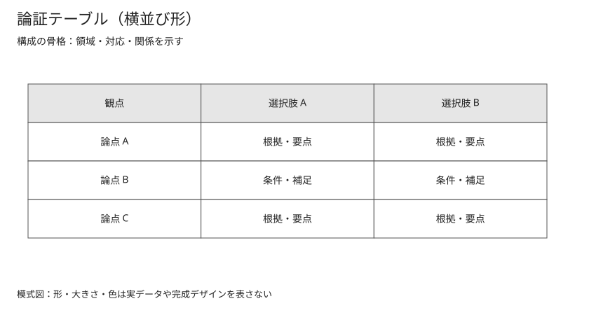

- 使いどころ: 選択肢を共通論点で比較する
- 整理軸: 横＝対象・時期・条件、縦＝論点と根拠。論理上の整理軸。全てを数量軸として描くものではない。
- 配置: 選択肢を列、判断観点を行にし、推奨列を枠で囲む
- 記号・情報の対応: 共通のセル構造、主役列の強調した枠
- 必要な情報: 対象・時期・条件、論点と根拠、元情報との対応
- 注意: 推奨に不利な根拠も同じ基準で載せる

### type-45-4: 論証テーブル（仮説検証形）

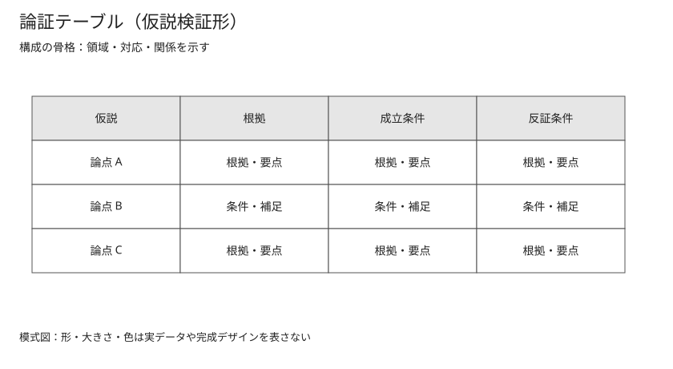

- 使いどころ: 仮説が条件によって変わる様子を示す
- 整理軸: 横＝対象・時期・条件、縦＝論点と根拠。論理上の整理軸。全てを数量軸として描くものではない。
- 配置: テーマ、現在の主張、根拠、成立・反証条件、示唆を列で対応させる
- 記号・情報の対応: 検証結果や変わる結論を強調で強調する
- 必要な情報: 対象・時期・条件、論点と根拠、元情報との対応
- 注意: 仮説・根拠・成立条件・反証条件を区別して並べる

## 変化を見せる

### type-20-1: 同位置Before/After

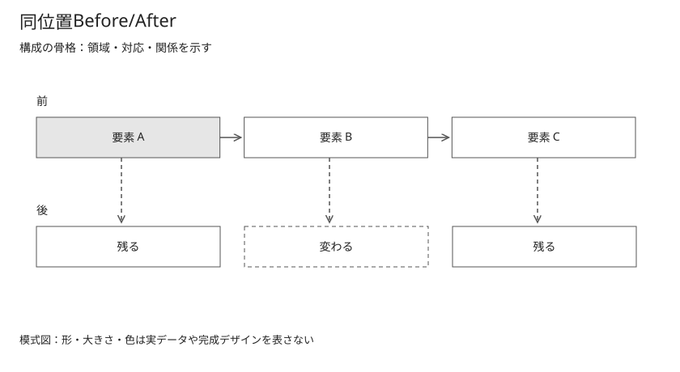

- 使いどころ: 変更後に消える工程と残る工程を示す
- 整理軸: 横＝対応する要素、縦＝前後の状態。論理上の整理軸。全てを数量軸として描くものではない。
- 配置: 変更前後の同じ工程列を上下に置き、下部に総時間の比較帯
- 記号・情報の対応: 削除箇所を同位置に残して破線、短縮分を棒で示す
- 必要な情報: 対応する要素、前後の状態、元情報との対応
- 注意: 削除後に箱を詰めて対応関係を崩さない

### type-21-1: 面積の組み替え

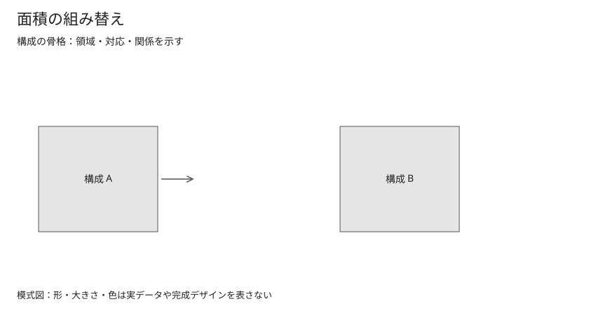

- 使いどころ: 全体の規模と構成の転換を示す
- 整理軸: 横＝構成要素・時点、縦＝量・質。論理上の整理軸。全てを数量軸として描くものではない。
- 配置: 左右に同じ基準の面積図を置き、中央に変換矢印を置く
- 記号・情報の対応: 幅と高さで二量、その積で総量、同じ対象は同じ記号
- 必要な情報: 構成要素・時点、量・質、元情報との対応
- 注意: 前後で縮尺を変えず、面積と実数の関係を明示する

### type-21-2: 面積の組み替え（残像版）

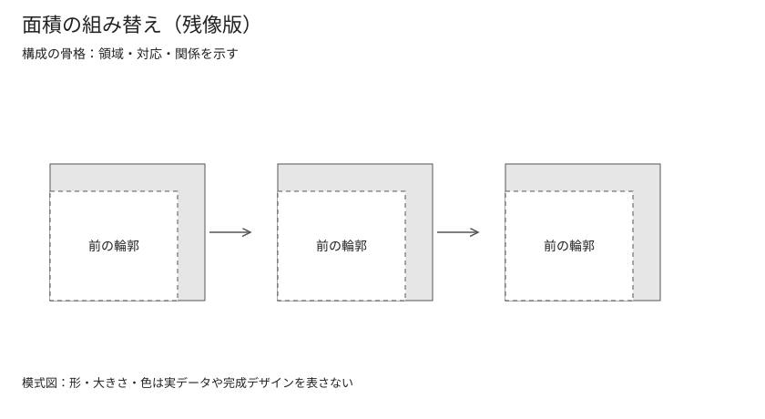

- 使いどころ: 段階的な拡大と前時点との差を示す
- 整理軸: 横＝構成要素・時点、縦＝量・質。論理上の整理軸。全てを数量軸として描くものではない。
- 配置: 三時点の面積図を横並びに置き、直前時点の輪郭を重ねる
- 記号・情報の対応: 点線の残像、時点間の矢印、増分注記
- 必要な情報: 構成要素・時点、量・質、元情報との対応
- 注意: 輪郭の比較は同じ尺度・基準位置で行う

### type-22-1: 前提の書き換え表

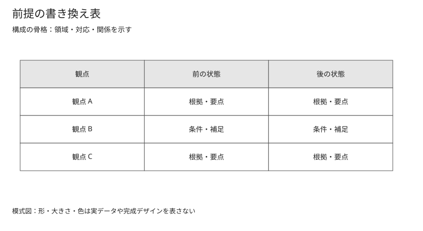

- 使いどころ: 従来の考え方から新方針への転換を示す
- 整理軸: 横＝前後の方針、縦＝共通観点。論理上の整理軸。全てを数量軸として描くものではない。
- 配置: 観点を行にし、左の従来と右の今後を矢印で結ぶ
- 記号・情報の対応: 前後の列と対応矢印。状態の違いはラベルまたは凡例で区別する
- 必要な情報: 前後の方針、共通観点、元情報との対応
- 注意: 同じ観点の言葉を対にし、実績と方針を区別する

## 関係と位置で見せる

### type-23-1: 面積図・構成比×効率

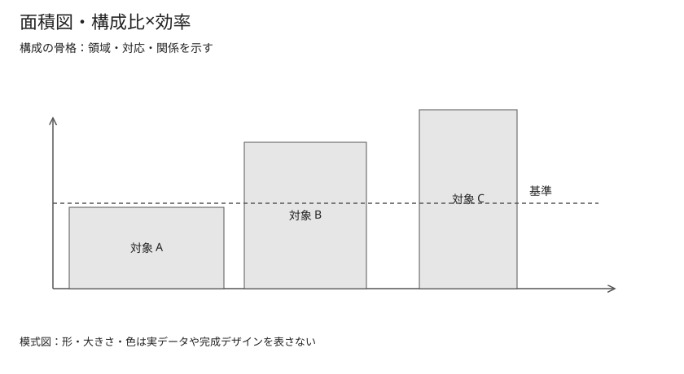

- 使いどころ: 規模と効率から重点領域を選ぶ
- 整理軸: 横＝量・構成比、縦＝効率・質。論理上の整理軸。全てを数量軸として描くものではない。
- 配置: 対象ごとに幅と高さの異なる矩形を共通基準線から並べる
- 記号・情報の対応: 幅は構成比、高さは効率、面積は成果、全体平均の水平線
- 必要な情報: 量・構成比、効率・質、元情報との対応
- 注意: 幅の和と構成比の分母を確認する

### type-24-1: 実数面積図

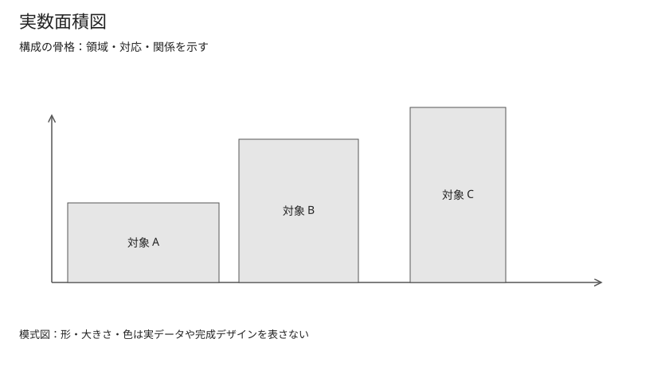

- 使いどころ: 多くの対象の量と質を一度に比較する
- 整理軸: 横＝実数量A、縦＝実数量B。論理上の整理軸。全てを数量軸として描くものではない。
- 配置: 共通底辺に幅・高さの異なる矩形を並べ、右に対象の説明を置く
- 記号・情報の対応: 両軸は実数、矩形の面積は積の値
- 必要な情報: 実数量A、実数量B、元情報との対応
- 注意: 幅だけで順位を読ませず、軸と単位を明示する

### type-24-2: 実数面積図（2枚並置）

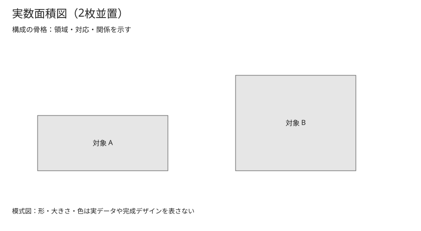

- 使いどころ: 二対象の量と質の違いを比較する
- 整理軸: 横＝実数量A、縦＝実数量B。論理上の整理軸。全てを数量軸として描くものではない。
- 配置: 左右に実数面積図を置き、差が出る幅と高さを補助線で示す
- 記号・情報の対応: 二図の共通尺度、差分寸法と数値
- 必要な情報: 実数量A、実数量B、元情報との対応
- 注意: 独立に正規化して面積差を失わない

### type-25-1: 軌跡散布

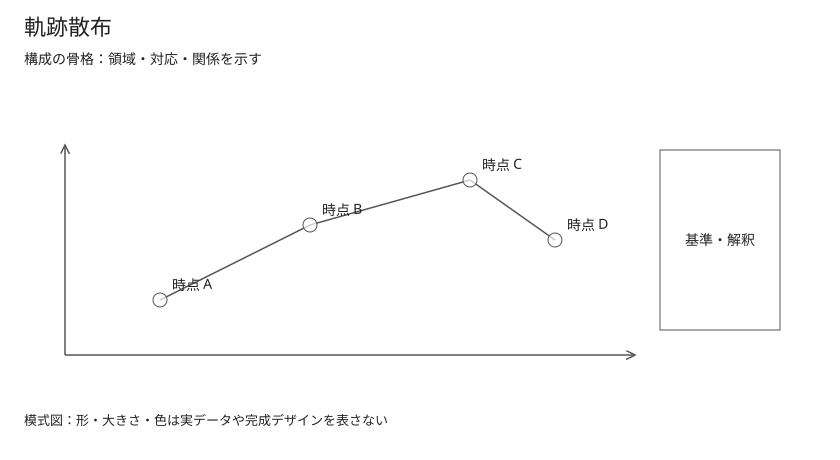

- 使いどころ: 二指標の時系列変化を追う
- 整理軸: 横＝指標A、縦＝指標Bと時点。論理上の整理軸。全てを数量軸として描くものではない。
- 配置: 散布図の年次点を順に結び、局面の近くに注記を置く
- 記号・情報の対応: 年ラベル、軌跡線、局面の囲み
- 必要な情報: 指標A、指標Bと時点、元情報との対応
- 注意: 点の順序を明示し、軌跡を因果の証明と扱わない

### type-25-2: 軌跡散布（頭打ち）

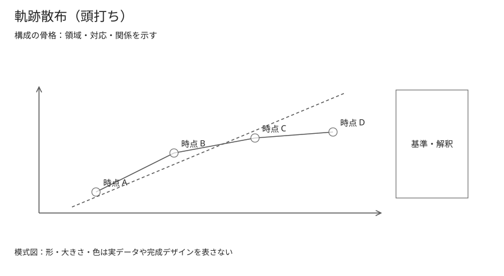

- 使いどころ: 投資などの増加に対する成果の鈍化を示す
- 整理軸: 横＝指標A、縦＝指標Bと時点。論理上の整理軸。全てを数量軸として描くものではない。
- 配置: 年次点の軌跡に初期の基準傾向を補助線で重ねる
- 記号・情報の対応: 後期の軌跡と基準線の乖離、局面への注記
- 必要な情報: 指標A、指標Bと時点、元情報との対応
- 注意: 外挿線の式・対象期間と推定前提を示す

### type-26-1: 循環散布

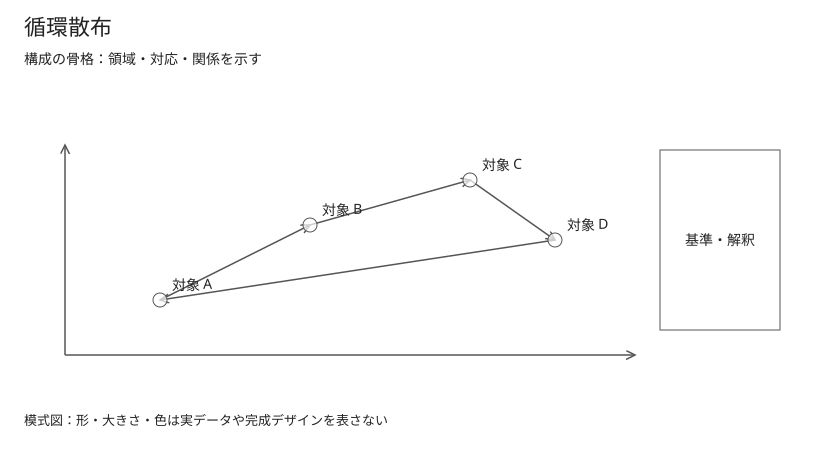

- 使いどころ: 順に関連する複数状態の循環を示す
- 整理軸: 横＝指標A、縦＝指標Bと順序。論理上の整理軸。全てを数量軸として描くものではない。
- 配置: 散布上の状態点を閉じた経路で結び、点の近くに説明を置く
- 記号・情報の対応: 矢印の方向、始点と状態名
- 必要な情報: 指標A、指標Bと順序、元情報との対応
- 注意: 循環の順序に根拠がある場合に使い、単なる相関と混同しない

### type-27-1: 基準線で意味づける散布

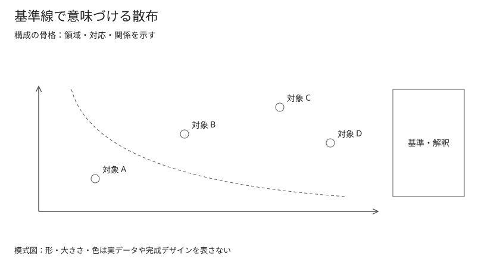

- 使いどころ: 同じ成果の境界に対して対象を評価する
- 整理軸: 横＝指標A、縦＝指標Bと基準条件。論理上の整理軸。全てを数量軸として描くものではない。
- 配置: 左に散布と等成果の曲線、右に重点施策の解説
- 記号・情報の対応: 基準曲線と重点点の主役色、直接ラベル
- 必要な情報: 指標A、指標Bと基準条件、元情報との対応
- 注意: 曲線は指標の数式から計算する

### type-28-1: 小マルチプル散布＋表

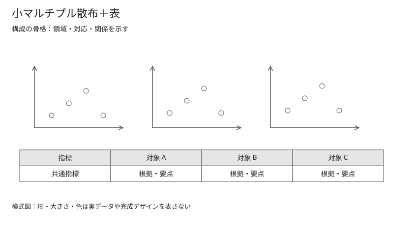

- 使いどころ: 分布の形と数値を対象別に比較する
- 整理軸: 横＝対象、縦＝共通指標の分布。論理上の整理軸。全てを数量軸として描くものではない。
- 配置: 上に共通軸の小散布を並べ、下に同じ列で数値表を置く
- 記号・情報の対応: 散布の軸統一、列位置の一致、重点列の強調
- 必要な情報: 対象、共通指標の分布、元情報との対応
- 注意: 小図ごとの目盛差で形を変えない

### type-29-1: 期間線分散布

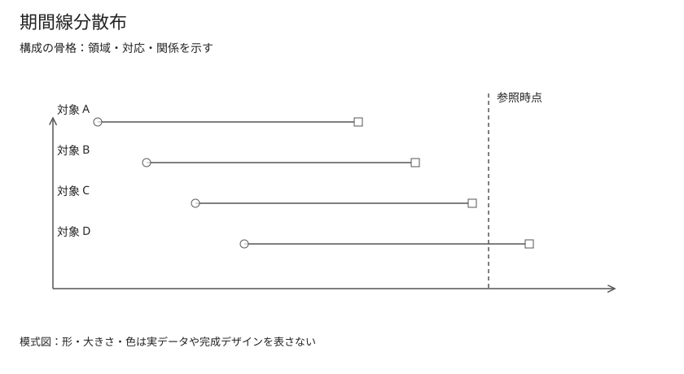

- 使いどころ: 開始・終了と継続期間を対象別に示す
- 整理軸: 横＝時間、縦＝対象。論理上の整理軸。全てを数量軸として描くものではない。
- 配置: 横に共通時系列、縦に対象を置き、期間を水平線分で示す
- 記号・情報の対応: 開始と終了のマーク、現在線、継続の線の延長
- 必要な情報: 時間、対象、元情報との対応
- 注意: この構造は期間を示す線分。現在線と予定終了を区別する

### type-30-1: 重なりのベン図

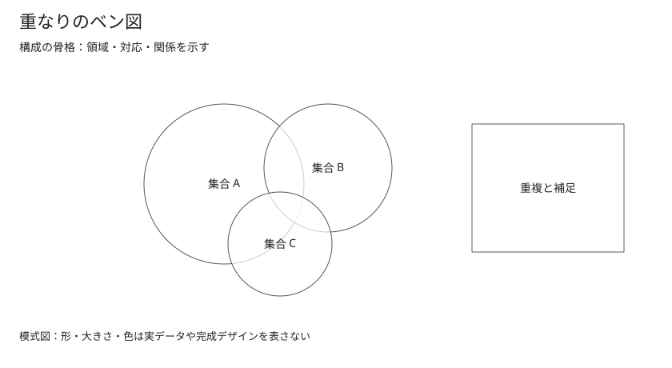

- 使いどころ: 集合の重複と統合機会を示す
- 整理軸: 横＝集合、縦＝重複関係。論理上の整理軸。全てを数量軸として描くものではない。
- 配置: 中央に重なる円と人数、右にキーナンバー、下に補足小図
- 記号・情報の対応: 交差部の数、中心の集約値、淡色の円
- 必要な情報: 集合、重複関係、元情報との対応
- 注意: 面積が近似なら明示し、集合の合計を二重計上しない

### type-31-1: 積み上げエリア

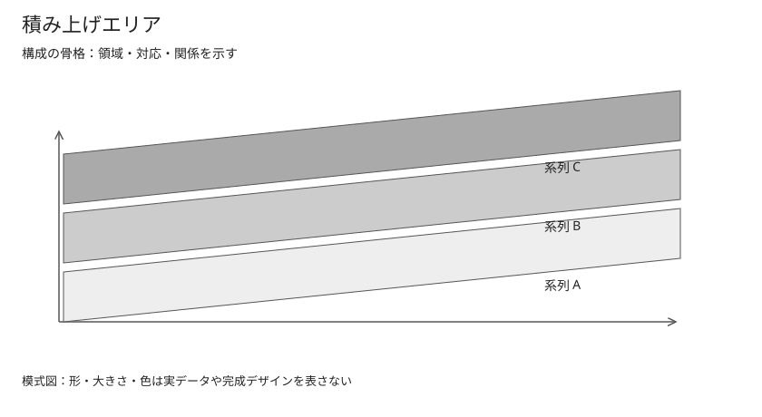

- 使いどころ: 総量と内訳の時間変化を示す
- 整理軸: 横＝時間、縦＝量と内訳。論理上の整理軸。全てを数量軸として描くものではない。
- 配置: 時系列に沿って系列を積み上げ、右端に系列名を直接書く
- 記号・情報の対応: 階調の層、実績と予測の境界、合計ラベル
- 必要な情報: 時間、量と内訳、元情報との対応
- 注意: 系列順を固定し、下層の変化で上層が誤読されないようにする

### type-32-1: 2×2と判断ロジック

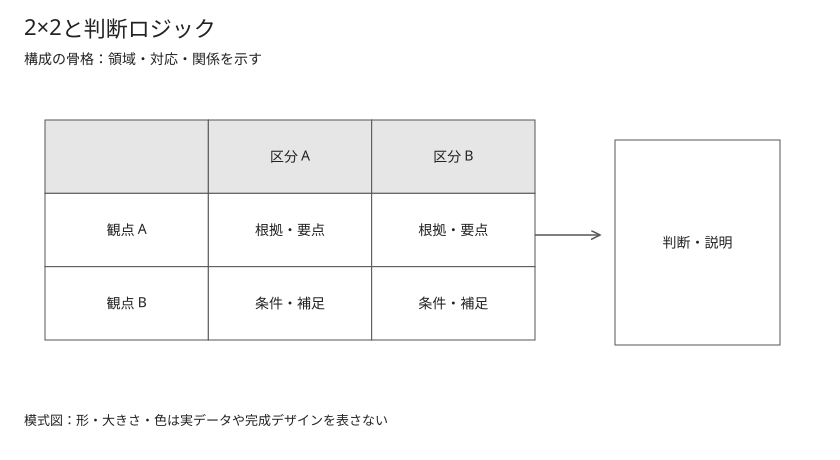

- 使いどころ: 二軸で対象を分け対応方針を説明する
- 整理軸: 横＝分類軸A、縦＝分類軸B。論理上の整理軸。全てを数量軸として描くものではない。
- 配置: 左に2×2の散布マトリクス、右に方針の説明を置く
- 記号・情報の対応: 重点象限の枠、象限から方針への対応線
- 必要な情報: 分類軸A、分類軸B、元情報との対応
- 注意: 判断に効く軸を選び、閾値の根拠を示す

### type-33-1: ライフサイクル対応

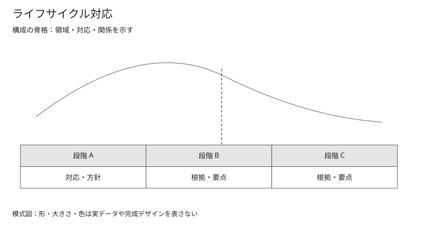

- 使いどころ: 成熟度に応じて施策を切り替える
- 整理軸: 横＝段階、縦＝状態と対応方針。論理上の整理軸。全てを数量軸として描くものではない。
- 配置: 上に段階カーブ、下に同じ段階列で方針表を置く
- 記号・情報の対応: 現在地の垂線、主役段階の強調
- 必要な情報: 段階、状態と対応方針、元情報との対応
- 注意: 概念曲線を実測値と扱わず、段階判定の根拠を示す

### type-34-1: 襷がけ補完

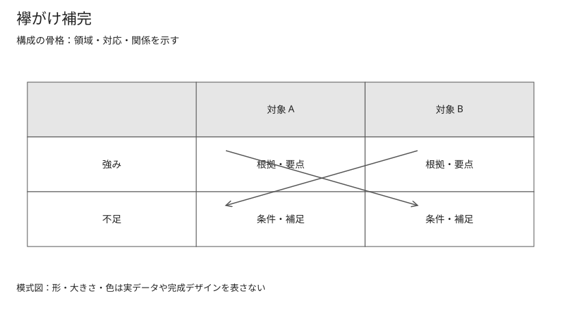

- 使いどころ: 二者の強みで相手の課題を補う
- 整理軸: 横＝対象、縦＝強みと不足。論理上の整理軸。全てを数量軸として描くものではない。
- 配置: 二者を列、強みと課題を行にする2×2を置く
- 記号・情報の対応: 対角に結ぶ交差矢印、中央に補完の効果
- 必要な情報: 対象、強みと不足、元情報との対応
- 注意: 一方向の依存と相互補完を区別する

## 時間と工程で見せる

### type-35-1: 期別スイムレーン

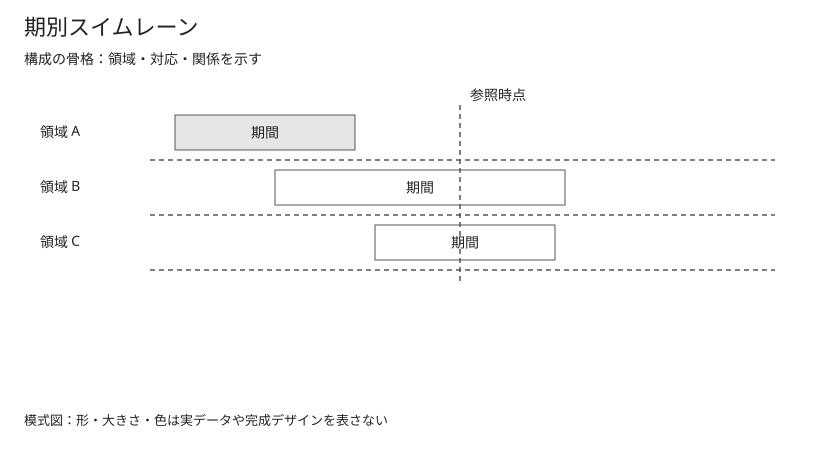

- 使いどころ: 効果の出る時期ごとに施策を並べる
- 整理軸: 横＝時間、縦＝効果時期・区分。論理上の整理軸。全てを数量軸として描くものではない。
- 配置: 短期・中期・長期を縦レーン、横を共通時間軸にする
- 記号・情報の対応: 期間バー、レーン見出しの効果合計、現在線
- 必要な情報: 時間、効果時期・区分、元情報との対応
- 注意: 期間の重なりと依存を示し、単純に効果を重複加算しない

### type-36-1: モジュール工程

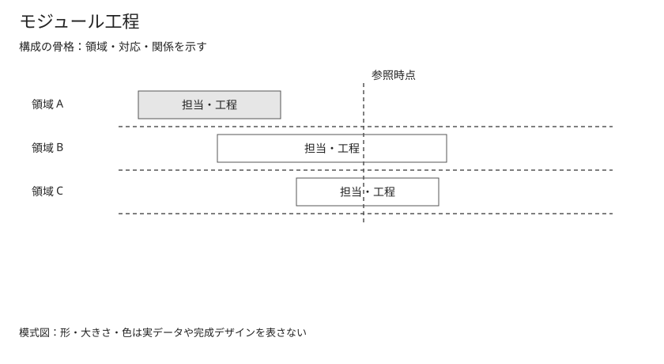

- 使いどころ: 担当・効果を持つ実行ブロックを配置する
- 整理軸: 横＝時間、縦＝領域・担当。論理上の整理軸。全てを数量軸として描くものではない。
- 配置: 領域別レーンと時間軸の上に連結するモジュールを置く
- 記号・情報の対応: ブロック内の担当・効果、期間に比例する横幅
- 必要な情報: 時間、領域・担当、元情報との対応
- 注意: ブロックの隙間を任意にして日程を誤読させない

### type-37-1: フェーズガント

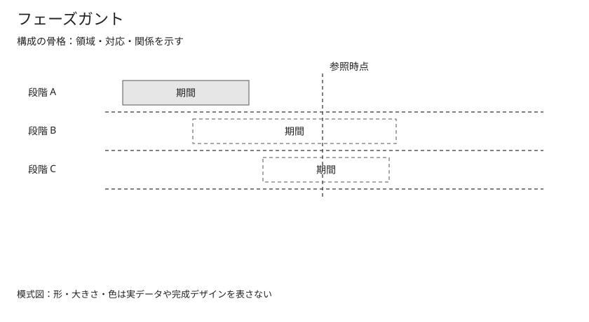

- 使いどころ: 段階的な実行と依存関係を示す
- 整理軸: 横＝時間、縦＝段階。論理上の整理軸。全てを数量軸として描くものではない。
- 配置: フェーズを行、時間を列にし、工程を階段状に配置する
- 記号・情報の対応: 完了は塗り、計画は枠、現在線と依存線
- 必要な情報: 時間、段階、元情報との対応
- 注意: 時制と担当の色の意味を混在させない

### type-38-1: 二段工程

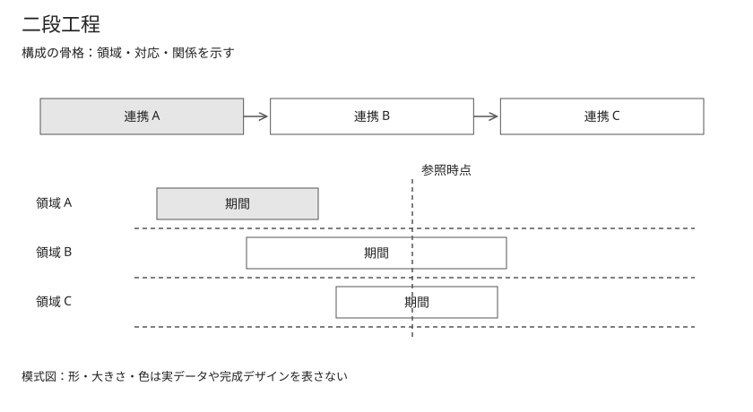

- 使いどころ: 連携構造と詳細日程を同時に読む
- 整理軸: 横＝共通時間、縦＝連携と詳細工程。論理上の整理軸。全てを数量軸として描くものではない。
- 配置: 上段にストリーム連携、下段に対応するガントを置く
- 記号・情報の対応: 上下の共通時間軸、工程名の対応、接続線
- 必要な情報: 共通時間、連携と詳細工程、元情報との対応
- 注意: 上段と下段の期間が矛盾しないようにする

### type-39-1: 会議体連携

- 使いどころ: 審議・承認の受け渡しと手戻りを示す
- 整理軸: 横＝審議・受渡し段階、縦＝役割・会議体。論理上の整理軸。全てを数量軸として描くものではない。
- 配置: 会議体を縦レーン、審議段階を横にし、会議箱を接続する
- 記号・情報の対応: 矢印に渡す文書、戻りの線と所要週数
- 必要な情報: 審議・受渡し段階、役割・会議体、元情報との対応
- 注意: 会議の開催頻度と日程上の依存を確認する

### type-40-1: 金モノ交差

- 使いどころ: 取引の物流と資金のタイミングを示す
- 整理軸: 横＝工程・取引、縦＝異なる流れ。論理上の整理軸。全てを数量軸として描くものではない。
- 配置: 上にモノの流れ、下に金額・支払条件を同じ工程列で置く
- 記号・情報の対応: モノの実線、金の破線、取引金額と支払サイト
- 必要な情報: 工程・取引、異なる流れ、元情報との対応
- 注意: モノの移動と所有権・支払時点を区別する

### type-47-1: 業務フロー図

- 使いどころ: 役割別の処理・判断・例外を可視化する
- 整理軸: 横＝工程・判断、縦＝役割。論理上の整理軸。全てを数量軸として描くものではない。
- 配置: 役割レーン内に処理箱、ひし形、ループを配置する
- 記号・情報の対応: 通常フローと例外の点線、発生率と追加日数
- 必要な情報: 工程・判断、役割、元情報との対応
- 注意: 分岐条件と戻り先を明示し、未知の率を補わない

## 構造を地図化する

### type-41-1: レイヤーマップ

- 使いどころ: 層と系列の被覆と空白を見る
- 整理軸: 横＝系列、縦＝層。論理上の整理軸。全てを数量軸として描くものではない。
- 配置: 縦に層、横に系列の格子を作り、プレイヤーの箱を配置する
- 記号・情報の対応: 中心対象の被覆を濃色、範囲をブラケットや集約帯
- 必要な情報: 系列、層、元情報との対応
- 注意: 層ごとに異なる分類軸を混ぜない

### type-42-1: バリューチェーン地図

- 使いどころ: 工程に対する成功要因と担当の被覆を示す
- 整理軸: 横＝工程、縦＝要因と担当範囲。論理上の整理軸。全てを数量軸として描くものではない。
- 配置: 上に工程、中に成功要因、下にプレイヤーの範囲帯を置く
- 記号・情報の対応: 同じ工程列、被覆帯、空白領域
- 必要な情報: 工程、要因と担当範囲、元情報との対応
- 注意: 空白が不足を意味するか対象外かを確認する

### type-43-1: 組織マッピング

- 使いどころ: 組織を類型に対応させて選択を考える
- 整理軸: 横＝組織・類型、縦＝階層と比較観点。論理上の整理軸。全てを数量軸として描くものではない。
- 配置: 上に組織ツリーと番号、右に類型凡例、下に比較表を置く
- 記号・情報の対応: 番号バッジと類型、表の対応列
- 必要な情報: 組織・類型、階層と比較観点、元情報との対応
- 注意: 組織の上下関係と類型の関係を区別する

### type-44-1: 全体と拡大

- 使いどころ: 全体に対する重点部分の内訳を示す
- 整理軸: 横＝全体と選択部分、縦＝対応する内訳。論理上の整理軸。全てを数量軸として描くものではない。
- 配置: 左に全体の内訳、右に選んだ部分の拡大図を置く
- 記号・情報の対応: 選択領域の強調、拡大先への引き出し、別スケール
- 必要な情報: 全体と選択部分、対応する内訳、元情報との対応
- 注意: 右の拡大尺度を明示し、同尺度に見せない

### type-48-1: 関係者相関マップ

- 使いどころ: 主役と関係者の交換関係を俯瞰する
- 整理軸: 横＝関係者の配置、縦＝交換・依存関係。論理上の整理軸。全てを数量軸として描くものではない。
- 配置: 中央に主役、周囲に関係者を置き、関係を放射状に接続する
- 記号・情報の対応: モノは実線、金は破線、データは点線、矢印に内容
- 必要な情報: 関係者の配置、交換・依存関係、元情報との対応
- 注意: 線の交差を整理し、矢印の方向と関係の意味を確認する

## 全型に効く原則

### principle-1: 共通項のくくり出し

- 使いどころ: 共通条件をまとめ選択肢の差を見せる
- 整理軸: 横＝対象と条件、縦＝共通事項と差分。論理上の整理軸。全てを数量軸として描くものではない。
- 配置: 選択肢を列、評価観点を行にし、共通する行を横断セルにまとめる
- 記号・情報の対応: 差分だけを各列に残し、共通事項を一度だけ書く
- 必要な情報: 対象と条件、共通事項と差分、元情報との対応
- 注意: 共通化しても例外や条件差を失わない

### principle-2: 重なりの作法

- 使いどころ: 期間ブロックの重なりを読みやすくする
- 整理軸: 横＝対象と条件、縦＝共通事項と差分。論理上の整理軸。全てを数量軸として描くものではない。
- 配置: レーン内の重なったブロックを同じ方向と角度でずらす
- 記号・情報の対応: 統一したずらし、接続と箱の前後関係
- 必要な情報: 対象と条件、共通事項と差分、元情報との対応
- 注意: 位置を崩す場合も時間軸と対応は保ち、恣意的な角度を混ぜない

