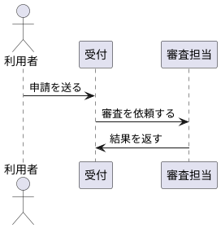

# 可視化とASCII図

既存図や画像へ説明を付ける場合は[注釈モード](visual-annotation.md)を使う。原図の配置や色を変えず、別レイヤーで番号・引出線・説明を加える。以下のカタログ照合は新規図解、または図外の説明パネルの構成に適用する。

Markdownを説明の中心に据え、理解を助ける図を補足する。図を作成・変更・確認するときに読む。ここにある図は表現方法の例であり、案件の事実や仕様ではない。

## カタログ照合と制作

図解候補の選択は[カタログ照合手順](catalog-selection.md)を必ず適用する。Markdownは説明の中心とし、比較・対応・分岐・全体と詳細などがある入力には補足図を組み合わせる。ASCIIは小さな単一関係の説明または配置検討のラフに使う。カタログの配置を採用した構造・配置図は、編集可能なDraw.ioファイルを制作する。

## 複雑な情報の見せ方

複数の関係や階層、条件・例外、時間と役割などが組み合わさり、文章だけでは読者が関係を組み立てる必要がある場合は、可能な限り可視化する。軽度の複雑さでも、全体像や対応関係が一目で理解できる補足図を検討し、図を省く場合は候補比較に理由を残す。

既存のスライド表現カタログから、比較対象の位置・尺度を揃える、関係を近接配置する、役割別のレーンを置く、全体と詳細を分ける、といった方法を参考にする。Markdownの補足図にも適用でき、HTMLスライドを作ることを前提にしない。適合しない場合はカタログ外の構造・複合表現を選ぶ。

シーケンス図はPlantUMLを採用する。構造・配置図は編集可能なDraw.ioを基本とする。UMLの状態・活動・クラス図など、関係を記法で定義する図もPlantUMLを候補とする。ユーザーが別の図ツールを指定した場合は従う。小さな階層・静的構造・処理順は、Markdownのfenced `text`にASCII文字やUnicode罫線を使った図を置ける。線の交差、多数の分岐・例外、広い横幅、繰り返しが必要なら図ツールへ切り替える。やり取りの順序はPlantUML、構造・配置はDraw.ioを選ぶ。大きなマトリクスの全量はTSV／CSVに保存し、図には重要な関係や領域の概要を示す。

## 共通規則

Draw.io図のテーマ・色・形・線は[テーマ規則](diagram-themes.md)を適用する。情報構造と図の型を決めた後に選び、テーマ変更で意味を変えない。

- 図の直前に、何を理解するための図かを一文で示す。
- ノードは対象・責務・状態の明確な単位とする。線は向きと関係名を示す。包含・参照・依存・変換を区別する。
- 元情報と条件・例外を照合し、色・形・座標だけで意味を定義しない。省略は`...`または本文で明示する。
- 一つの図に定義、実体、処理順、履歴を詰め込まず、全体図と詳細図に分ける。
- 日本語の左右二列の桁揃えに意味を持たせない。関係や階層は線・ラベルで示し、横幅はおおむね120桁以内に収める。
- 図は整理済み情報の表現とし、重要な関係は本文・表・整理データでも確認できるようにする。

## ASCII図の8つの型

近い型を起点に、対象名・関係名・向き・条件を実入力に合わせる。

### A. 構成要素と接続

```text
[受付] --依頼を送る--> [審査]
```

### B. 層と境界

```text
[表示層]
├─ 一覧画面
└─ 詳細画面
   │ 業務操作を依頼する
   ▼
[業務層]
└─ 申請管理
```

層の境界と層間の利用関係を分ける。

### C. 包含・親子

```text
装置（物理構成）
├─ 制御基板
└─ 電源
```

参照や依存関係を包含の枝で表さない。

### D. 処理順と変換

```text
[原文] --抽出--> [情報単位] --整理--> [整理結果]
```

論理順序と実時間は別に扱う。分岐・合流が増えたら図ツールへ切り替える。

### E. 定義と実体

```text
[申請の型] --具体化--> [申請A]
```

型の定義と個別実体の抽象度を区別する。

### F. 正本と派生・表示

```text
[整理データ]
├─ 要約する --> [Markdown説明]
└─ 図示する --> [Draw.io図]
```

独立した情報への参照を派生と呼ばない。

### G. やり取りの順序

```text
1. 利用者 → 受付: 申請を送る
2. 受付 → 審査担当: 審査を依頼する
3. 審査担当 → 受付: 結果を返す
```

このASCIIの列挙は順序を確かめるためのラフとする。シーケンス図として提出する場合は、参加者数や例外の有無にかかわらずPlantUMLを使う。

同じラフを図にする例:



条件分岐、繰り返し、並行処理は入力に存在する場合だけ追加する。メッセージの順序を、入力にない実時間や処理時間へ置き換えない。

### H. レコード・データ構成

```text
申請レコード
├─ 申請ID
├─ 申請者
└─ 状態
```

データの項目構成を示す。配置そのものに意味がない場合は、ビット配置のような箱図にしない。

## 確認と提出

Draw.ioは[配置とコネクター検査](drawio-layout-check.md)を適用する。線・矢印・ラベルと図形間の余白を表示で点検し、問題を修正して再表示する。検査はproduction.mdに従い、今回作成したファイルを対象とする。output内での検査も可能である。

図の目的、関係の名前・方向・条件、全体図と詳細図の対応、元情報IDを確認する。Markdownに図の説明とファイルへのリンクを置き、PlantUMLソース・Draw.io図・必要なプレビュー・TSV／CSV・整理根拠を同じ実行フォルダへ保存する。表示確認の方法はproduction.mdに従う。
