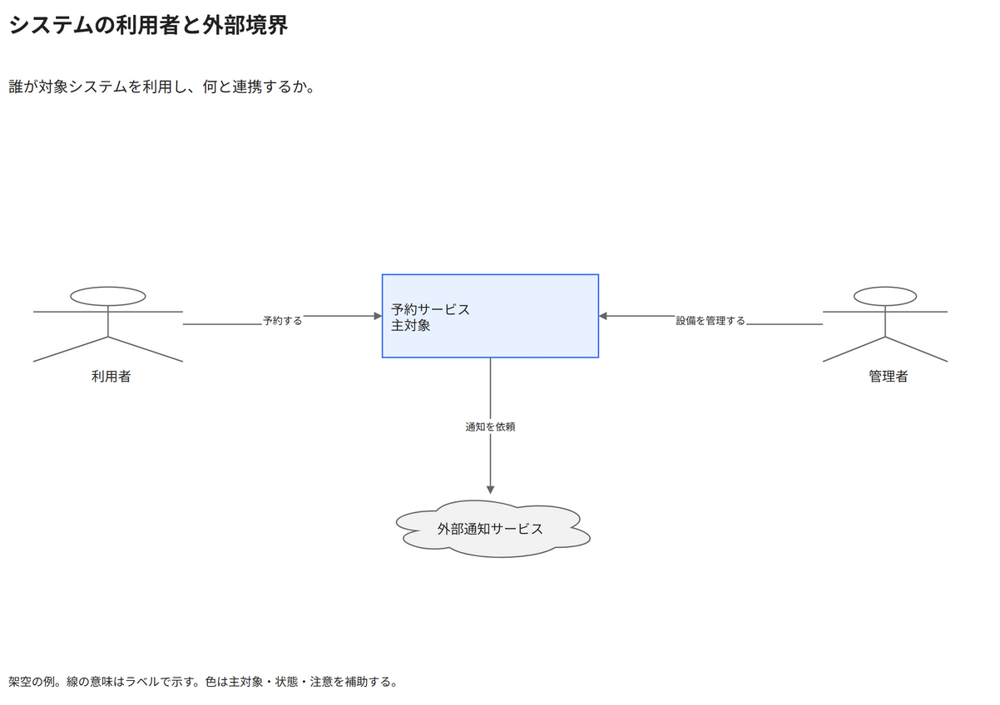

# システムの利用者と外部境界

誰が対象システムを利用し、何と連携するか。

[Draw.io](example.drawio) · [SVG](preview.svg) · [情報と採否](metadata.yaml) · [IR](diagram-ir.json)

採用条件: 誰が対象システムを利用し、何と連携するかを説明したい場合。

不向きな条件: 入力に示されていない条件・順序・数量を補う場合。

参照: SRC-010, SRC-045（[URL一覧](../../sources/urls.md)）。関係の種類と粒度を抽出し、固有データと具体的配置をコピーせず架空の予約サービスへ適応した。

図形・表・所属・接続・ラベルをDraw.ioで編集できる。

点検記録: 利用者の名称を図形の下へ移し、外部通知を中央寄せへ修正。三つの経路と主対象を個別PNGで確認。
