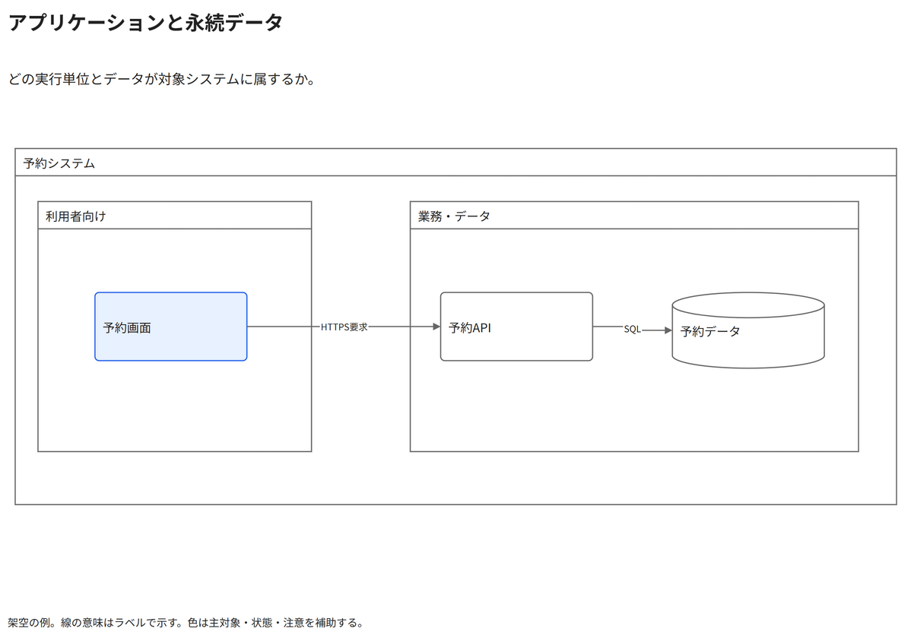

# アプリケーションと永続データ

どの実行単位とデータが対象システムに属するか。

[Draw.io](example.drawio) · [SVG](preview.svg) · [情報と採否](metadata.yaml) · [IR](diagram-ir.json)

採用条件: どの実行単位とデータが対象システムに属するかを説明したい場合。

不向きな条件: 入力に示されていない条件・順序・数量を補う場合。

参照: SRC-010（[URL一覧](../../sources/urls.md)）。関係の種類と粒度を抽出し、固有データと具体的配置をコピーせず架空の予約サービスへ適応した。

図形・表・所属・接続・ラベルをDraw.ioで編集できる。

点検記録: 外側と内側の所属境界、画面からAPIとDBへの接続、境界の見出しと線ラベルの余白をPNGで確認。
