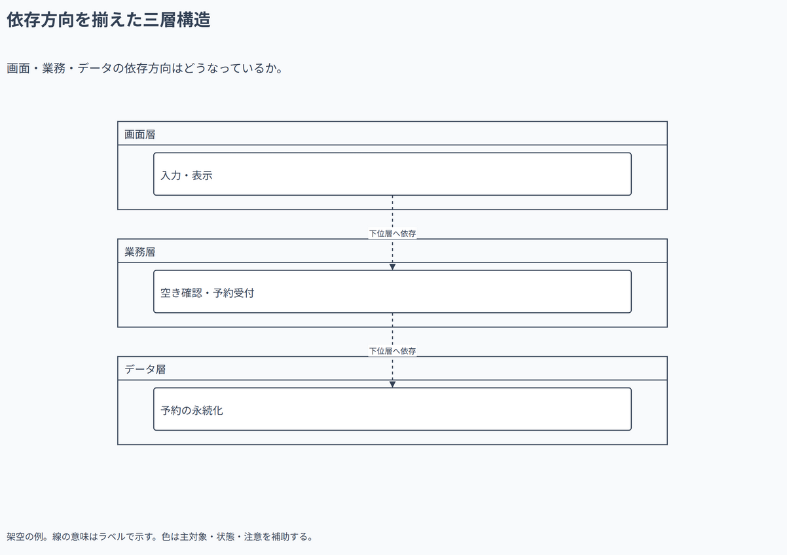

# 依存方向を揃えた三層構造

画面・業務・データの依存方向はどうなっているか。

[Draw.io](example.drawio) · [SVG](preview.svg) · [情報と採否](metadata.yaml) · [IR](diagram-ir.json)

採用条件: 画面・業務・データの依存方向はどうなっているかを説明したい場合。

不向きな条件: 入力に示されていない条件・順序・数量を補う場合。

参照: SRC-011（[URL一覧](../../sources/urls.md)）。関係の種類と粒度を抽出し、固有データと具体的配置をコピーせず架空の予約サービスへ適応した。

図形・表・所属・接続・ラベルをDraw.ioで編集できる。

点検記録: 三層の縦方向と依存の破線を確認。境界横断は所属先への接続であり、本文を隠す線交差はない。
