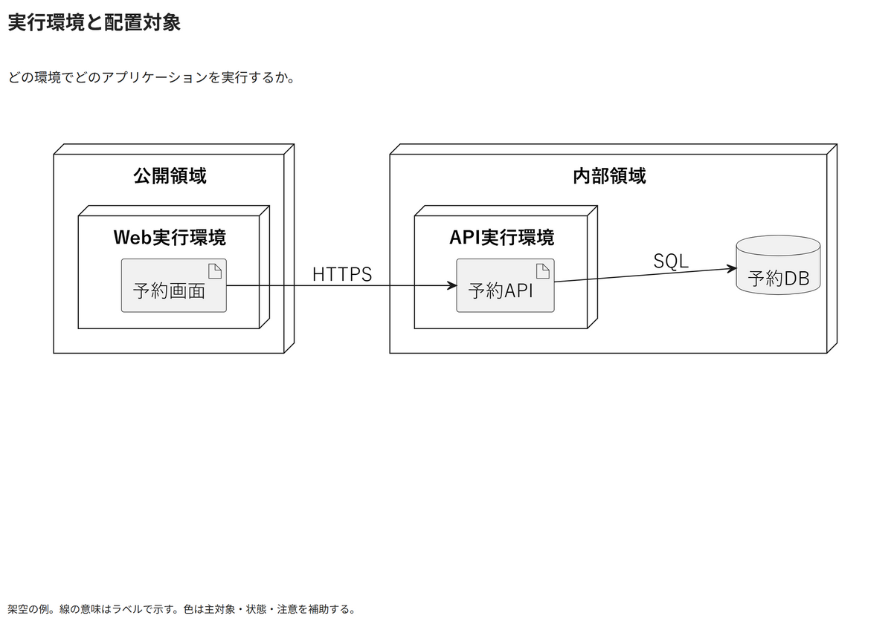

# 実行環境と配置対象

どの環境でどのアプリケーションを実行するか。

[Draw.io](example.drawio) · [SVG](preview.svg) · [情報と採否](metadata.yaml) · [IR](diagram-ir.json)

採用条件: どの環境でどのアプリケーションを実行するかを説明したい場合。

不向きな条件: 入力に示されていない条件・順序・数量を補う場合。

参照: SRC-011（[URL一覧](../../sources/urls.md)）。関係の種類と粒度を抽出し、固有データと具体的配置をコピーせず架空の予約サービスへ適応した。

PlantUML正本を保持。内部SVGは単一オブジェクト。

点検記録: 縦配置ではHTTPS線がAPI環境の見出しを横切ったため、横配置へ変更。再描画PNGで文字との重なり解消と所属境界を確認。
