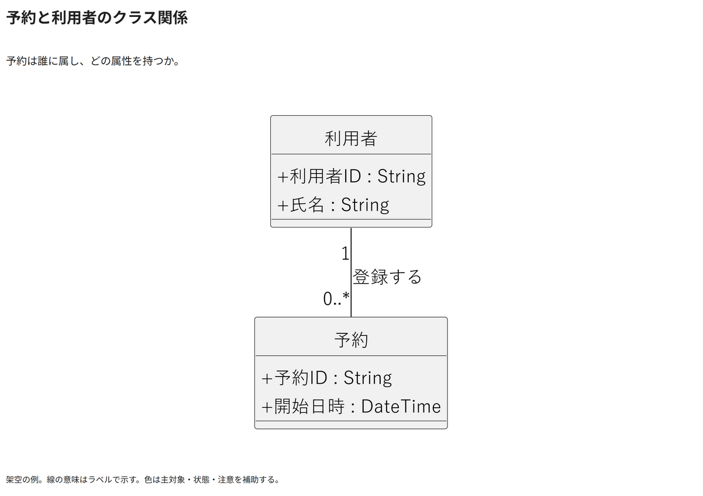

# 予約と利用者のクラス関係

予約は誰に属し、どの属性を持つか。

[Draw.io](example.drawio) · [SVG](preview.svg) · [情報と採否](metadata.yaml) · [IR](diagram-ir.json)

採用条件: 予約は誰に属し、どの属性を持つかを説明したい場合。

不向きな条件: 入力に示されていない条件・順序・数量を補う場合。

参照: SRC-012（[URL一覧](../../sources/urls.md)）。関係の種類と粒度を抽出し、固有データと具体的配置をコピーせず架空の予約サービスへ適応した。

PlantUML正本を保持。内部SVGは単一オブジェクト。

点検記録: 装飾的なクラスアイコンを除去。属性、関連名、両端の多重度が明確に読めることを再描画PNGで確認。
