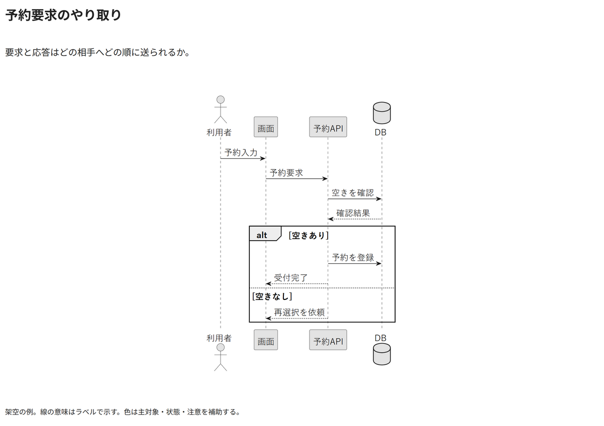

# 予約要求のやり取り

要求と応答はどの相手へどの順に送られるか。

[Draw.io](example.drawio) · [SVG](preview.svg) · [情報と採否](metadata.yaml) · [IR](diagram-ir.json)

採用条件: 要求と応答はどの相手へどの順に送られるかを説明したい場合。

不向きな条件: 入力に示されていない条件・順序・数量を補う場合、実時間の期間や予定日を比較したい場合。

参照: SRC-011（[URL一覧](../../sources/urls.md)）。関係の種類と粒度を抽出し、固有データと具体的配置をコピーせず架空の予約サービスへ適応した。

PlantUML正本を保持。内部SVGは単一オブジェクト。

点検記録: 四つのライフライン、要求と戻りの線種、空きあり・なしのalt領域、各応答先をPNGで確認。
