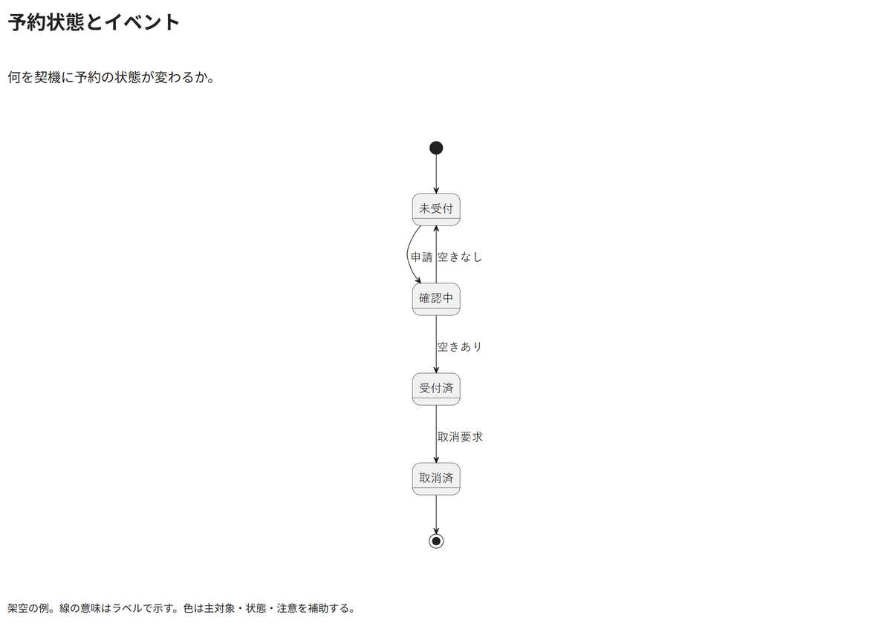

# 予約状態とイベント

何を契機に予約の状態が変わるか。

[Draw.io](example.drawio) · [SVG](preview.svg) · [情報と採否](metadata.yaml) · [IR](diagram-ir.json)

採用条件: 何を契機に予約の状態が変わるかを説明したい場合。

不向きな条件: 入力に示されていない条件・順序・数量を補う場合、担当ごとの業務手順だけを説明したい場合。

参照: SRC-014（[URL一覧](../../sources/urls.md)）。関係の種類と粒度を抽出し、固有データと具体的配置をコピーせず架空の予約サービスへ適応した。

PlantUML正本を保持。内部SVGは単一オブジェクト。

点検記録: 状態名と遷移イベント、空きなし時の戻り、初期・終端を確認。戻り曲線は逆向き遷移を分けるための経路。
