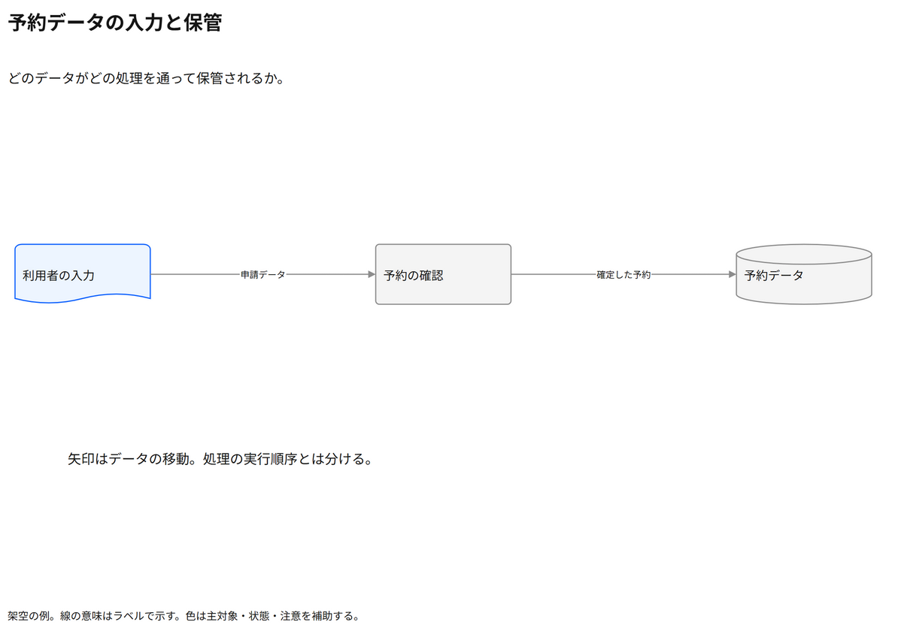

# 予約データの入力と保管

どのデータがどの処理を通って保管されるか。

[Draw.io](example.drawio) · [SVG](preview.svg) · [情報と採否](metadata.yaml) · [IR](diagram-ir.json)

採用条件: どのデータがどの処理を通って保管されるかを説明したい場合。

不向きな条件: 入力に示されていない条件・順序・数量を補う場合、実行の並行性やイベント順を厳密に示したい場合。

参照: SRC-017（[URL一覧](../../sources/urls.md)）。関係の種類と粒度を抽出し、固有データと具体的配置をコピーせず架空の予約サービスへ適応した。

図形・表・所属・接続・ラベルをDraw.ioで編集できる。

点検記録: 入力文書・処理・保存データの意味図形と、申請データ・確定予約のラベルを確認。データ流と実行順序の区別を補足。
