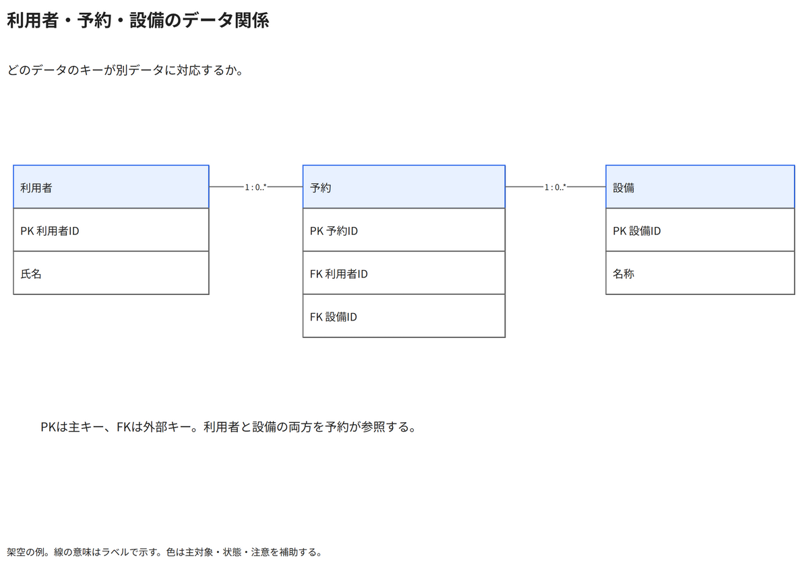

# 利用者・予約・設備のデータ関係

どのデータのキーが別データに対応するか。

[Draw.io](example.drawio) · [SVG](preview.svg) · [情報と採否](metadata.yaml) · [IR](diagram-ir.json)

採用条件: どのデータのキーが別データに対応するかを説明したい場合。

不向きな条件: 入力に示されていない条件・順序・数量を補う場合。

参照: SRC-018（[URL一覧](../../sources/urls.md)）。関係の種類と粒度を抽出し、固有データと具体的配置をコピーせず架空の予約サービスへ適応した。

図形・表・所属・接続・ラベルをDraw.ioで編集できる。

点検記録: 三つのネイティブ表、PK・FK、利用者と設備から予約への一対多関係を確認。表の行高と線ラベルの間隔は明確。
