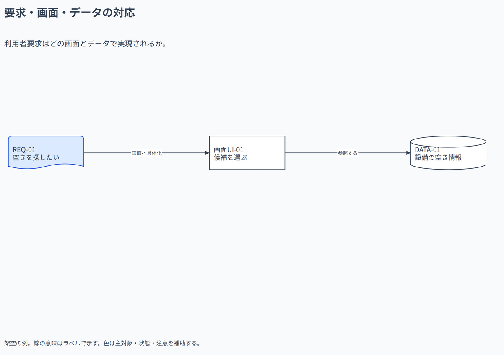

# 要求・画面・データの対応

利用者要求はどの画面とデータで実現されるか。

[Draw.io](example.drawio) · [SVG](preview.svg) · [情報と採否](metadata.yaml) · [IR](diagram-ir.json)

採用条件: 利用者要求はどの画面とデータで実現されるかを説明したい場合。

不向きな条件: 入力に示されていない条件・順序・数量を補う場合。

参照: SRC-019（[URL一覧](../../sources/urls.md)）。関係の種類と粒度を抽出し、固有データと具体的配置をコピーせず架空の予約サービスへ適応した。

図形・表・所属・接続・ラベルをDraw.ioで編集できる。

点検記録: 要求から画面への線を「画面へ具体化」に修正し、実現関係の向きの誤読を避けた。各IDとデータ参照の接続を再確認。
