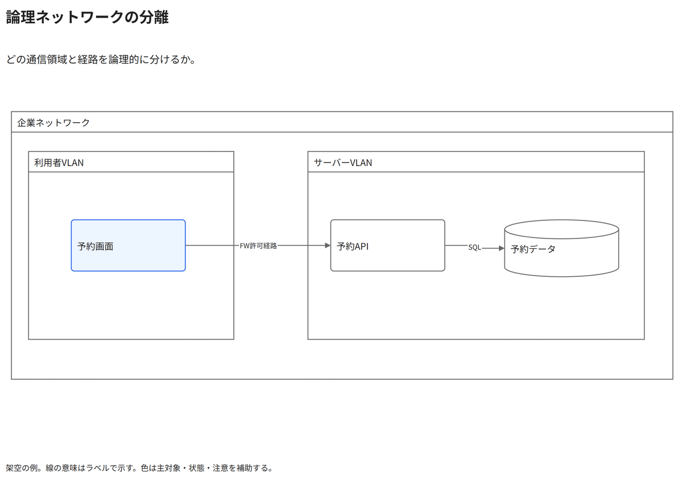

# 論理ネットワークの分離

どの通信領域と経路を論理的に分けるか。

[Draw.io](example.drawio) · [SVG](preview.svg) · [情報と採否](metadata.yaml) · [IR](diagram-ir.json)

採用条件: どの通信領域と経路を論理的に分けるかを説明したい場合。

不向きな条件: 入力に示されていない条件・順序・数量を補う場合。

参照: SRC-020（[URL一覧](../../sources/urls.md)）。関係の種類と粒度を抽出し、固有データと具体的配置をコピーせず架空の予約サービスへ適応した。

図形・表・所属・接続・ラベルをDraw.ioで編集できる。

点検記録: 企業ネットワークと二つのVLAN所属、許可経路とSQL接続を確認。これは論理領域の説明で、配線やIP値を含まない。
