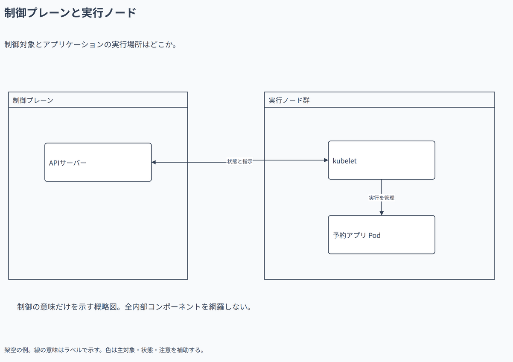

# 制御プレーンと実行ノード

制御対象とアプリケーションの実行場所はどこか。

[Draw.io](example.drawio) · [SVG](preview.svg) · [情報と採否](metadata.yaml) · [IR](diagram-ir.json)

採用条件: 制御対象とアプリケーションの実行場所はどこかを説明したい場合。

不向きな条件: 入力に示されていない条件・順序・数量を補う場合。

参照: SRC-046（[URL一覧](../../sources/urls.md)）。関係の種類と粒度を抽出し、固有データと具体的配置をコピーせず架空の予約サービスへ適応した。

図形・表・所属・接続・ラベルをDraw.ioで編集できる。

点検記録: kubeletとPodの横並びでは短い線の文字が図形に重なったため縦配置へ変更。再描画で制御・実行の二段階を確認。
