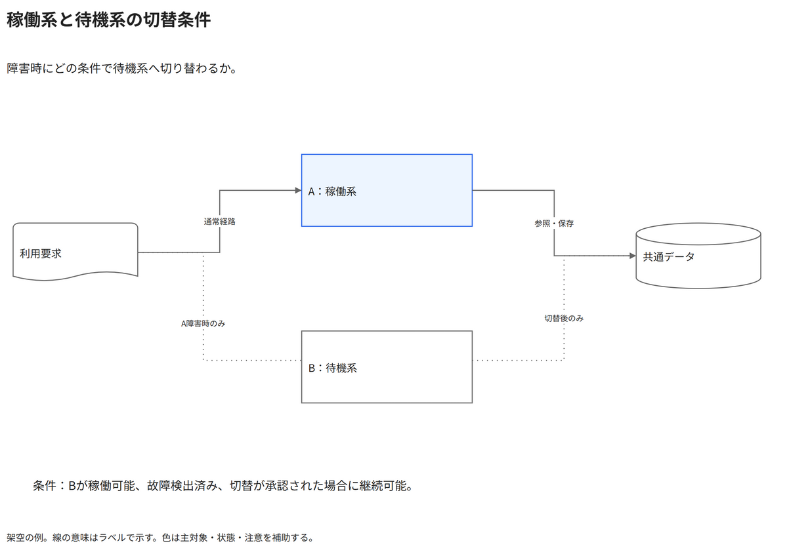

# 稼働系と待機系の切替条件

障害時にどの条件で待機系へ切り替わるか。

[Draw.io](example.drawio) · [SVG](preview.svg) · [情報と採否](metadata.yaml) · [IR](diagram-ir.json)

採用条件: 障害時にどの条件で待機系へ切り替わるかを説明したい場合。

不向きな条件: 入力に示されていない条件・順序・数量を補う場合、待機系の存在だけで継続を保証したい場合。

参照: SRC-020（[URL一覧](../../sources/urls.md)）。関係の種類と粒度を抽出し、固有データと具体的配置をコピーせず架空の予約サービスへ適応した。

図形・表・所属・接続・ラベルをDraw.ioで編集できる。

点検記録: 通常の実線と切替時のみの点線、稼働・待機の区別、継続条件を確認。条件を省略して常時継続できるとは扱わない。
