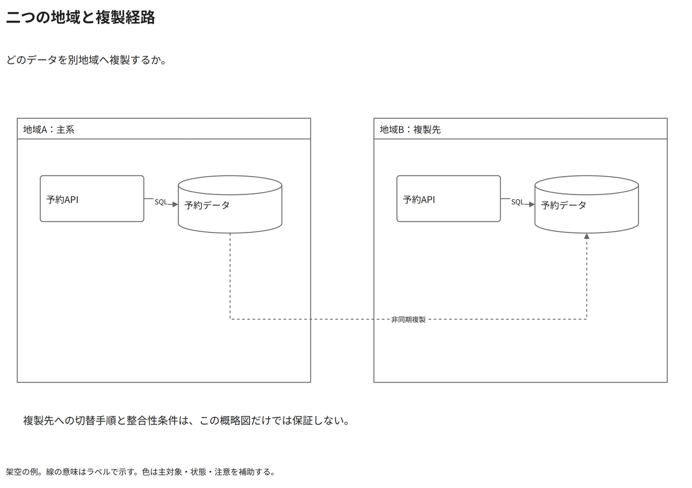

# 二つの地域と複製経路

どのデータを別地域へ複製するか。

[Draw.io](example.drawio) · [SVG](preview.svg) · [情報と採否](metadata.yaml) · [IR](diagram-ir.json)

採用条件: どのデータを別地域へ複製するかを説明したい場合。

不向きな条件: 入力に示されていない条件・順序・数量を補う場合。

参照: SRC-039, SRC-040, SRC-044（[URL一覧](../../sources/urls.md)）。複数地域の境界と複製という抽象構造を公式Architecture Centerから再構成。REF-022をmulti-region原図と扱わない。

図形・表・所属・接続・ラベルをDraw.ioで編集できる。

点検記録: 地域間の複製経路を下側へ分離し、短い内部線のラベルをSQLへ簡潔化。原図のHA例をmulti-regionそのものの証拠とは扱わない。
