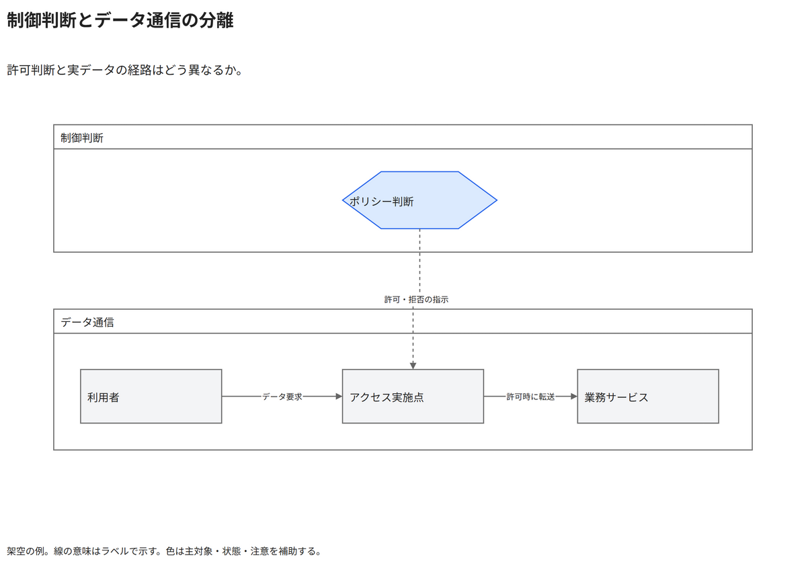

# 制御判断とデータ通信の分離

許可判断と実データの経路はどう異なるか。

[Draw.io](example.drawio) · [SVG](preview.svg) · [情報と採否](metadata.yaml) · [IR](diagram-ir.json)

採用条件: 許可判断と実データの経路はどう異なるかを説明したい場合。

不向きな条件: 入力に示されていない条件・順序・数量を補う場合。

参照: SRC-047, SRC-048（[URL一覧](../../sources/urls.md)）。関係の種類と粒度を抽出し、固有データと具体的配置をコピーせず架空の予約サービスへ適応した。

図形・表・所属・接続・ラベルをDraw.ioで編集できる。

点検記録: 制御判断とデータ経路を上下の領域で分離。許可・拒否の破線と許可時のみの転送条件が読めることを確認。
