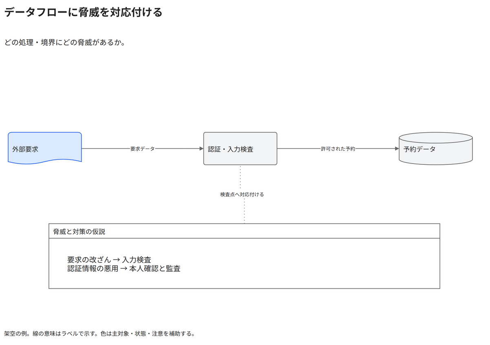

# データフローに脅威を対応付ける

どの処理・境界にどの脅威があるか。

[Draw.io](example.drawio) · [SVG](preview.svg) · [情報と採否](metadata.yaml) · [IR](diagram-ir.json)

採用条件: どの処理・境界にどの脅威があるかを説明したい場合。

不向きな条件: 入力に示されていない条件・順序・数量を補う場合。

参照: SRC-033, SRC-057（[URL一覧](../../sources/urls.md)）。関係の種類と粒度を抽出し、固有データと具体的配置をコピーせず架空の予約サービスへ適応した。

図形・表・所属・接続・ラベルをDraw.ioで編集できる。

点検記録: データ流の線を要求データ・許可された予約へ修正。脅威の仮説を検査点に対応付ける点線と本文を確認。
