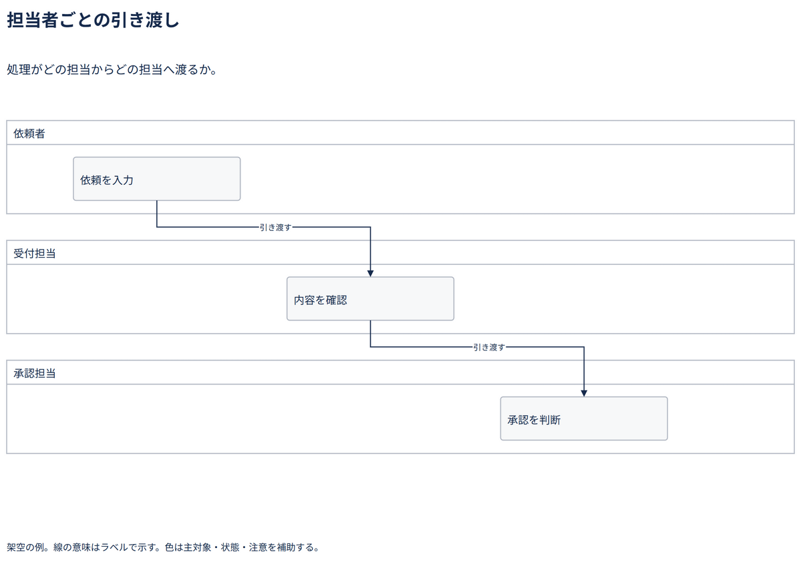

# 担当者ごとの引き渡し

処理がどの担当からどの担当へ渡るか。

[Draw.io](example.drawio) · [SVG](preview.svg) · [情報と採否](metadata.yaml) · [IR](diagram-ir.json)

採用条件: 処理がどの担当からどの担当へ渡るかを説明したい場合。

不向きな条件: 入力に示されていない条件・順序・数量を補う場合。

参照: SRC-054（[URL一覧](../../sources/urls.md)）。関係の種類と粒度を抽出し、固有データと具体的配置をコピーせず架空の予約サービスへ適応した。

図形・表・所属・接続・ラベルをDraw.ioで編集できる。

点検記録: 境界線と引渡し線の重なりを解消し、担当領域間へ40pxの余白を確保。主要線を濃色化し、二つの引渡し経路を再確認。
