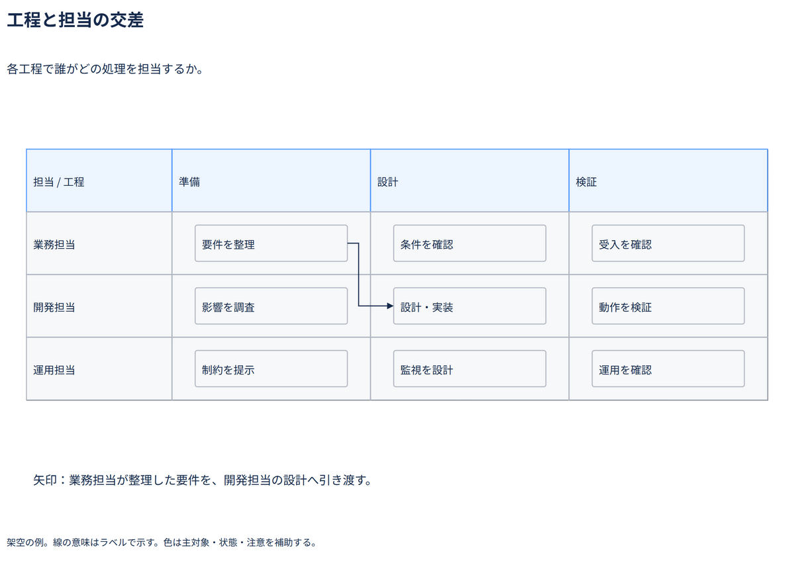

# 工程と担当の交差

各工程で誰がどの処理を担当するか。

[Draw.io](example.drawio) · [SVG](preview.svg) · [情報と採否](metadata.yaml) · [IR](diagram-ir.json)

採用条件: 各工程で誰がどの処理を担当するかを説明したい場合。

不向きな条件: 入力に示されていない条件・順序・数量を補う場合。

参照: SRC-027（[URL一覧](../../sources/urls.md)）。関係の種類と粒度を抽出し、固有データと具体的配置をコピーせず架空の予約サービスへ適応した。

図形・表・所属・接続・ラベルをDraw.ioで編集できる。

点検記録: セルを処理の親にするネイティブ表。枠線と近すぎた接続をセル内の空間へ移動し、線の意味は図外に明示。再描画で引渡しを確認。
