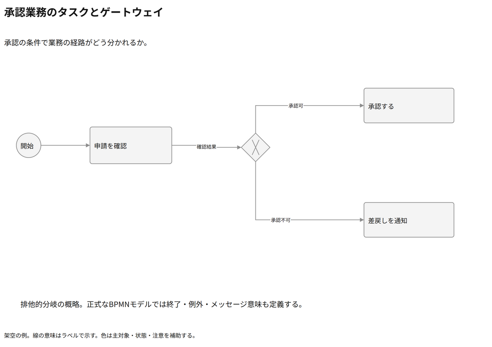

# 承認業務のタスクとゲートウェイ

承認の条件で業務の経路がどう分かれるか。

[Draw.io](example.drawio) · [SVG](preview.svg) · [情報と採否](metadata.yaml) · [IR](diagram-ir.json)

採用条件: 承認の条件で業務の経路がどう分かれるかを説明したい場合。

不向きな条件: 入力に示されていない条件・順序・数量を補う場合。

参照: SRC-016（[URL一覧](../../sources/urls.md)）。関係の種類と粒度を抽出し、固有データと具体的配置をコピーせず架空の予約サービスへ適応した。

図形・表・所属・接続・ラベルをDraw.ioで編集できる。

点検記録: 自動経路で承認可・不可の線と文字が重なったため、ゲートウェイ上下へ分岐点を分離。再描画で二経路と条件を確認。
