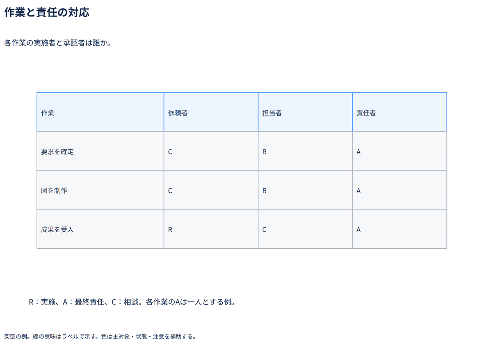

# 作業と責任の対応

各作業の実施者と承認者は誰か。

[Draw.io](example.drawio) · [SVG](preview.svg) · [情報と採否](metadata.yaml) · [IR](diagram-ir.json)

採用条件: 各作業の実施者と承認者は誰かを説明したい場合。

不向きな条件: 入力に示されていない条件・順序・数量を補う場合、作業の実行順序や完了条件を示したい場合。

参照: SRC-028（[URL一覧](../../sources/urls.md)）。関係の種類と粒度を抽出し、固有データと具体的配置をコピーせず架空の予約サービスへ適応した。

図形・表・所属・接続・ラベルをDraw.ioで編集できる。

点検記録: 各作業のR・A・Cと凡例を確認。Aは各行一人、実施順序はこの表から読み取らせない。
