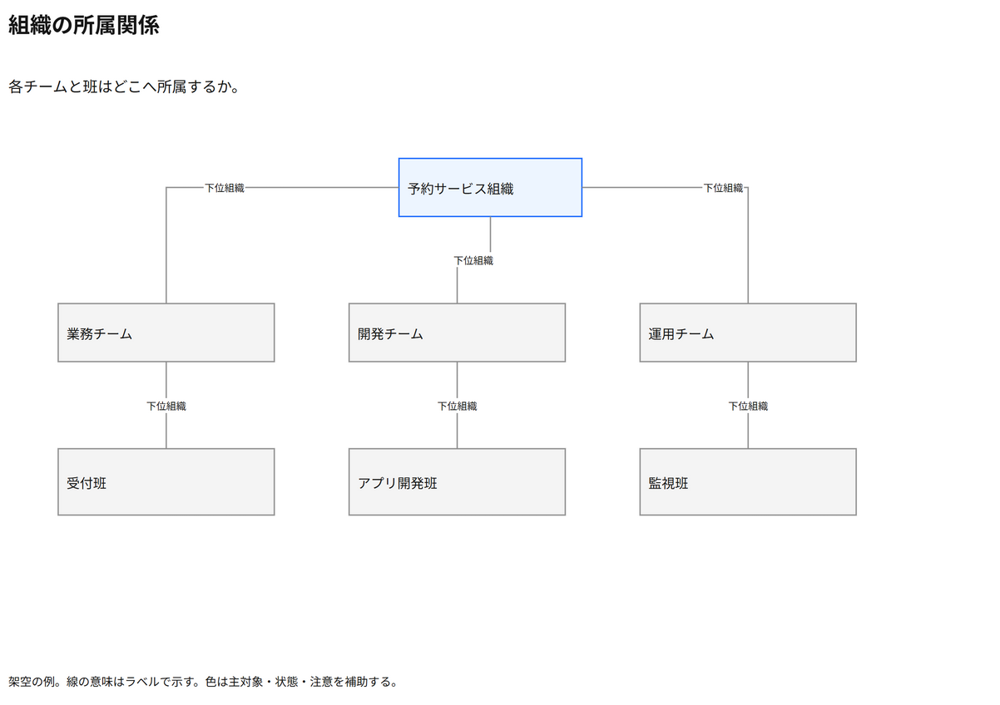

# 組織の所属関係

各チームと班はどこへ所属するか。

[Draw.io](example.drawio) · [SVG](preview.svg) · [情報と採否](metadata.yaml) · [IR](diagram-ir.json)

採用条件: 各チームと班はどこへ所属するかを説明したい場合。

不向きな条件: 入力に示されていない条件・順序・数量を補う場合、組織を越えた多対多の責任割当を示したい場合。

参照: SRC-029（[URL一覧](../../sources/urls.md)）。関係の種類と粒度を抽出し、固有データと具体的配置をコピーせず架空の予約サービスへ適応した。

図形・表・所属・接続・ラベルをDraw.ioで編集できる。

点検記録: 職務名と組織所属の混同を解消し、下位を班の名称へ修正。三段階の組織階層と線の意味を再確認。
