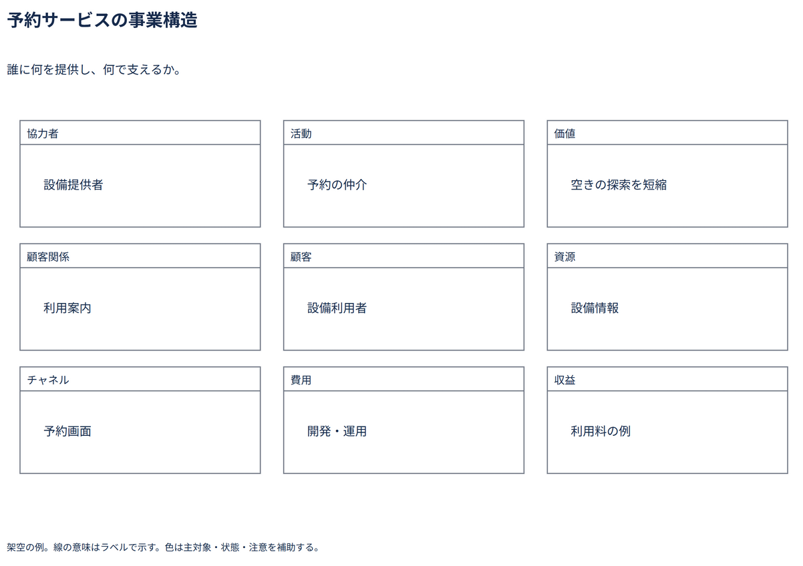

# 予約サービスの事業構造

誰に何を提供し、何で支えるか。

[Draw.io](example.drawio) · [SVG](preview.svg) · [情報と採否](metadata.yaml) · [IR](diagram-ir.json)

採用条件: 誰に何を提供し、何で支えるかを説明したい場合。

不向きな条件: 入力に示されていない条件・順序・数量を補う場合、九つの論点を列挙するだけで事業の成立を証明したい場合。

参照: SRC-031（[URL一覧](../../sources/urls.md)）。関係の種類と粒度を抽出し、固有データと具体的配置をコピーせず架空の予約サービスへ適応した。

図形・表・所属・接続・ラベルをDraw.ioで編集できる。

点検記録: 事業の九つの論点を独立した区画で確認。定型Business Model Canvasの位置を完全再現したものではなく、架空論点の概略整理である。
