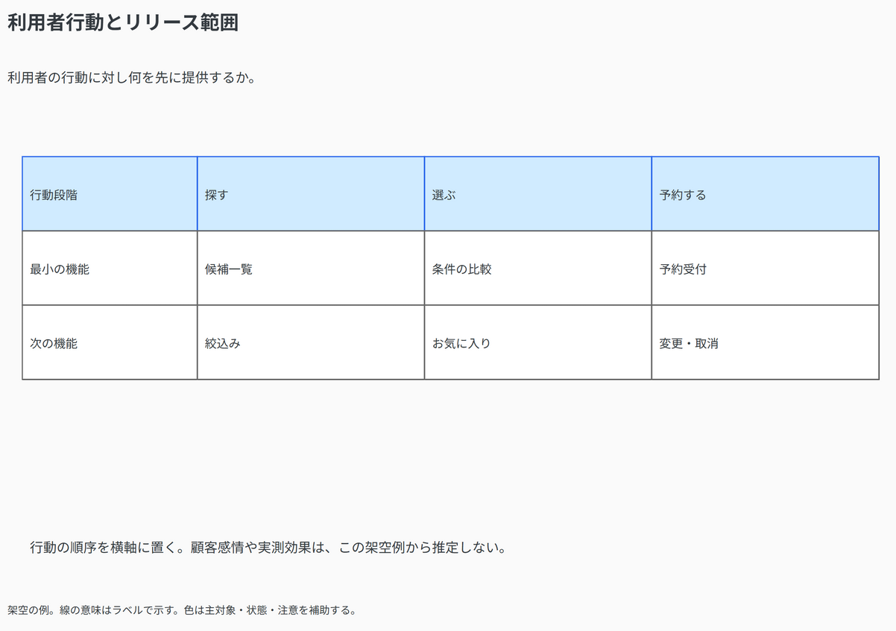

# 利用者行動とリリース範囲

利用者の行動に対し何を先に提供するか。

[Draw.io](example.drawio) · [SVG](preview.svg) · [情報と採否](metadata.yaml) · [IR](diagram-ir.json)

採用条件: 利用者の行動に対し何を先に提供するかを説明したい場合。

不向きな条件: 入力に示されていない条件・順序・数量を補う場合。

参照: SRC-053（[URL一覧](../../sources/urls.md)）。関係の種類と粒度を抽出し、固有データと具体的配置をコピーせず架空の予約サービスへ適応した。

図形・表・所属・接続・ラベルをDraw.ioで編集できる。

点検記録: 行動の横順と、最小・次の機能のリリース区分を確認。顧客感情や実測効果を例から推定しない留保がある。
