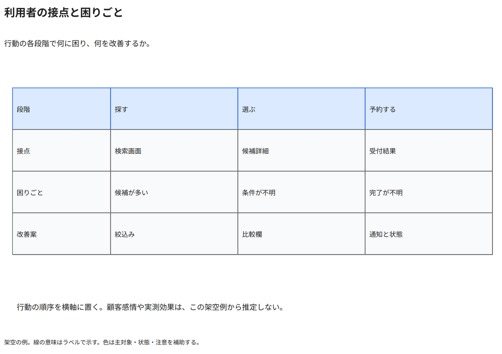

# 利用者の接点と困りごと

行動の各段階で何に困り、何を改善するか。

[Draw.io](example.drawio) · [SVG](preview.svg) · [情報と採否](metadata.yaml) · [IR](diagram-ir.json)

採用条件: 行動の各段階で何に困り、何を改善するかを説明したい場合。

不向きな条件: 入力に示されていない条件・順序・数量を補う場合。

参照: SRC-053（[URL一覧](../../sources/urls.md)）。REF-032の行動×段階のグリッドを応用。専用Customer Journey原図を確認したとは扱わない。

図形・表・所属・接続・ラベルをDraw.ioで編集できる。

点検記録: 段階・接点・困りごと・改善案の対応を確認。Story Mapの行動グリッドを応用した独自例で、専用Customer Journey原図を確認したとは扱わない。
