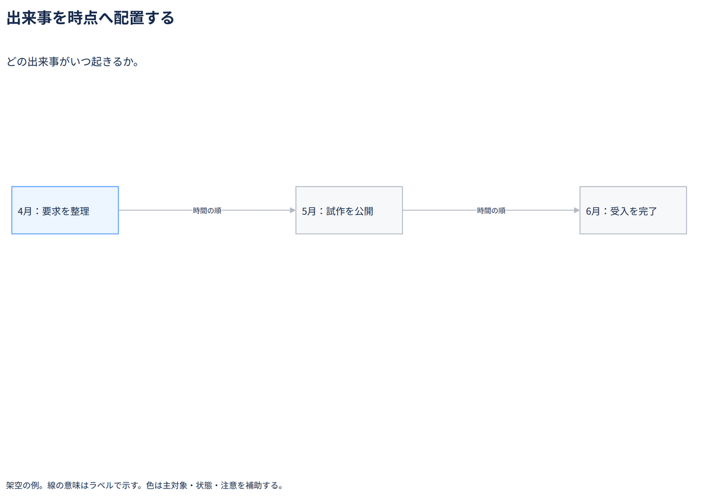

# 出来事を時点へ配置する

どの出来事がいつ起きるか。

[Draw.io](example.drawio) · [SVG](preview.svg) · [情報と採否](metadata.yaml) · [IR](diagram-ir.json)

採用条件: どの出来事がいつ起きるかを説明したい場合。

不向きな条件: 入力に示されていない条件・順序・数量を補う場合、期間や資源制約を比較したい場合。

参照: SRC-026（[URL一覧](../../sources/urls.md)）。関係の種類と粒度を抽出し、固有データと具体的配置をコピーせず架空の予約サービスへ適応した。

図形・表・所属・接続・ラベルをDraw.ioで編集できる。

点検記録: 4月・5月・6月の出来事と時間順を確認。期間・工数を箱の幅から読ませる例ではない。
