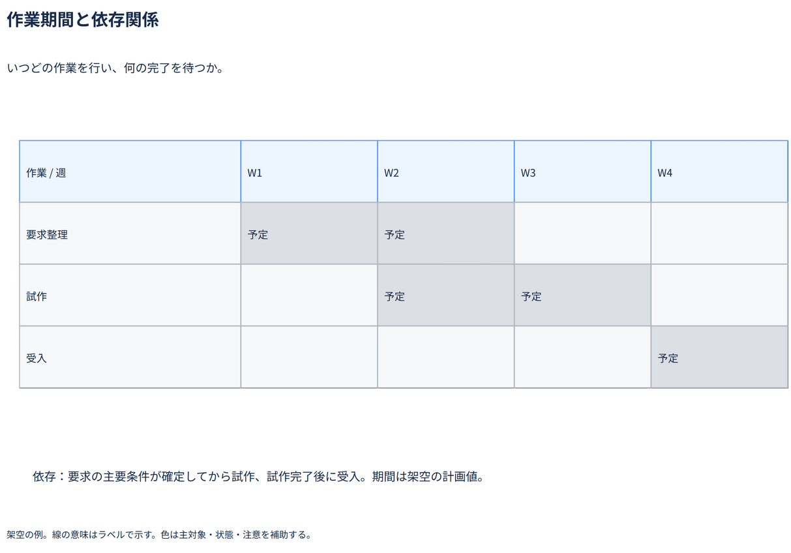

# 作業期間と依存関係

いつどの作業を行い、何の完了を待つか。

[Draw.io](example.drawio) · [SVG](preview.svg) · [情報と採否](metadata.yaml) · [IR](diagram-ir.json)

採用条件: いつどの作業を行い、何の完了を待つかを説明したい場合。

不向きな条件: 入力に示されていない条件・順序・数量を補う場合、論理順序しか分からず期間が与えられていない場合。

参照: SRC-024（[URL一覧](../../sources/urls.md)）。関係の種類と粒度を抽出し、固有データと具体的配置をコピーせず架空の予約サービスへ適応した。

図形・表・所属・接続・ラベルをDraw.ioで編集できる。

点検記録: 週ごとの予定期間を灰色セルの帯で示し、要求整理と試作の一部並行、受入の前提を確認。計画と実績を区別する。
