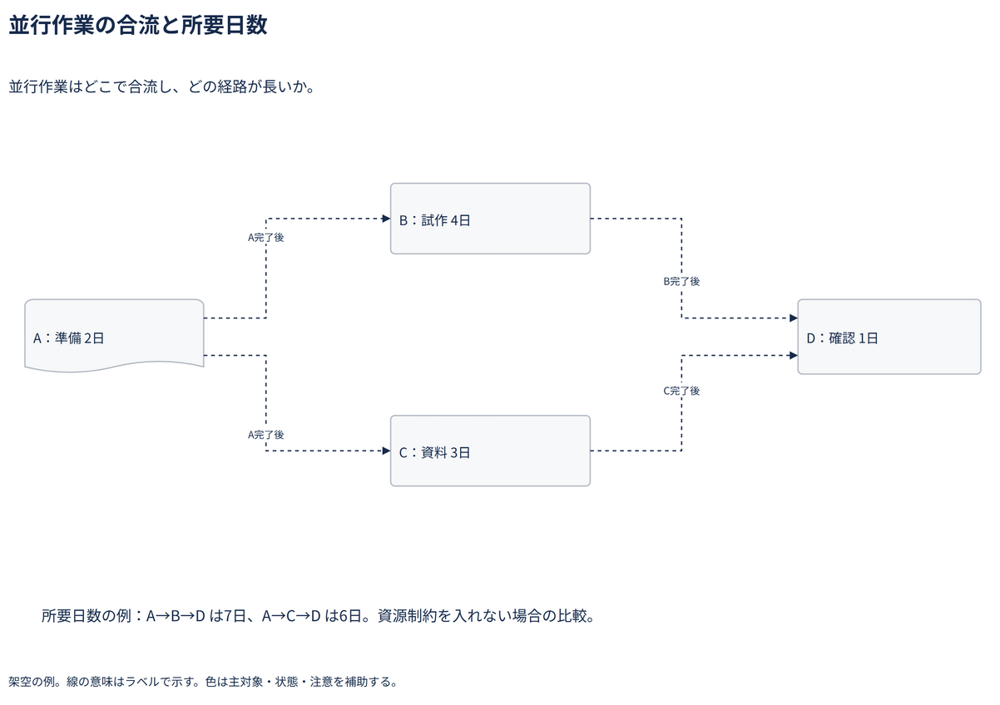

# 並行作業の合流と所要日数

並行作業はどこで合流し、どの経路が長いか。

[Draw.io](example.drawio) · [SVG](preview.svg) · [情報と採否](metadata.yaml) · [IR](diagram-ir.json)

採用条件: 並行作業はどこで合流し、どの経路が長いかを説明したい場合。

不向きな条件: 入力に示されていない条件・順序・数量を補う場合、資源制約・稼働率・暦を含む完了日を保証したい場合。

参照: SRC-023（[URL一覧](../../sources/urls.md)）。関係の種類と粒度を抽出し、固有データと具体的配置をコピーせず架空の予約サービスへ適応した。

図形・表・所属・接続・ラベルをDraw.ioで編集できる。

点検記録: 並行分岐の共有経路でラベルが重なったため、異なる接続点と折れ点へ分離。二経路の7日・6日の計算とDの合流を確認。
