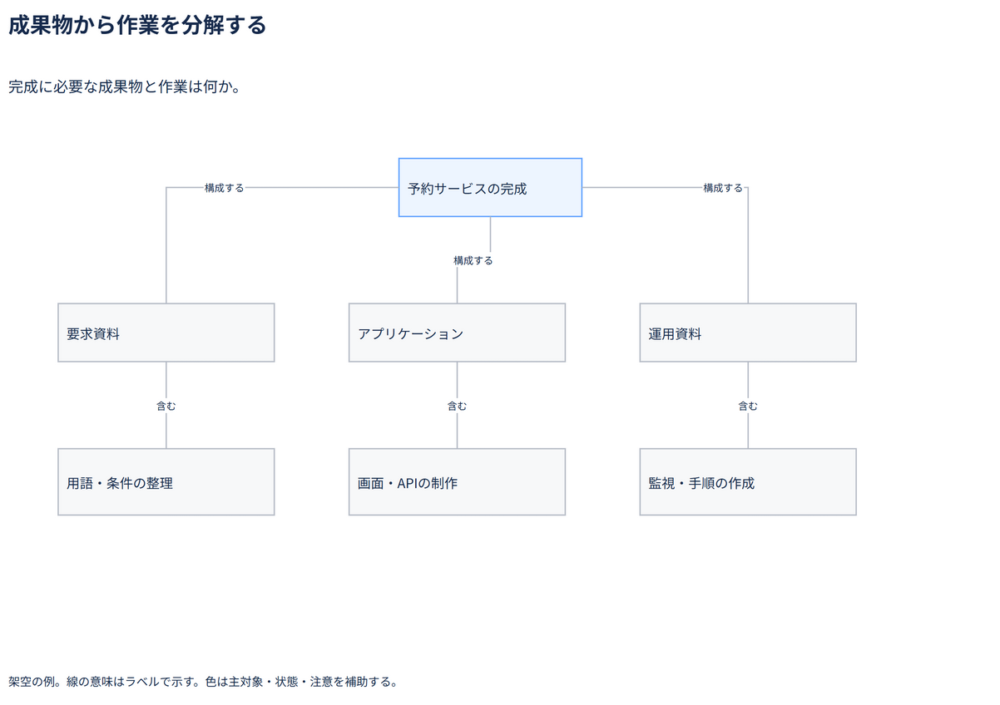

# 成果物から作業を分解する

完成に必要な成果物と作業は何か。

[Draw.io](example.drawio) · [SVG](preview.svg) · [情報と採否](metadata.yaml) · [IR](diagram-ir.json)

採用条件: 完成に必要な成果物と作業は何かを説明したい場合。

不向きな条件: 入力に示されていない条件・順序・数量を補う場合、依存関係や実時間の予定をこの木だけで示したい場合。

参照: SRC-056（[URL一覧](../../sources/urls.md)）。関係の種類と粒度を抽出し、固有データと具体的配置をコピーせず架空の予約サービスへ適応した。

図形・表・所属・接続・ラベルをDraw.ioで編集できる。

点検記録: 成果物とそれを作る作業の二段階を確認。WBSの分解観点を成果物と明示し、期間・依存を木の位置から推定しない。
