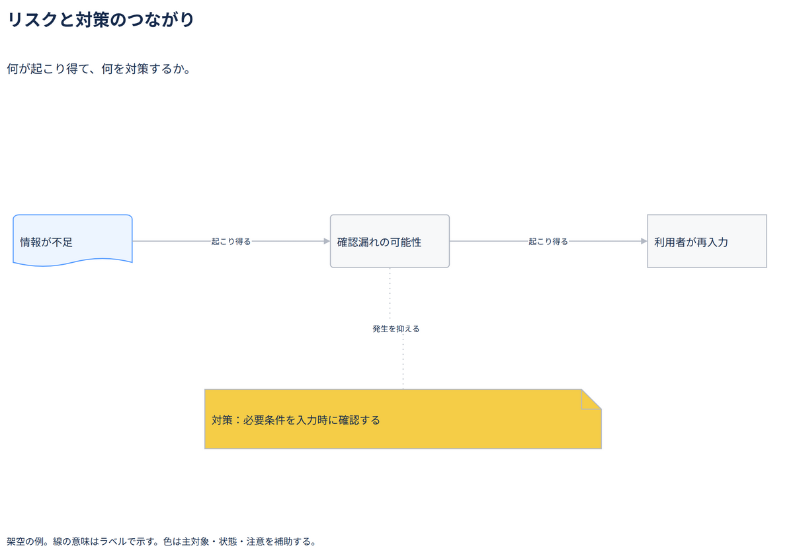

# リスクと対策のつながり

何が起こり得て、何を対策するか。

[Draw.io](example.drawio) · [SVG](preview.svg) · [情報と採否](metadata.yaml) · [IR](diagram-ir.json)

採用条件: 何が起こり得て、何を対策するかを説明したい場合。

不向きな条件: 入力に示されていない条件・順序・数量を補う場合。

参照: SRC-034（[URL一覧](../../sources/urls.md)）。関係の種類と粒度を抽出し、固有データと具体的配置をコピーせず架空の予約サービスへ適応した。

図形・表・所属・接続・ラベルをDraw.ioで編集できる。

点検記録: 原因条件・起こり得る事象・利用者影響と対策の対応を確認。発生確率や効果量を作らず、可能性の表現を保つ。
