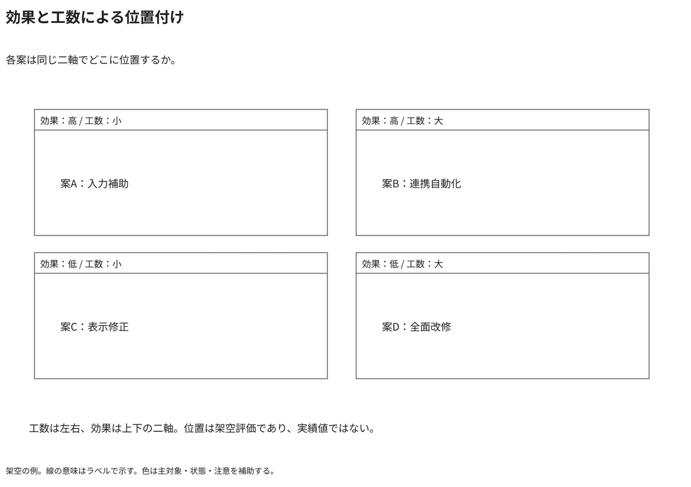

# 効果と工数による位置付け

各案は同じ二軸でどこに位置するか。

[Draw.io](example.drawio) · [SVG](preview.svg) · [情報と採否](metadata.yaml) · [IR](diagram-ir.json)

採用条件: 各案は同じ二軸でどこに位置するかを説明したい場合。

不向きな条件: 入力に示されていない条件・順序・数量を補う場合、二軸の尺度や比較対象の粒度が揃わない場合。

参照: SRC-031（[URL一覧](../../sources/urls.md)）。関係の種類と粒度を抽出し、固有データと具体的配置をコピーせず架空の予約サービスへ適応した。

図形・表・所属・接続・ラベルをDraw.ioで編集できる。

点検記録: 工数の左右と効果の上下という二軸、四つの案の区分を確認。入力がない尺度・順位・数値は作らない。
