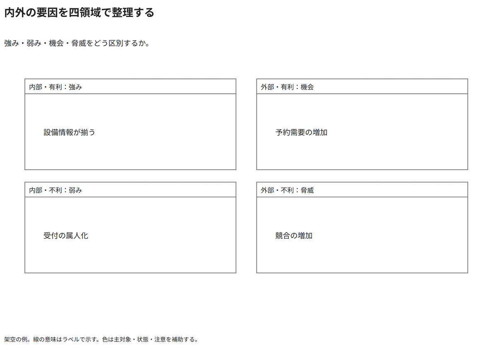

# 内外の要因を四領域で整理する

強み・弱み・機会・脅威をどう区別するか。

[Draw.io](example.drawio) · [SVG](preview.svg) · [情報と採否](metadata.yaml) · [IR](diagram-ir.json)

採用条件: 強み・弱み・機会・脅威をどう区別するかを説明したい場合。

不向きな条件: 入力に示されていない条件・順序・数量を補う場合。

参照: SRC-031（[URL一覧](../../sources/urls.md)）。関係の種類と粒度を抽出し、固有データと具体的配置をコピーせず架空の予約サービスへ適応した。

図形・表・所属・接続・ラベルをDraw.ioで編集できる。

点検記録: 内外の要因と有利・不利の二軸、強み・弱み・機会・脅威の対応を確認。四区画の粒度を揃えた。
