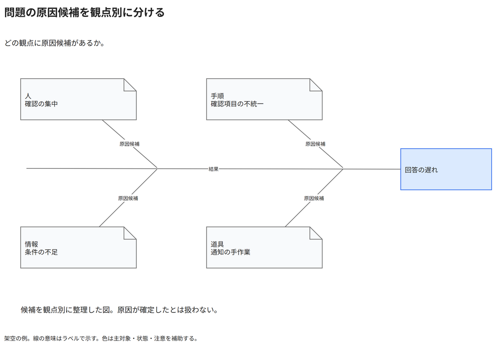

# 問題の原因候補を観点別に分ける

どの観点に原因候補があるか。

[Draw.io](example.drawio) · [SVG](preview.svg) · [情報と採否](metadata.yaml) · [IR](diagram-ir.json)

採用条件: どの観点に原因候補があるかを説明したい場合。

不向きな条件: 入力に示されていない条件・順序・数量を補う場合、相関や候補から原因確定を主張したい場合。

参照: SRC-030（[URL一覧](../../sources/urls.md)）。関係の種類と粒度を抽出し、固有データと具体的配置をコピーせず架空の予約サービスへ適応した。

図形・表・所属・接続・ラベルをDraw.ioで編集できる。

点検記録: 魚骨の幹線と四観点の斜線、結果と原因候補の区別を確認。一般的な矢印ネットワークではなく、観点別の原因整理として再構成。
