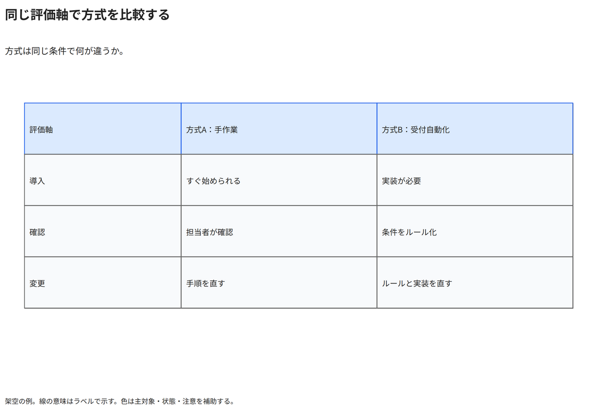

# 同じ評価軸で方式を比較する

方式は同じ条件で何が違うか。

[Draw.io](example.drawio) · [SVG](preview.svg) · [情報と採否](metadata.yaml) · [IR](diagram-ir.json)

採用条件: 方式は同じ条件で何が違うかを説明したい場合。

不向きな条件: 入力に示されていない条件・順序・数量を補う場合。

参照: SRC-031（[URL一覧](../../sources/urls.md)）。関係の種類と粒度を抽出し、固有データと具体的配置をコピーせず架空の予約サービスへ適応した。

図形・表・所属・接続・ラベルをDraw.ioで編集できる。

点検記録: 導入・確認・変更の共通評価軸で二方式を比較。数値重みや優劣を作らず、同じ粒度の記述をPNGで確認。
