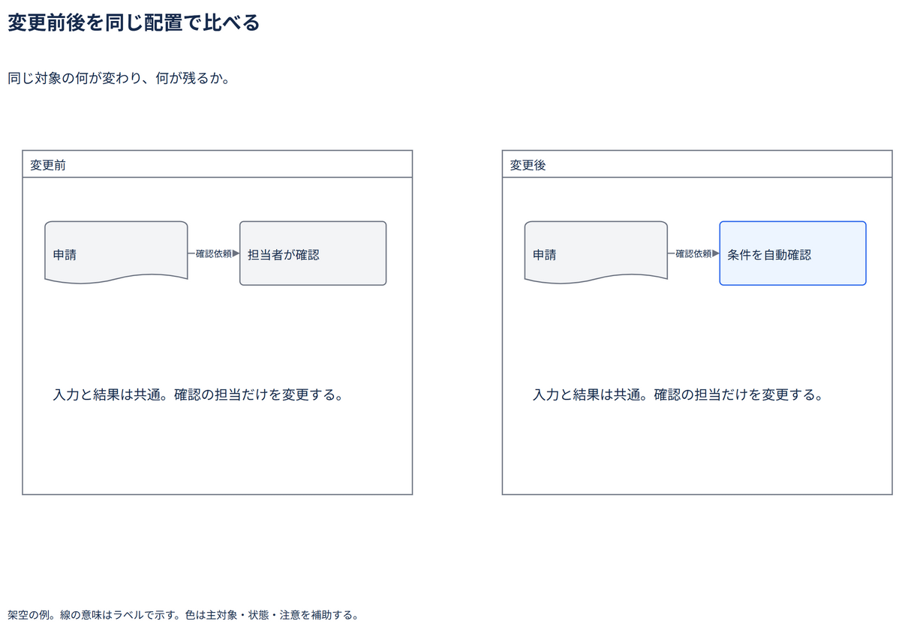

# 変更前後を同じ配置で比べる

同じ対象の何が変わり、何が残るか。

[Draw.io](example.drawio) · [SVG](preview.svg) · [情報と採否](metadata.yaml) · [IR](diagram-ir.json)

採用条件: 同じ対象の何が変わり、何が残るかを説明したい場合。

不向きな条件: 入力に示されていない条件・順序・数量を補う場合。

参照: SRC-031（[URL一覧](../../sources/urls.md)）。関係の種類と粒度を抽出し、固有データと具体的配置をコピーせず架空の予約サービスへ適応した。

図形・表・所属・接続・ラベルをDraw.ioで編集できる。

点検記録: 変更前後の申請と確認を同じ位置へ置き、変わった確認担当だけを強調。構図による誤った差分を作っていない。
