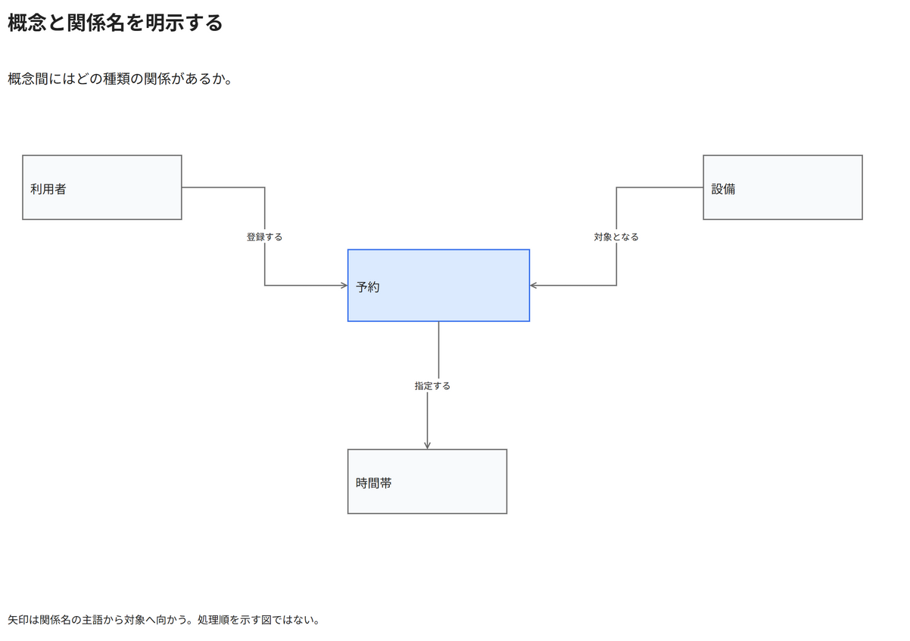

# 概念と関係名を明示する

概念間にはどの種類の関係があるか。

[Draw.io](example.drawio) · [SVG](preview.svg) · [情報と採否](metadata.yaml) · [IR](diagram-ir.json)

採用条件: 概念間にはどの種類の関係があるかを説明したい場合。

不向きな条件: 入力に示されていない条件・順序・数量を補う場合。

参照: SRC-032（[URL一覧](../../sources/urls.md)）。関係の種類と粒度を抽出し、固有データと具体的配置をコピーせず架空の予約サービスへ適応した。

図形・表・所属・接続・ラベルをDraw.ioで編集できる。

点検記録: 時間帯の関係を予約が指定する向きへ修正。左右の共有幹線を分離し、主語から対象への矢印を凡例で明示。再描画で確認。
