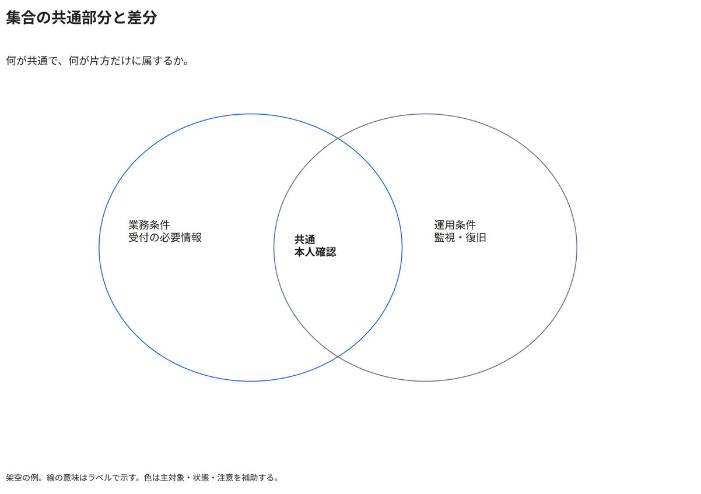

# 集合の共通部分と差分

何が共通で、何が片方だけに属するか。

[Draw.io](example.drawio) · [SVG](preview.svg) · [情報と採否](metadata.yaml) · [IR](diagram-ir.json)

採用条件: 何が共通で、何が片方だけに属するかを説明したい場合。

不向きな条件: 入力に示されていない条件・順序・数量を補う場合、厳密な数量比を円の面積から読み取らせたい場合、集合間の依存方向や厳密な数量比を説明したい場合。

参照: SRC-055（[URL一覧](../../sources/urls.md)）。関係の種類と粒度を抽出し、固有データと具体的配置をコピーせず架空の予約サービスへ適応した。

図形・表・所属・接続・ラベルをDraw.ioで編集できる。

点検記録: 共通の本人確認が重なりの領域内、固有条件が左右の差分内へ収まることを確認。円の面積で数量比を示す例ではない。
