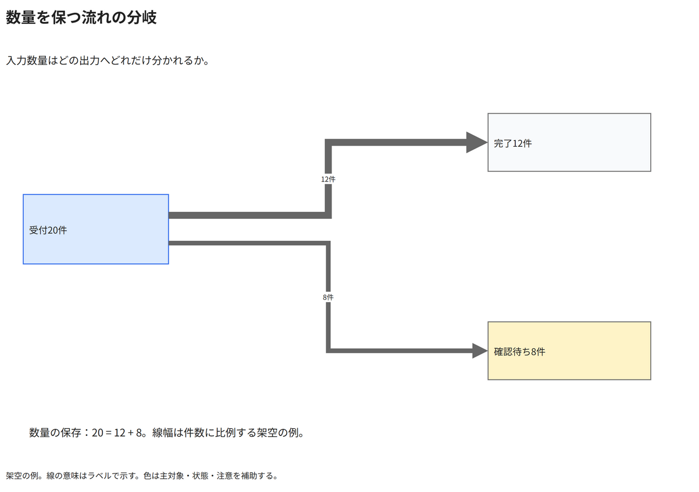

# 数量を保つ流れの分岐

入力数量はどの出力へどれだけ分かれるか。

[Draw.io](example.drawio) · [SVG](preview.svg) · [情報と採否](metadata.yaml) · [IR](diagram-ir.json)

採用条件: 入力数量はどの出力へどれだけ分かれるかを説明したい場合。

不向きな条件: 入力に示されていない条件・順序・数量を補う場合、数量が不明、単位が異なる、流量が保存されない場合。

参照: SRC-036（[URL一覧](../../sources/urls.md)）。REF-052から流れの分岐を抽出。原図は比例幅の検証根拠ではなく、本例の20=12+8と線幅を独立検査する。

図形・表・所属・接続・ラベルをDraw.ioで編集できる。

点検記録: 20件が12件と8件に分岐し、線幅12px・8pxの比と数値ラベルを確認。参照原図から比例幅精度を推定せず独立に検査する。
