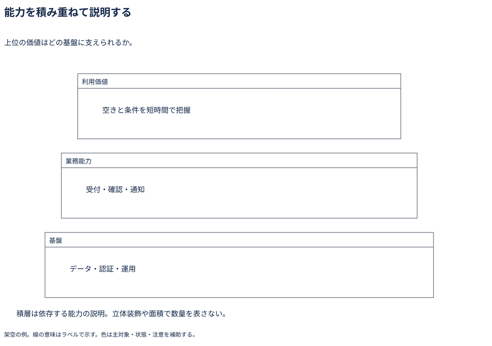

# 能力を積み重ねて説明する

上位の価値はどの基盤に支えられるか。

[Draw.io](example.drawio) · [SVG](preview.svg) · [情報と採否](metadata.yaml) · [IR](diagram-ir.json)

採用条件: 上位の価値はどの基盤に支えられるかを説明したい場合。

不向きな条件: 入力に示されていない条件・順序・数量を補う場合。

参照: SRC-037（[URL一覧](../../sources/urls.md)）。関係の種類と粒度を抽出し、固有データと具体的配置をコピーせず架空の予約サービスへ適応した。

図形・表・所属・接続・ラベルをDraw.ioで編集できる。

点検記録: 基盤を下に広く置く積層へ修正。価値・能力・基盤の抽象度と、面積を数量と扱わない留保を確認。
