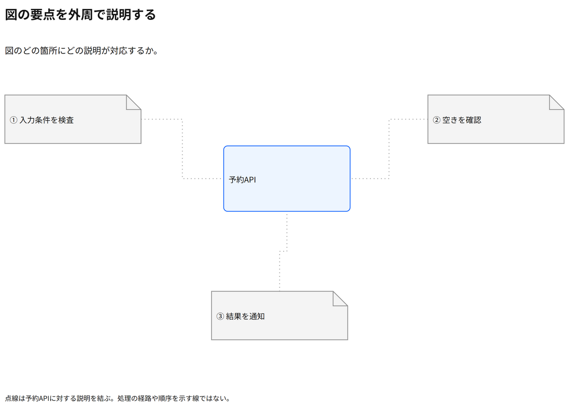

# 図の要点を外周で説明する

図のどの箇所にどの説明が対応するか。

[Draw.io](example.drawio) · [SVG](preview.svg) · [情報と採否](metadata.yaml) · [IR](diagram-ir.json)

採用条件: 図のどの箇所にどの説明が対応するかを説明したい場合。

不向きな条件: 入力に示されていない条件・順序・数量を補う場合。

参照: SRC-037（[URL一覧](../../sources/urls.md)）。関係の種類と粒度を抽出し、固有データと具体的配置をコピーせず架空の予約サービスへ適応した。

図形・表・所属・接続・ラベルをDraw.ioで編集できる。

点検記録: 三つの説明線を主対象の左右・下へ分離し、共有幹線を除去。線の意味を凡例へ集約し、番号付き説明との対応を確認。
