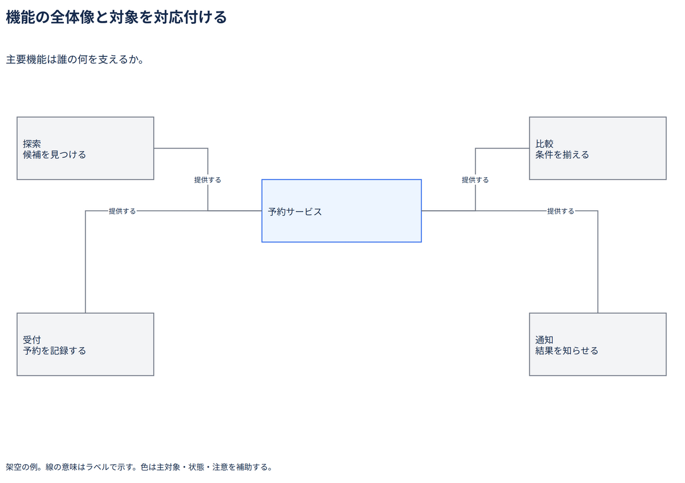

# 機能の全体像と対象を対応付ける

主要機能は誰の何を支えるか。

[Draw.io](example.drawio) · [SVG](preview.svg) · [情報と採否](metadata.yaml) · [IR](diagram-ir.json)

採用条件: 主要機能は誰の何を支えるかを説明したい場合。

不向きな条件: 入力に示されていない条件・順序・数量を補う場合。

参照: SRC-035（[URL一覧](../../sources/urls.md)）。原図は機能カテゴリの区画。本例では機能と主対象の関係へ独自に再配置した。

図形・表・所属・接続・ラベルをDraw.ioで編集できる。

点検記録: 主対象と四機能の関係を確認。元の機能区画をハブ配置へ独自に適応した例であり、元図が同じ配置だったとは記録しない。
