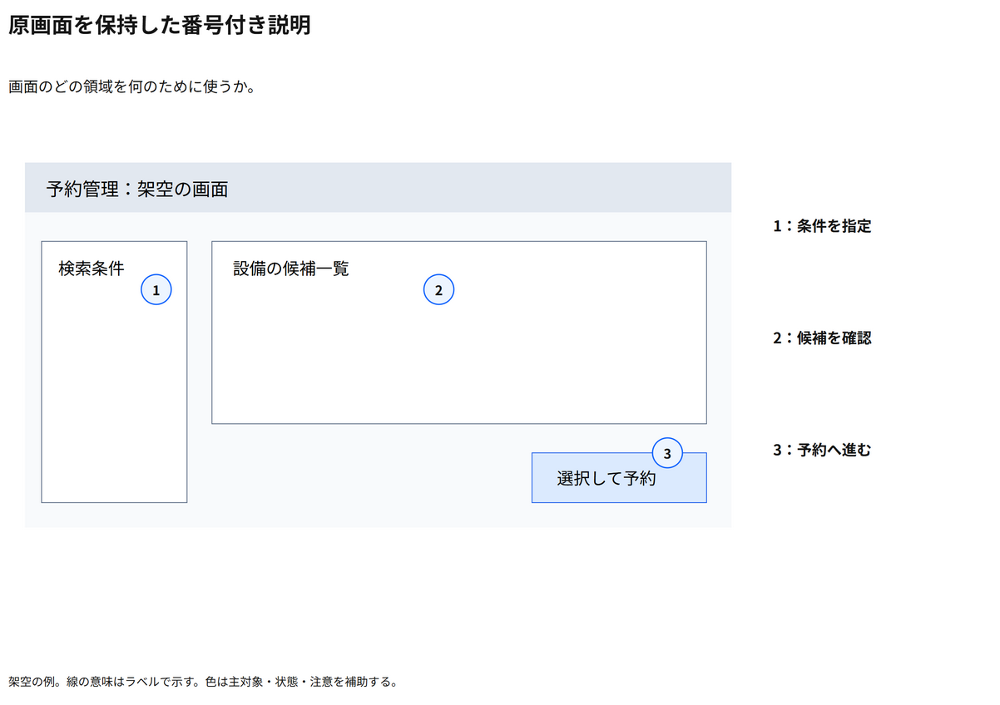

# 原画面を保持した番号付き説明

画面のどの領域を何のために使うか。

[Draw.io](example.drawio) · [SVG](preview.svg) · [情報と採否](metadata.yaml) · [IR](diagram-ir.json)

採用条件: 画面のどの領域を何のために使うかを説明したい場合。

不向きな条件: 入力に示されていない条件・順序・数量を補う場合、表示だけから未確認の動作や操作結果を断定したい場合。

参照: SRC-038（[URL一覧](../../sources/urls.md)）。原図はUI断片の説明。独自に描いた架空UIの保持と番号説明へ応用した。

原図SVGを保持。内部は単一オブジェクト、番号と説明はDraw.ioで編集できる。

点検記録: 架空UIの原SVGをロックし、三番号と図外説明を対応。3番をボタン文字の上から境界付近へ移し、可視文字を隠さないことを確認。
