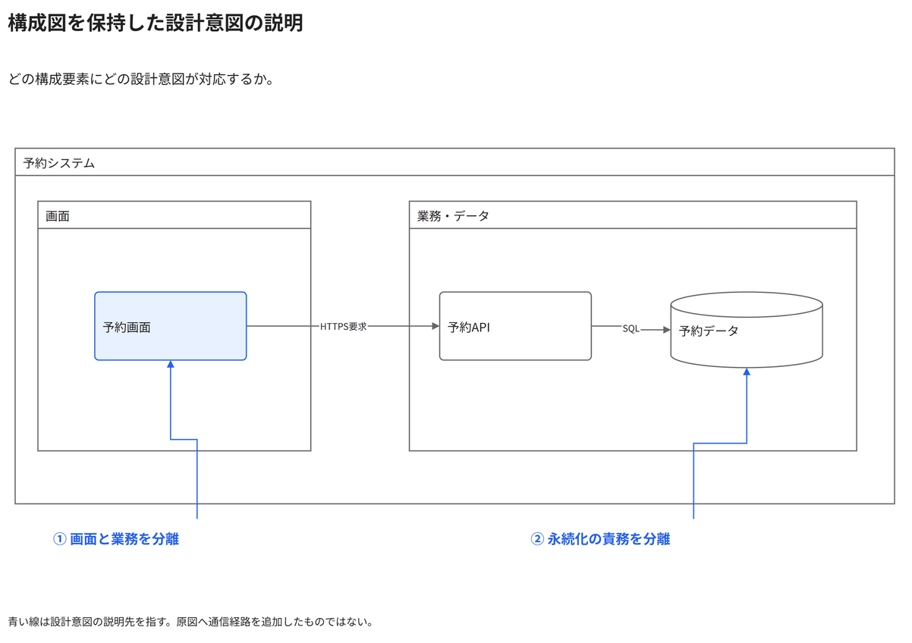

# 構成図を保持した設計意図の説明

どの構成要素にどの設計意図が対応するか。

[Draw.io](example.drawio) · [SVG](preview.svg) · [情報と採否](metadata.yaml) · [IR](diagram-ir.json)

採用条件: どの構成要素にどの設計意図が対応するかを説明したい場合。

不向きな条件: 入力に示されていない条件・順序・数量を補う場合。

参照: SRC-038（[URL一覧](../../sources/urls.md)）。関係の種類と粒度を抽出し、固有データと具体的配置をコピーせず架空の予約サービスへ適応した。

図形・表・所属・接続・ラベルをDraw.ioで編集できる。

点検記録: 原図の通信線と青い説明線を区別し、注記が画面と永続化先を正しく指す。原図をロックした別層に保持している。
