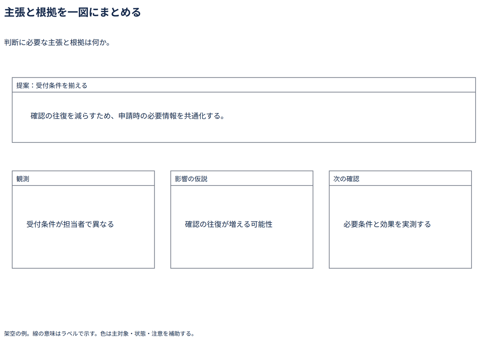

# 主張と根拠を一図にまとめる

判断に必要な主張と根拠は何か。

[Draw.io](example.drawio) · [SVG](preview.svg) · [情報と採否](metadata.yaml) · [IR](diagram-ir.json)

採用条件: 判断に必要な主張と根拠は何かを説明したい場合。

不向きな条件: 入力に示されていない条件・順序・数量を補う場合。

参照: SRC-035（[URL一覧](../../sources/urls.md)）。関係の種類と粒度を抽出し、固有データと具体的配置をコピーせず架空の予約サービスへ適応した。

図形・表・所属・接続・ラベルをDraw.ioで編集できる。

点検記録: 提案を上段、観測・影響の仮説・次の確認を下段に分離し、断定と仮説を混同していない。文字と枠に重なりがない。
