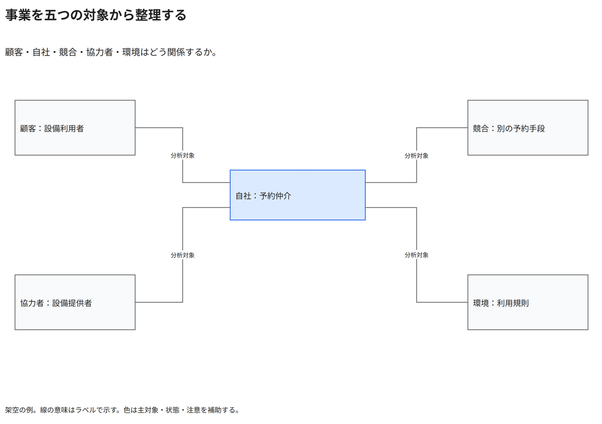

# 事業を五つの対象から整理する

顧客・自社・競合・協力者・環境はどう関係するか。

[Draw.io](example.drawio) · [SVG](preview.svg) · [情報と採否](metadata.yaml) · [IR](diagram-ir.json)

採用条件: 顧客・自社・競合・協力者・環境はどう関係するかを説明したい場合。

不向きな条件: 入力に示されていない条件・順序・数量を補う場合。

参照: SRC-031（[URL一覧](../../sources/urls.md)）。関係の種類と粒度を抽出し、固有データと具体的配置をコピーせず架空の予約サービスへ適応した。

図形・表・所属・接続・ラベルをDraw.ioで編集できる。

点検記録: 五つの分析対象を主対象と四つの周辺対象に分離。共有幹を避けて四本の線を独立した接続点へ引き直し、方向や因果を暗示していない。
