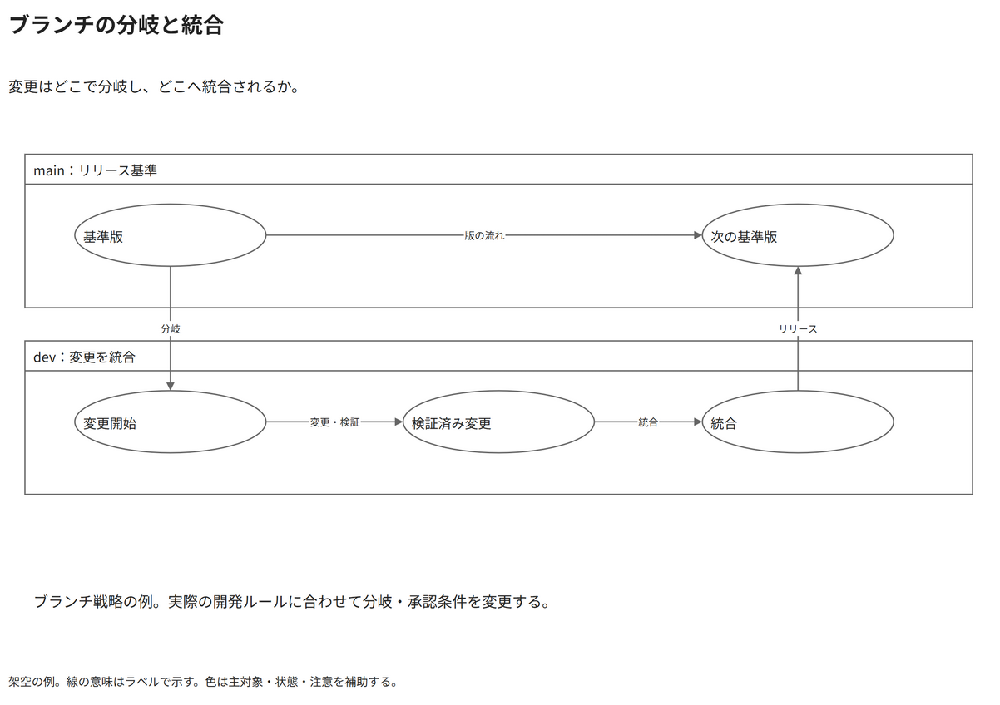

# ブランチの分岐と統合

変更はどこで分岐し、どこへ統合されるか。

[Draw.io](example.drawio) · [SVG](preview.svg) · [情報と採否](metadata.yaml) · [IR](diagram-ir.json)

採用条件: 変更はどこで分岐し、どこへ統合されるかを説明したい場合。

不向きな条件: 入力に示されていない条件・順序・数量を補う場合。

参照: SRC-022（[URL一覧](../../sources/urls.md)）。関係の種類と粒度を抽出し、固有データと具体的配置をコピーせず架空の予約サービスへ適応した。

図形・表・所属・接続・ラベルをDraw.ioで編集できる。

点検記録: mainとdevを別レーンに置き、分岐・変更検証・統合・リリースを区別。縦の矢印は枠を横断するが見出しと接続ラベルを隠さない。
