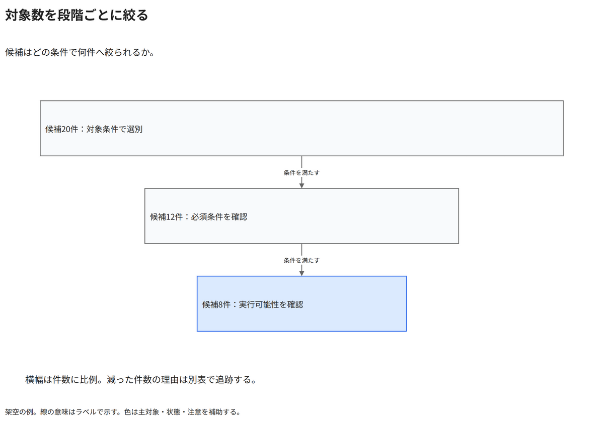

# 対象数を段階ごとに絞る

候補はどの条件で何件へ絞られるか。

[Draw.io](example.drawio) · [SVG](preview.svg) · [情報と採否](metadata.yaml) · [IR](diagram-ir.json)

採用条件: 候補はどの条件で何件へ絞られるかを説明したい場合。

不向きな条件: 入力に示されていない条件・順序・数量を補う場合、各段階の包含関係や選別条件が不明な場合。

参照: SRC-035（[URL一覧](../../sources/urls.md)）。関係の種類と粒度を抽出し、固有データと具体的配置をコピーせず架空の予約サービスへ適応した。

図形・表・所属・接続・ラベルをDraw.ioで編集できる。

点検記録: 20・12・8件を同じ横幅尺度で縮小し、段階間の選別条件を表示。細い段でも文章が切れず、コネクターは箱の隙間で見える。
