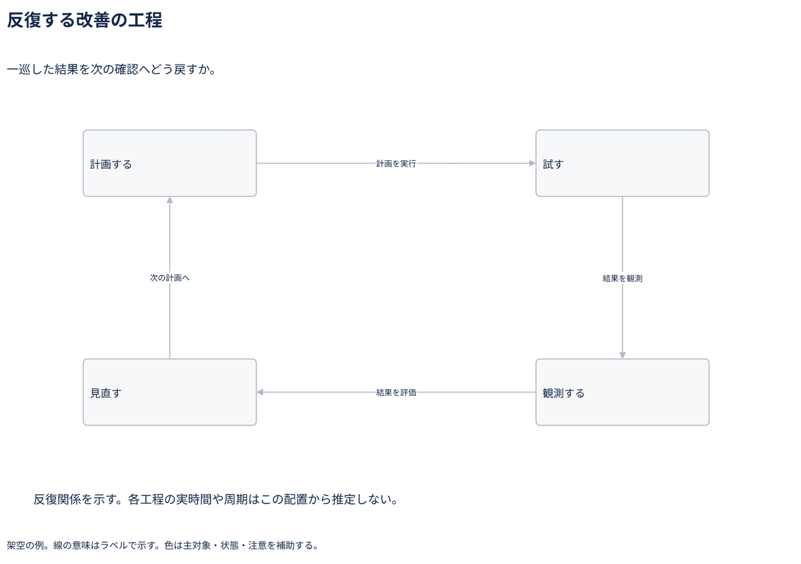

# 反復する改善の工程

一巡した結果を次の確認へどう戻すか。

[Draw.io](example.drawio) · [SVG](preview.svg) · [情報と採否](metadata.yaml) · [IR](diagram-ir.json)

採用条件: 一巡した結果を次の確認へどう戻すかを説明したい場合。

不向きな条件: 入力に示されていない条件・順序・数量を補う場合。

参照: SRC-051（[URL一覧](../../sources/urls.md)）。関係の種類と粒度を抽出し、固有データと具体的配置をコピーせず架空の予約サービスへ適応した。

図形・表・所属・接続・ラベルをDraw.ioで編集できる。

点検記録: 四工程の矢印を時計回りに追える。戻り先を次の計画と明示し、配置から周期や期間を読めないことを注記。線と文字の交差がない。
